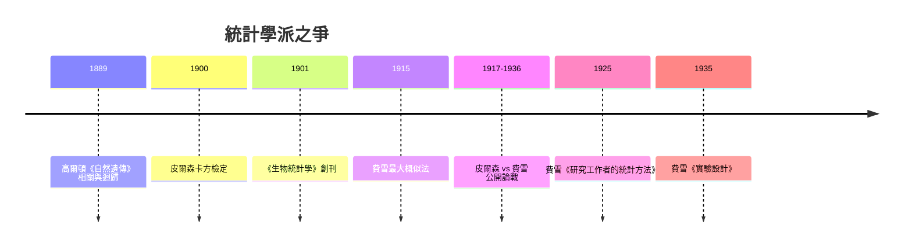

# 7.1 皮爾森與費雪：現代統計學的父子戰爭

## 高爾頓的遺產：相關與迴歸

故事要從達爾文的表弟弗朗西斯·高爾頓（Francis Galton）說起。他研究人類身高時發現一個反直覺的規律：高個子的兒子平均而言仍高於平均，但不如父親那麼高——他稱之為「向平均回歸」（regression toward mediocrity），並畫出著名的相關圖，發明「相關係數」與「迴歸直線」。這是第一次用數學描述「兩個變數一起變動」的程度。高爾頓還是優生學的倡議者——這一思想暗面日後為統計學招來長久的道德審查。

高爾頓晚年資助倫敦大學學院設立優生學講座，首位講座教授就是他的信徒卡爾·皮爾森（Karl Pearson，1857–1936）。

## 皮爾森：把統計變成學科

皮爾森是維多利亞時代知識分子的典型：出身律師家庭，劍橋畢業，通曉德國史、哲學與數學，一度在倫敦女性學院講授馬克思主義與德國思想。1890 年代起，他把高爾頓的直覺發展成一整套「數理統計」：卡方檢定（1900）、動差法、眾數與中位數的系統化、相關的顯著性理論。他創辦《生物統計學》（Biometrika，1901），建立生物統計實驗室，訓練出整整一代統計學家。在他手中，統計學從一種「國家的算術」蛻變為大學裡的數理學科。

## 費雪的崛起與第一波衝突

羅納德·費雪（Ronald Fisher，1890–1962）是劍橋出身的遺傳學家兼統計學家。1915 年，年輕的費雪發表最大概似估計的論文，皮爾森起初審閱時寫了和解的話，但隨後兩人在「自由度」的數學上公開爭執——費雪指出皮爾森實驗室多年來的卡方檢定自由度計算有誤。自 1917 年起，這場衝突升級為長達二十年的公開戰爭：皮爾森在期刊上連載批評，費雪則在 1922 年的論文中把皮爾森一派的方法斥為「無用」。1920 年代後期，費雪在羅森斯特農業試驗場發展出變異數分析、實驗設計與假設檢定的完整體系（1935 年《實驗設計》），聲勢反超。皮爾森去世後，費雪接掌了他的實驗室——卻幾乎解僱了整個舊班底。

## 爭的不只是數學

這場戰爭的實質超出技術錯誤。皮爾森一派信奉「大樣本」：統計是描述大量資料的科學，分布由資料決定（他發明了各種分布族的配適）。費雪則主張「小樣本」的精確推論：統計的任務是從有限的樣本對母體做出可檢驗的推論，他為此引入充分性、有效性、概似、顯著水準等概念。費雪還堅決反對貝氏的「逆機率」，提出概似為綱——這使他在反對皮爾森的同時，也埋下了與日後貝氏學派的對立。兩派的分歧延續為今日「頻率學派 vs 貝氏學派」的基本格局。

更深的背景是學術制度的世代交替：皮爾森代表優生學講座、期刊、實驗室的學術帝國；費雪代表農業試驗場、國家補助研究與新興的遺傳學。他們的戰爭，也是新問題（農業育種、小樣本試驗）對舊制度（倫敦大講堂、大樣本蒐集）的造反。

## 戰爭的收穫

諷刺的是，這場不體面的私人恩怨，反而以驚人的速度建立了現代統計學：卡方檢定、最大概似、變異數分析、假設檢定、信賴區間（奈曼—皮爾森理論，由皮爾森之子 Egon 與奈曼完成，同樣與費雪交惡）、實驗設計——二十世紀前半的統計工具箱，幾乎全部出自這場戰爭的硝煙。科學有時不是靠和諧前進，而是靠兩個不願認錯的人互相拆台、各自把理論推到極致。
