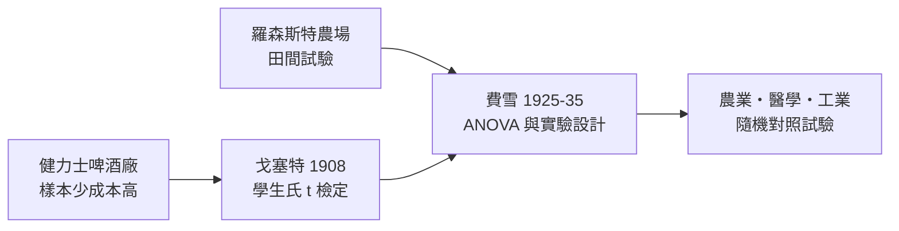

# 7.2 T檢定與健力士啤酒廠：小樣本改寫工業與農業

## 都柏林的品管員

這可能是統計學史上最有趣的假名。威廉·希利·戈塞特（William Sealy Gosset，1876–1937）畢業於牛津，化學與數學雙修，1899 年進入都柏林的健力士（Arthur Guinness Son & Co.）啤酒廠工作。他的任務很實際：用大麥、酒花與酵母的少量樣本，判斷哪一批原料、哪一種製程能釀出更好的啤酒。

健力士的問題暴露了當時統計學的一個盲區。皮爾森的大樣本理論動輒以千計的樣本——保險公司的死亡紀錄、生物測量資料。但啤酒廠不可能釀一千桶酒做實驗：一桶就是錢，一天就是產能。品管員手裡只有三、五、十個樣本，皮爾森的公式在這種規模下根本失準——樣本的變異數本身也不穩定，若拿它當真值使用，顯著性會被系統性高估。

## 學生氏的 t 分布

戈塞特在皮爾森的倫敦實驗室進修一年（1906–1907），研究這個問題，推導出：當母體服從常態、樣本數為 $n$ 時，統計量

$$t = \frac{\bar{x} - \mu}{s / \sqrt{n}}$$

不服從常態，而是服從一種尾部更厚的分布——今日的 t 分布（Student's t-distribution），自由度 $\nu = n - 1$。他用蒙地卡羅式的暴力計算（在當時是手工抽牌與數千次模擬）驗證了結果，1908 年以筆名「學生」（Student）發表〈平均數的可能誤差〉。為什麼用假名？因為健力士公司規定：員工不得發表論文，以免洩漏釀酒祕方——過去就曾因發表文章暴露製程而洩密。據戈塞特自己的說法，公司點頭的條件是「不得用真名」。「學生」就這樣成了統計學史上最著名的化名。

實用的意義立即顯現：品管員只需少數幾桶樣本，就能回答「新製程真的更好嗎」這類問題，而且知道自己的判斷有多大風險。這是小樣本推論的誕生，也是工業品管統計的開端。

## 羅森斯特農場：費雪把小樣本變成體系

戈塞特的問題被劍橋畢業生費雪接手完成。1919 年，費雪進入羅森斯特農業試驗場（Rothamsted Experimental Station，英國最古老的農業研究站），面對的是同樣的困境：一塊田只能種一次，肥料效果要從幾小塊地的產量推斷。費雪發展出「隨機化區組設計」「因子設計」與變異數分析（ANOVA），並在 1925 年《研究工作者的統計方法》中推廣了「學生」的 t 檢定，給它統一的假設檢定框架（顯著水準、虛無假設、p 值）。戈塞特與費雪保持了十幾年友好通信——有趣的是，這兩位小樣本革命者私下交流密切，與費雪對皮爾森的公開惡戰形成對比。

## 從啤酒到臨床試驗

這條「小樣本革命」的路線最終改變的不只是啤酒與小麥。隨機化實驗設計成為二十世紀實驗科學的黃金標準：農業上的育種比較、工業上的品質管制（休哈特的管制圖直接繼承了小樣本思想），以及最重要的——醫學。1948 年英國醫學研究理事會的鏈黴素隨機對照試驗，被公認為第一個現代臨床試驗，其方法論正是費雪式隨機化加上戈塞特式小樣本推論。今日藥廠每一份新藥送審的統計報告、每一個 A/B 測試的點擊率判斷，背後都是「學生」在都柏林酒窖裡的計算。

一家啤酒廠、一間農業試驗場、一個假名——現代實驗科學的規則，竟是這樣從生產線上長出來的。這是「經濟需求驅動方法論」最生動的一課：當樣本的代價昂貴，統計學就必須學會用更少的證據說出更誠實的話。
