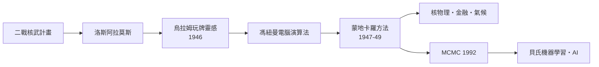

# 8.1 蒙地卡羅方法：用亂數解難題的電腦時代

## 洛斯阿拉莫斯的病房

1946 年，洛杉磯的醫院裡，波蘭裔數學家斯坦尼斯拉夫·烏拉姆（Stanislaw Ulam）因腦炎住院養病，百無聊賴中玩接龍。他開始琢磨一個過去沒人認真想過的問題：與其辛苦計算每一步的機率，何不把牌局玩上幾百次、直接數結果？接龍的成功率無法解析計算，但「模擬」它易如反掌。

病癒後，他回到新墨西哥的洛斯阿拉莫斯國家實驗室——曼哈頓計畫的心臟——把這個想法告訴了約翰·馮紐曼（John von Neumann）。當時的難題正是氫彈與核反應的中子行為：中子在裂變材料中隨機碰撞、散射、吸收，鏈式反應的過程涉及無數隨機事件，解析方法束手無策。烏拉姆與馮紐曼意識到：可以用「隨機抽樣」代替「精確積分」。馮紐曼立即著手設計在 ENIAC 之類電腦上執行的方案。

為了保密，同事尼古拉斯·梅特羅波利斯提議以摩納哥著名的賭場為這種方法命名——蒙地卡羅方法（Monte Carlo method）誕生。烏拉姆事後戲稱：機率論從巴斯卡的賭桌出發，繞了三百年，又回到賭場的名字上。

## 方法的精神

蒙地卡羅方法的邏輯出奇簡單：想知道一個難以解析計算的量，就大量重複「隨機實驗」，用頻率估計機率、用平均值估計期望。最經典的演示是估計圓周率：在單位正方形內隨機撒 $N$ 個點，數落在四分之一圓內的比例，乘以四即近似 $\pi$。

```python
import random
N = 1_000_000
inside = sum(1 for _ in range(N)
             if random.random()**2 + random.random()**2 <= 1)
print(4 * inside / N)   # ≈ 3.1416
```

誤差以 $1/\sqrt{N}$ 的速度收斂——慢，但與問題維度無關。這一點在核物理中至關重要：中子在六維以上的相空間運動，傳統數值積分在維度災難面前完全失效，蒙地卡羅卻照樣工作。這也是為什麼它首先誕生於核武實驗室：物理需求逼出了方法，電腦提供了引擎。

## 戰爭、電腦與方法的三位一體

蒙地卡羅方法是二戰科技複合體的典型產物。沒有戰爭，不會有洛斯阿拉莫斯；沒有曼哈頓計畫，電腦不會那麼快問世；沒有電腦，一天做幾百萬次模擬只是空談。馮紐曼在 ENIAC 的第一個正式任務之一就是氫彈 preliminary 計算的蒙地卡羅版本（1947–1948）。戰後，這套方法迅速外溢：物理學（粒子輸運）、統計力學（1953 年梅特羅波利斯演算法，至今是分子模擬的基石）、運籌學、金融工程（選擇權定價）、以及統計學本身——吉爾斯與高弗 1992 年提出的 MCMC（馬可夫鏈蒙地卡羅）讓貝氏統計的後驗分布終於可以被計算，直接引爆了 1990 年代以降的貝氏復興與今日的機器學習。



## 回到惠更斯

蒙地卡羅方法的出現，也改變了機率論自身的地位。在它之前，模擬只是「懶人的手段」；在它之後，模擬成為與解析、數值並列的第三條道路，甚至反過來滋養理論——隨機演算法、隨機矩陣理論、深度學習中的隨機梯度下降，都把「可控的隨機」當作計算資源。惠更斯若在世，會發現他筆下的賭局期望值，如今以每秒十億次的規模在矽晶片上重複；他那些需要數月的算術，現在只需幾毫秒。工具變了，但那個十七世紀的洞見未變：偶然事件雖然個別不可預測，大量的偶然卻有著精確的形狀。
