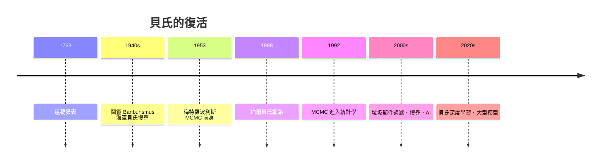

# 8.2 貝氏的復活：從圖靈破解恩尼格瑪到人工智慧

## 戰爭中的逆機率

1763 年問世之後沉寂近兩百年的貝氏定理，在二十世紀中葉以最戲劇性的方式復活：戰爭。

第一幕在布萊切利園。圖靈與他的團隊破解德軍恩尼格瑪密碼的核心工具之一，是「班伯里斯穆斯」（Banburismus，因作業地點班伯里得名）——一套用「證據的重量」為假設打分的程序：每當截獲一段電文、驗證一個猜測，就累積更新對「兩份電文是否屬於同一轉子設定」的信念。圖靈把證據強度的單位稱為「班」（ban），其對數版本「德西班」（deciban）正是對數概似比——貝氏更新的現代形式。圖靈讀過拉普拉斯，明確以機率推理指導密碼分析。貝氏邏輯成為盟軍情報的引擎之一，其成果直接影響大西洋之戰的勝負。

第二幕在冷戰的海底。1968 年，美國海軍在西班牙外海丟失一枚氫彈；海軍請來統計學家皮爾斯（John Craven），他用貝氏搜尋理論整合各路專家的模糊判斷與碎片證據，逐輪更新「氫彈在哪」的機率地圖，最終在搜索區域之外（專家直覺與機率地圖衝突之處，機率獲勝）找到氫彈。貝氏搜尋隨後成為尋找失踪潛艦（如天蝎號）與失事飛機的標準方法——2014 年馬航 MH370 的搜索方案也建立在同一數學上。

## 為什麼頻率學派曾經勝出

要理解這場復活，得先理解它為何沉寂。費雪與奈曼建立的頻率學派有著嚴格的哲學紀律：機率必須是長期頻率，先驗分布被斥為「主觀」與不科學。在樣本充足、計算便宜的和平學院裡，這套紀律運轉良好。但戰爭的問題剛好相反：證據永遠稀少（一次截聽、一張殘骸照片），而你有大量「先驗知識」（德軍的操作慣例、洋流的知識）；而且你等不起重複實驗——你必須現在就下注。頻率方法的哲學潔癖，在戰爭的壓力下成了奢侈；貝氏方法「帶著成見上場、隨證據修正」的務實風格，恰好就是情報工作的本質。

## 電腦與冷戰的雙重助推

貝氏方法的第二波助力來自計算。後驗分布的積分在高維空間中難以解析，但 1953 年的蒙地卡羅思想（梅特羅波利斯演算法）與 1970 年代的吉布斯取樣，使電腦能直接「從後驗中抽樣」。1990 年前後，MCMC 方法經吉爾斯與高弗引入統計學，貝氏分析一夜之間從「理論上優雅、實務上不可行」變成「點一下滑鼠就能跑」。同期，人工智慧面臨專家系統的困境——知識無法窮舉規則——轉向機率推理；茱蒂亞·珀爾（Judea Pearl）的貝氏網路（1988）提供了圖模型框架，讓不確定推理可以工程化。垃圾郵件過濾（1998 年前後）、搜尋引擎、語音辨識、金融風控、疫情傳播模型——貝氏思想滲透進數位生活的每個角落。

## 從牧師書房到神經網路

今天的機器學習體系裡，貝氏方法與頻率方法已不再你死我活：正則化的最小平方等價於高斯先驗的貝氏推論，神經網路訓練的貝葉斯化、生成模型中的後驗近似，都是兩大傳統的融合。回望三百年：一位長老教會牧師為回應懷疑論者寫下的遺稿，經另一位牧師出版，沉寂於學派的論戰，在密碼戰與深海搜尋中證明身價，最後在電腦上成為機器的推理方式。觀念的身世告訴我們：一個數學想法的壽命，取決於它能否在下一個時代的問題裡，被再度需要。
