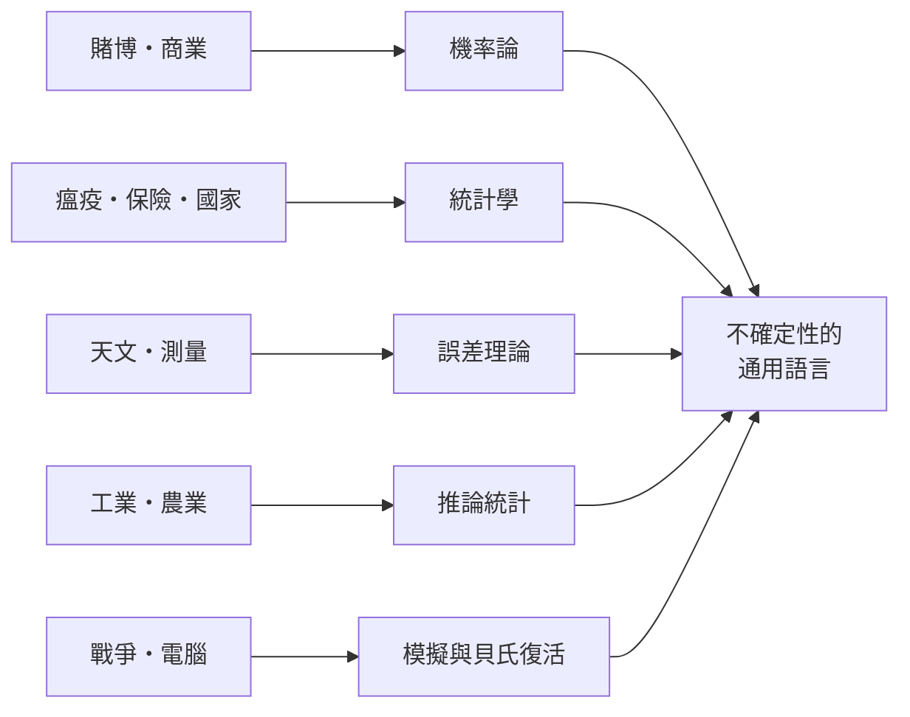

# 後記：偶然不是敵人，而是世界的語法

## 一條三百年的曲線

回望本書走過的路：1494 年帕喬利在帳簿書裡留下一道賭金難題；1654 年巴斯卡與費馬用七封信解開它；1657 年惠更斯寫下第一本機率小冊；1662 年格朗特把倫敦的死亡名單製成生命表；1713 年伯努利證明大數法則；1733 年棣美弗算出鐘形曲線；1763 年貝葉斯的遺稿問世；1801 年高斯用最小平方法找回失蹤的小行星；1835 年凱特勒宣告「平均人」；1908 年「學生」在啤酒廠裡發明 t 檢定；1946 年烏拉姆在病房玩牌，蒙地卡羅方法誕生；二十一世紀，這一切都化為搜尋引擎、臨床試驗、天氣預報與人工智慧背後的數學。

這條時間線上有一個反覆出現的模式值得注意：幾乎每一個關鍵突破，都不是「為科學而科學」的產物，而是被一種具體的社會需求逼出來的。分金難題來自賭博與商業，生命表來自瘟疫與年金，最小平方法來自天文觀測與大地測量，t 檢定來自啤酒的品質管制，蒙地卡羅來自核武設計，貝氏復活來自密碼戰與深海搜尋。數學家當然功不可沒，但供給問題的是賭場、教區、天文台、農場、工廠與戰場。科學史的動力學，從來是需求與天才的合唱。

## 觀念在制度中旅行

本書也一再出現「制度」的角色：梅雷騎士的沙龍傳播了書信，皇家學會的《哲學學報》發表了貝葉斯的遺稿，倫敦咖啡館孵化了勞埃德保險市場，國際統計大會 standardized 了各國的普查方法，健力士公司的保密規定造出了「學生」這個假名，洛斯阿拉莫斯的機密計畫催生了蒙地卡羅。觀念不會自己旅行，它需要沙龍、期刊、市場、公司、軍隊與大學這些載體。反過來，觀念也重塑了這些制度：保險業因精算學而穩健，國家因統計而「看見」人民，實驗科學因隨機化而獲得公信力。理解一門學問，必須同時理解供養它的制度。

## 我們時代的偶然

今天，我們活在一個被機率統計徹底包圍的時代。天氣預報給出降雨機率，醫生引用篩檢的敏感度與特異度，民調附上誤差界線，藥物的療效經假設檢定背書，保單的價格由精算模型決定，推薦系統用貝氏網路猜你想看什麼。這既是三百年馴服偶然的成就，也是新的風險：p 值被濫用與誤讀，「顯著」不等於「重要」；演算法用歷史資料學習，可能把舊偏見複製成「客觀」的預測；「平均人」的陰影仍在——當模型以平均為目標，多數會被要求向少數的標準看齊。

歷史給我們的教訓恰恰是清醒：機率統計從誕生第一天起，就是「在不確定中做更好的決策」，而不是「宣稱確定」。巴斯卡分金分的是期望，不是真理；戈塞特的 t 檢定告訴你風險有多大，而不是替你保證結論；貝氏更新的是信念，信念永遠可以再更新。把統計當作絕對答案，是對這門學問最深的誤解。

偶然不是命運的捉弄，也不是待消滅的敵人。三百年來，人類做過的最聰明的事情之一，是學會了用數學與偶然對話——聽懂它的語法，承認它的邊界，然後在它面前做出更誠實的決定。這門學問還在生長，而我們每一個看天氣預報、買保險、讀民調的人，都已身在這個故事裡。
