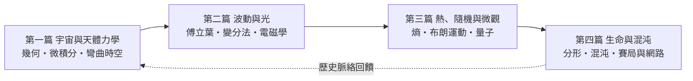

# 自序：數學——自然界最精確的語言

> 「數學是寫在宇宙這本大書上的語言。」——伽利略

## 一個古老的困惑

1610 年的一個夜晚，帕多瓦大學的伽利略把望遠鏡轉向木星，發現四顆衛星正繞著木星運轉。那一刻，他確信了一件事：天上的世界，是可以用「數量」來描述的。

但真正令人驚訝的，不是我們「可以」用數學描述自然，而是我們「只能」用數學描述自然。為什麼橢圓——這個古希臘幾何學家在沙地上畫了兩千年的曲線——恰好就是行星的軌道？為什麼虛數 $\sqrt{-1}$ 這個看似「不存在」的數，竟然是描述電路、量子力學和流體力學不可或缺的工具？

物理學家維格納（Eugene Wigner）在 1960 年寫下著名論文〈數學在自然科學中不合理的有效性〉。這個「不合理」，正是本書想要探索的主題。

## 本書的寫法：不只是公式，更是公式背後的故事

市面上有兩種科普書：一種完全避開數學，只講比喻，讀完之後你覺得自己懂了，其實什麼都沒懂；另一種是滿紙方程，只有物理系學生讀得下去。

本書選擇第三條路：**把每個公式還原成當時的人面對的具體問題**。

- 開普勒不是坐在搖椅上想出橢圓軌道的，他是接手了第谷·布拉赫用二十年、肉眼觀測累積的火星數據，在 8 角分的誤差前不肯妥協，才被迫放棄「圓形是完美軌道」這個兩千年的信仰。而這份信仰，來自柏拉圖學園的大門上刻的那句話：「不懂幾何者不得入內。」
- 牛頓的微積分誕生於瘟疫年（1665 年倫敦大瘟疫，劍橋關閉），以及荷蘭商船為了賺錢而瘋狂改良航海鐘與彈道學的時代。**經濟需求驅動了技術，技術需求驅動了數學。**
- 傅立葉分析源自拿破崙遠征埃及時的熱傳導問題；而它在二十世紀最大的受益者，是貝爾實驗室與後來的整個數位經濟——沒有 FFT（快速傅立葉轉換，1965），就沒有 MP3、沒有 JPEG、沒有你的手機。

## 全書結構：四篇，從宏觀到微觀再到複雜

每一篇都遵循同一條線索：**時代的具體問題 → 數學工具的發明 → 意想不到的跨領域應用 → 反過來改變社會**。你會看到數學與科技、經濟、戰爭、宗教、教育之間環環相扣的驅動關係：

| 時代 | 社會驅動力 | 數學突破 |
|------|-----------|---------|
| 古希臘 | 宗教宇宙觀、幾何信仰 | 圓錐曲線（阿波羅尼奧斯） |
| 文藝復興 | 航海、曆法、教會贊助 | 望遠鏡觀測 + 三角學 |
| 十七世紀 | 火炮、航海、鐘錶貿易 | 微積分、微分方程 |
| 十九世紀 | 蒸汽機、電報帝國 | 熱力學、向量分析 |
| 二十世紀 | 戰爭、電腦、電信 | 統計力學、量子力學、混沌、賽局 |

## 給讀者

你不需要微積分的先修訓練也能讀懂本書的主線；但每章都附有可動手驗證的數學推導，讓想深挖的讀者不會覺得被敷衍。我們相信一個原則：

> **真正的理解，是你能自己把公式推一遍，並說出它當年為誰而寫。**

翻開第一章吧。我們要回到 1600 年的布拉格，一間堆滿火星觀測紙卷的書房。

---
[下一節：1.1 為什麼行星走橢圓而非圓形？](01.1-為什麼行星走橢圓而非圓形.md)
