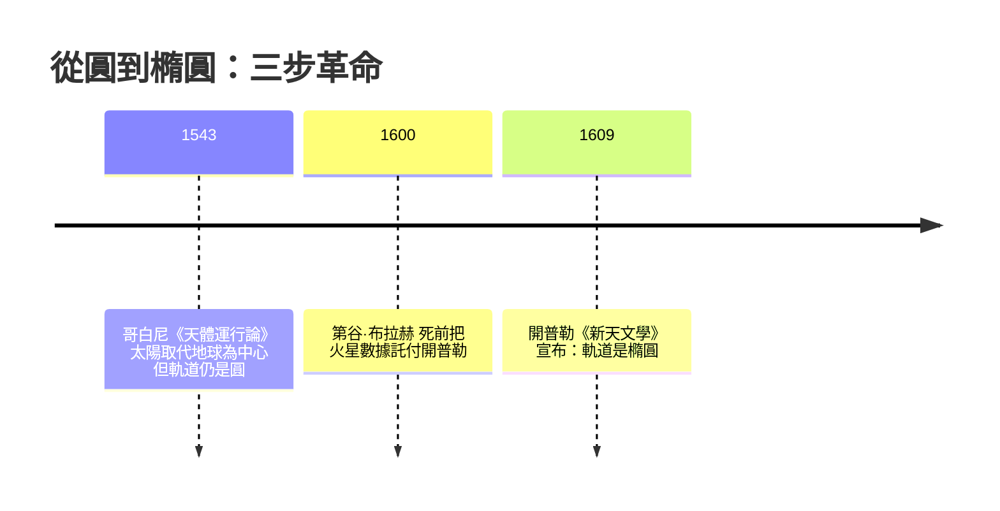

# 1.1 為什麼行星走橢圓而非圓形？（圓錐曲線的幾何本質）

## 兩千年的「圓形信仰」

西元前四世紀，柏拉圖學園的大門上刻著：「不懂幾何者不得入內。」對柏拉圖而言，天界是完美的領域，而完美的圖形只有一種——**圓**。行星不規則的表觀運動，只是「完美圓周運動的疊加」。這套「本輪—均輪」（epicycle）體系，經托勒密在《至大論》（約 150 年）系統化後，統治了天文學 **1400 年**。

為什麼能統治這麼久？因為它**夠用**。教會需要它計算復活節日期，航海者需要它粗略定位。一個數學模型的生命力，往往不取決於它是否為真，而取決於它服務的社會功能能維持多久。

## 打破信仰的三個人

**第谷·布拉赫（Tycho Brahe）** 是關鍵的「數據工程師」。丹麥國王腓特烈二世把汶島（Hven）整座島撥給他建乌拉尼堡天文台——這是**史上第一個由國家重金資助的科學大工程**，堪稱現代大科學計畫（如 CERN）的鼻祖。他沒有望遠鏡，卻用巨型象限儀把觀測精度推到 **1 角分**，比前人好十倍。

**開普勒（Johannes Kepler）** 接手數據後，發現用圓計算的火星位置與觀測差了 **8 角分**（約滿月直徑的 1/4）。他寫道：

> 「這 8 角分，就是改變整個天文學的起點。」

換了別人，會把它當觀測誤差丟掉。開普勒沒有——因為他信任第谷的數據，而這份信任建立在一個新興的制度上：**數據的所有權與移交**（第谷死前一天的遺言：「讓我沒有白白活過」）。

## 橢圓的幾何本質

橢圓在古希臘已被阿波羅尼奧斯（Apollonius, 約前 200 年）研究透徹——**切圓錐所得的曲線**。這是純數學「無用之用」的極致案例：一千八百年間毫無用處的圓錐曲線理論，突然成了天體的軌道。

圓錐曲線家族：

橢圓的定義：**到兩定點（焦點）距離之和為常數的點的軌跡**。

$$|PF_1| + |PF_2| = 2a$$

用笛卡兒座標寫成標準式：

$$\frac{x^2}{a^2} + \frac{y^2}{b^2} = 1$$

離心率 $e = \sqrt{1 - b^2/a^2}$ 描述「有多不圓」：$e = 0$ 是正圓，$e \to 1$ 愈扁。地球軌道 $e \approx 0.0167$（接近圓），火星 $e \approx 0.093$，哈雷彗星 $e \approx 0.967$（極扁）。

**開普勒第一定律**：行星沿橢圓軌道運行，太陽位於其中一個焦點。

## 為什麼是橢圓？（先給直覺，第 2 章給證明）

直覺版本：行星想走直線（慣性），太陽不斷把它往回拉（引力）。當「回拉的力」恰好與距離平方成反比（$F \propto 1/r^2$），數學上唯一可能的封閉軌道就是圓錐曲線——能量夠低是橢圓，恰好逃逸是拋物線，超過則是雙曲線。

換句話說：**橢圓不是天體的偏好，而是平方反比定律與慣性定律聯合的幾何必然。** 古希臘人先造好了幾何的模具，宇宙只是照著澆鑄。

## 歷史迴響

- **思想**：柏拉圖的「完美天界」從此破產。科學史家柯瓦雷說這是「天界的祛魅」——天與地服從同一套數學。
- **宗教與政治**：伽利略因支持日心說受審（1633），但開普勒作為新教徒反而因宗教戰爭（三十年戰爭）流離，兩人的遭遇顯示：科學革命的阻力從來不只是教會，還有整個政治秩序的動盪。
- **經濟**：精確軌道表（曆書）成為航海經濟的核心商品——英國 1714 年設立「經度獎」（£20,000，相當今日數百萬英鎊），直接催生了《航海曆》產業。**軌道數學第一次成為賺錢的生意。**

## 動手算

取 $a = 2$, $b = 1$ 的橢圓。焦點在 $(\pm c, 0)$，$c = \sqrt{a^2 - b^2} = \sqrt{3}$。驗證：點 $(0, 1)$ 到兩焦點距離和 = $\sqrt{0+3} + \sqrt{0+3} + \dots$ = $2 + 2 = 4 = 2a$。✓

---
[下一節：1.2 面積與時間的對話](01.2-面積與時間的對話.md)
