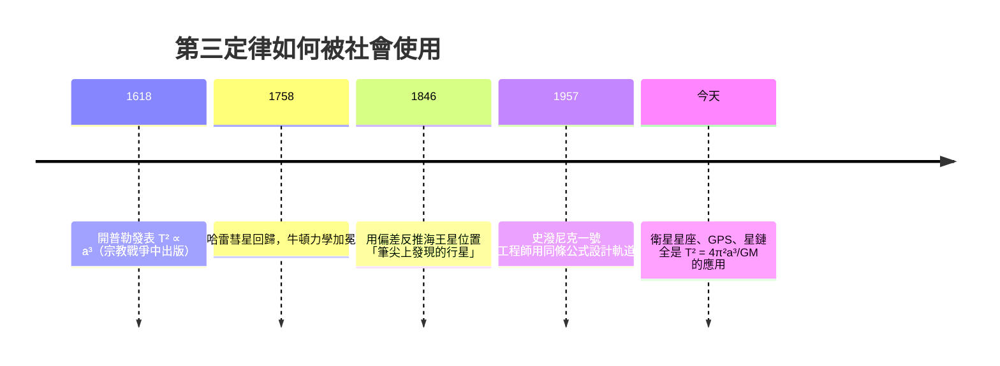

# 1.3 行星週期的和諧：三次方與二次方的對稱美

## 數據裡的驚人規律

1595 年，24 歲的開普勒在教書時突發奇想：為什麼恰好是六顆行星？他先試了正多面體（五種柏拉圖立體嵌套，恰好隔開六顆行星）——這套「神聖幾何」後來被證明是失敗的，但它驅動他窮盡畢生整理第谷的數據。**錯誤的動機也能產生正確的數據。**

1618 年，在《世界的和諧》中，他寫下第三定律：

$$\frac{T^2}{a^3} = \text{常數（對所有行星相同）}$$

其中 $T$ 是公轉週期，$a$ 是軌道半長軸。

## 用真實數據驗證

| 行星 | $a$ (AU) | $T$ (年) | $T^2/a^3$ |
|------|---------|---------|-----------|
| 水星 | 0.387 | 0.241 | 1.000 |
| 地球 | 1.000 | 1.000 | 1.000 |
| 火星 | 1.524 | 1.881 | 0.999 |
| 木星 | 5.203 | 11.862 | 1.000 |
| 土星 | 9.537 | 29.457 | 0.999 |

當時開普勒沒有任何理論解釋這個 $2/3$ 的指數關係。他寫道：「我捕捉到了美麗的鳥，但我不明白它為何如此。」

**這是科學的常態：先有經驗定律（What），理論解釋（Why）往往遲到數十年。** 牛頓在 1687 年證明：從 $F = GMm/r^2$ + $F = ma$ 可以**推導**出第三定律。反過來，第三定律也成為檢驗萬有引力的實驗證據——特別是 1758 年哈雷彗星如期回歸，成了牛頓理論的加冕典禮。

## 推導（牛頓式，簡化版）

圓軌道近似下，引力提供向心力：

$$\frac{GMm}{r^2} = \frac{mv^2}{r} \;\Rightarrow\; v^2 = \frac{GM}{r}$$

週期 $T = \frac{2\pi r}{v}$，所以：

$$T^2 = \frac{4\pi^2 r^2}{v^2} = \frac{4\pi^2 r^3}{GM} \;\Rightarrow\; \frac{T^2}{r^3} = \frac{4\pi^2}{GM}$$

**常數只依賴太陽質量**，與行星無關——這正是開普勒觀察到的「對所有行星相同」。此外這條公式讓人類第一次「稱出」了太陽的質量：$M = \frac{4\pi^2 r^3}{GT^2}$。

## 第三定律的社會史：從曆法到太空時代

注意 1846 年的邏輯反轉：過去是用數學解釋觀測；勒維耶與亞當斯反過來**用理論預測未知**——天王星軌道的微小偏差，被換算成「某處應有一顆行星」，柏林天文台在預測位置 1 度內找到了海王星。**數學從描述工具升級為預測引擎**，這是近代科學與工程分水嶺，也直接帶動了十九世紀國家天文台、標準化曆書的建制化。

## 一個附帶的哲學衝擊：和諧的降級

開普勒所謂「和諧」，原本指音樂般的神聖比例。但 $T^2 \propto a^3$ 是一條冷冰冰的冪次律——美依然在，卻不是神學的美，而是**結構的美**。後來的物理學反覆重演這個劇本：麥克斯韋的四個方程、狄拉克方程的負能量解……**美從「目的」變成了「線索」。**

## 本章小結

| 定律 | 內容 | 數學本質 | 後續發展 |
|------|------|---------|---------|
| 第一 | 軌道為橢圓，太陽在焦點 | 圓錐曲線（幾何） | 牛頓從 $1/r^2$ 推出 |
| 第二 | 等時間掃等面積 | $dA/dt$ 常數（積分） | 角動量守恆 |
| 第三 | $T^2/a^3$ 為常數 | 冪次律（代數） | 可反推天體質量 |

三條定律分別是**幾何學、積分學、代數學**的勝利——開普勒一個人，預告了整個十七世紀數學的議程。而接手把議題完成的，是瘟疫隔離中的一個劍橋學生。

---
[下一節：2.1 瞬時變化率](02.1-瞬時變化率.md)
