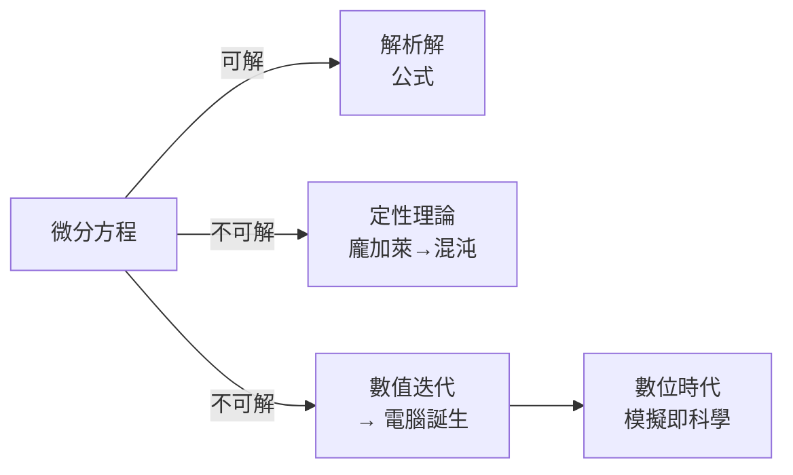

# 2.2 微分方程：描述宇宙變化的核心語言

## 從「量」到「變化」的範式轉移

牛頓之後，物理學的提問方式徹底改變。不再問「行星在哪裡」，而是問：

> **「此刻的狀態，決定了它如何變化。請解出未來。」**

這就是微分方程（ODE/PDE）：一個包含未知函數**及其導數**的方程。

$$F = ma \quad\Longrightarrow\quad m\frac{d^2 x}{dt^2} = F(x, v, t)$$

牛頓《原理》（1687）第二卷已經用文字寫過微分方程。今天我們知道：**宇宙的「作業系統」就是微分方程**——行星軌道、電路、流行病、神經元放電、股價，全都用它編寫。

## 經典例子一：單擺（鐘錶經濟的數學）

大航海時代最大的技術難題是**經度**：船在海上無法確定東西位置，不知道經度就不知道還有多遠才到港口，無數商船因此觸礁。1657 年惠更斯發明擺鐘，就是為了解決這個價值連城的問題（英國後來的經度獎 £20,000 便是明證）。

單擺的力矩方程：

$$mL^2\ddot{\theta} = -mgL\sin\theta \quad\Longrightarrow\quad \ddot{\theta} + \frac{g}{L}\sin\theta = 0$$

這是**非線性**的（有 $\sin\theta$）。小角度近似 $\sin\theta \approx \theta$ 後變線性：

$$\ddot{\theta} + \omega^2\theta = 0, \qquad \omega = \sqrt{g/L}$$

解為 $\theta(t) = A\cos(\omega t)$——**週期與擺幅無關**（等時性）。這條性質讓鐘錶成為可能，讓「時間」從教堂的鐘聲變成資本主義的計價單位。工業革命與工時制度、鐵路時刻表、全球時區，全部建立在「精確且可複製的振盪器」上。

**但注意**：大角度時 $\sin\theta \approx \theta$ 失效，等時性破壞——惠更斯用擺線齒輪修正。**線性化是工程師的魔法，也是數學家的妥協**；什麼時候能線性化、什麼時候不能（第 10 章混沌！），是貫穿本書的主線。

## 經典例子二：人口與傳染病（馬爾薩斯到 SIR）

1798 年馬爾薩斯《人口論》：人口按幾何級數增長（$\dot{P} = rP$，解為 $P = P_0 e^{rt}$）——這條指數曲線引發了經濟學史上最著名的悲觀預言，也刺激了達爾文（他讀了馬爾薩斯才想通「生存鬥爭」）。**經濟學文本 → 進化論的催化劑**，思想流動的意外路徑。

邏輯斯蒂方程加入資源限制：

$$\dot{P} = rP\left(1 - \frac{P}{K}\right)$$

1927 年 Kermack–McKendrick 的 SIR 模型把同樣想法用到傳染病：

$$\frac{dS}{dt} = -\beta S I, \qquad \frac{dI}{dt} = \beta S I - \gamma I, \qquad \frac{dR}{dt} = \gamma I$$

2020 年 COVID-19 期間，全球政府決策直接依賴這組方程的數值解。**一個 1927 年的數學模型，變成了 2020 年封城政策的依據**——數學的社會影響力常以數十年為尺度兌現。

## 解微分方程：為何「解析解」如此稀少

大多數微分方程**沒有封閉形式的解**。這不是數學家的失敗，而是數學的本性（後來龐加萊證明三體問題不可解析求解，見第 10 章）。於是數學分支轉向兩條路：

1. **定性理論**（龐加萊，1880s）：不解方程，但證明解的軌跡「長什麼樣」——穩定？週期？發散？這直接催生了混沌理論。
2. **數值計算**：用差分近似導數，一步步「迭代」。這條路最終導致**電腦的發明**——埃尼阿克（ENIAC, 1945）的第一個正式任務就是計算氫彈與砲彈彈道的微分方程。

**深刻的歷史反諷**：牛頓發明微積分是為了避免無窮逼近（他嫌無窮級數不夠「精確」）；三百年後，人類承認解析解是奢侈品，整個數位文明建立在無窮逼近上——你的手機每一秒都在做數值積分（感測器融合、遊戲物理引擎）。

## 小結

| 概念 | 數學形式 | 歷史驅動力 | 現代迴響 |
|------|---------|-----------|---------|
| 單擺方程 | $\ddot\theta + \omega^2\theta = 0$ | 航海經度、鐘錶貿易 | 時間標準化、工時制度 |
| 馬爾薩斯/邏輯斯蒂 | $\dot P = rP(1-P/K)$ | 人口與政治經濟學 | 生態學、流行病模型 |
| 定性理論 | 相空間、軌道分類 | 三體問題 | 混沌、非線性科學 |
| 數值解 | 差分迭代 | 彈道、核武 | 電腦、模擬科學 |

微分方程給了人類一件前所未有的事物：**一種寫下來就能「運行未來」的語言**。下一章，我們要看愛因斯坦如何把這種語言升級到彎曲的時空。

---
[下一節：3.1 從歐幾里得幾何到黎曼幾何](03.1-從歐幾里得幾何到黎曼幾何.md)
