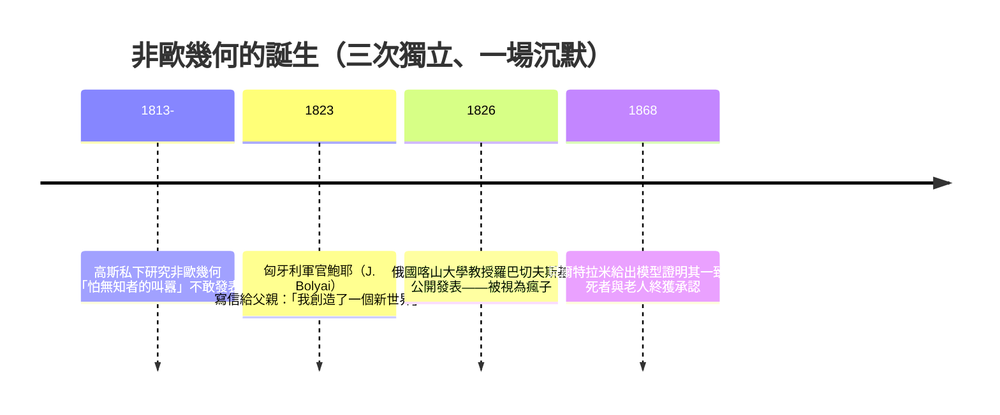

# 3.1 從歐幾里得幾何到黎曼幾何（非歐幾里得空間）

## 兩千年的公理聖殿

歐幾里得《幾何原本》（約前 300 年）是人類史上最暢銷的教科書之一，也是**理性主義的範本**——從少數自明公理出發，演繹出全部真理。斯賓諾莎用幾何體例寫《倫理學》；林肯口袋裡裝著《幾何原本》；康德宣稱歐氏幾何是人類先驗直觀的必然形式。

聖殿的地基裡卻藏著一根刺——**第五公設（平行公設）**：

> 過直線外一點，有且僅有一條直線與之平行。

它不像其他公設那樣「自明」，反而像一條定理。兩千年間無數數學家試圖從其他公理證明它：托勒密、普羅克洛斯、薩凱里（1733 年，差一步——他用歸謬法推出了非歐幾何的一堆定理，卻因深信歐氏幾何而宣告「矛盾」）。

## 三個敲門人：高斯、鮑耶、羅巴切夫斯基

注意歷史的社會學：**高斯不敢發表**——在普魯士保守的學術體制中，挑戰康德哲學有真實的職業風險；鮑耶的父親（數學家法卡斯·鮑耶，高斯終身摯友）曾極力勸阻兒子研究這個題目；羅巴切夫斯基發表後遭聖彼得堡科學院冷遇。**「顛覆性思想的安全環境」本身就是一種制度資源**，當時的歐洲大陸並不具備。

三種幾何並存：

| 幾何 | 平行線 | 三角形內角和 | 曲率 $K$ | 例 |
|------|--------|------------|---------|-----|
| 歐氏 | 恰好一條 | $= 180°$ | $0$ | 平面 |
| 羅巴切夫斯基（雙曲） | 至少兩條 | $< 180°$ | $< 0$ | 馬鞍面、 pseudosphere |
| 黎曼（橢圓） | 沒有 | $> 180°$ | $> 0$ | 球面 |

**球面上的三角形**：地球上從赤道出發沿經線到北極再回來的三角形，內角和可達 $270°$。這不是抽象遊戲——這正是**航海家每天使用的幾何**。諷刺的是，實用的地球表面早在實踐中「非歐」了兩千年，只是哲學家沒注意到。

## 黎曼的 1854 年演講：把空間交給度量

1854 年，27 歲的黎曼為取得哥廷根講師資格（Privatdozent，**無薪、靠學生學費過活**的職位——注意當時德國大學的制度設計如何篩選與折磨天才），發表〈論幾何學基礎的假說〉。高斯本人在場（他一生幾乎不參加這類演講）。

黎曼做了兩件驚天動地的事：

**1. 把「空間」抽象成「流形」（manifold）**——任何維度、任何形狀、局部看起來像歐氏空間的東西。

**2. 幾何 = 度量**。在一個流形上，距離由一個「度量張量」$g_{ij}$ 決定：

$$ds^2 = \sum_{i,j} g_{ij}\, dx^i dx^j$$

曲率不再需要嵌入高維空間來定義——**內蘊曲率**，由 $g_{ij}$ 自己就能算出。曲面上的居民不需要「跳出」曲面，就能測出自己的空間是彎的。

高斯早年在測量漢諾威王國的實地測繪工作（一份**國家工程任務**）中驗證過這個想法：他測三座山峰構成的三角形，內角和確實超出 $180°$ 一點點（雖然在誤差邊緣）。**測量學——最土的應用數學——孕育了最抽象的幾何革命。**

## 從數學到物理：為什麼愛因斯坦需要黎曼

1905 年狹義相對論統一了空間與時間；1907 年起愛因斯坦追尋廣義化，卡了整整八年。瓶頸正是數學：他需要一種「彎曲的、度規可變的四維空間幾何」。

1912 年，他的蘇黎世同窗、數學家格羅斯曼（Marcel Grossmann）告訴他：「你要的東西，黎曼幾何裡都有。」愛因斯坦後來自述：

> 「如果沒有黎曼幾何，我可能永遠無法完成廣義相對論。」

這裡有本書反覆出現的主題：**純數學搶跑了幾十年甚至幾千年（圓錐曲線、虛數、非歐幾何、纖維叢），等著物理學來「提貨」。** 龐加萊說「數學是給不同事物取相同名字的藝術」——黎曼給彎曲空間取的名字，剛好適合描述引力。

## 觀念後果：幾何從「真理」降格為「模型」

非歐幾何的哲學衝擊比物理衝擊更早到來：**如果多種自洽的幾何並存，那麼「空間是什麼」就成了經驗問題，而非先驗真理。** 康德的先驗感性論被拆掉了地基。龐加萊的約定主義、後來的邏輯實證主義，都在這片廢墟上生長。

而教育制度的迴響持續至今：每個中學生仍在學歐氏幾何——不是因為它是「真理」，而是因為它是**人類第一個公理化系統**，是「什麼叫證明」的教學工具。

---
[下一節：3.2 張量分析](03.2-張量分析.md)
