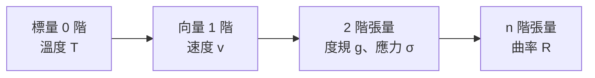

# 3.2 張量分析：用數學表達「物質告訴時空如何彎曲」

## 愛因斯坦的八年困境

從 1907 年「最快樂的思想」（ elevator 自由下落中的人感覺不到重力——等效原理）到 1915 年完成廣義相對論，愛因斯坦走了八年。他的難題可以用一句話概括：

> **把「引力」從一種「力」改寫成「時空的形狀」，需要一種能自動適應任意座標系的數學。**

普通方程不滿足這個要求——它們依賴你選的座標系（就像直角座標與極座標下公式長得不一樣）。他需要**座標無關**的語言。這種語言就是**張量分析**。

## 張量是什麼？一個直覺的階梯

- **標量**：每點一個數（溫度）
- **向量**：每點一組數，帶方向（風速）
- **2 階張量**：每點一個矩陣——描述「每個方向如何關聯每個方向」。例子：描述鋼材內部應力的張量（工程學！）、描述空間距離結構的度規 $g_{\mu\nu}$

張量的核心性質：**座標變換時按特定規則變換**。因此「兩個張量相等」是一條**與觀察者座標無關的客觀陳述**——這正是物理定律該有的樣子。

## 場方程：人類寫下最精煉的方程之一

1915 年 11 月，愛因斯坦在普魯士科學院連續四場演講，最後寫下：

$$\boxed{G_{\mu\nu} + \Lambda g_{\mu\nu} = \frac{8\pi G}{c^4}\, T_{\mu\nu}}$$

左邊：$G_{\mu\nu}$（愛因斯坦張量）描述**時空的彎曲**；右邊：$T_{\mu\nu}$（應力—能量張量）描述**物質與能量**。

一句話讀法——惠勒（John Wheeler）的名言：

> **「物質告訴時空如何彎曲，時空告訴物質如何運動。」**

結構之美在於對稱：左右兩邊都是 2 階張量，都是對稱的，都守恆。物理定律第一次以「幾何恆等式」的形式出現。

## 這些數學是誰造的？里奇、列維-齊維塔與絕對微分

愛因斯坦不是自己發明張量分析的。工具來自義大利數學學派：

- **里奇（Gregorio Ricci-Curbastro）** 與學生**列維-齊維塔（Tullio Levi-Civita）** 在 1890s–1900 建立「絕對微分學」（即張量分析），純粹出於對座標不變性的數學興趣
- 1912 年愛因斯坦的數學家同學**格羅斯曼**向他介紹里奇的理論
- 1915 年列維-齊維塔與愛因斯坦通信討論，愛因斯坦承認：「我必須承認，我從沒像崇拜這位義大利數學家的美妙工作那樣崇拜過任何人。」

歷史鏈條：**德國大學的無薪講師制度（黎曼）→ 義大利的純數學傳統（里奇）→ 蘇黎世理工的同窗情誼（格羅斯曼）→ 專利局職員的物理革命（愛因斯坦）**。科學是社會網絡的產物，不是孤膽英雄的神話。

## 驗證的三次歷史時刻

| 年份 | 事件 | 意義 |
|------|------|------|
| 1915 | 解釋水星近日點每百年 43 角秒的進動 | 事後解釋——勒維耶曾為此虛構「火神星」，牛頓力學的第一次裂縫 |
| 1919 | 愛丁頓日食觀測：星光經太陽偏折 $1.75''$ | 戰後英德和解的象徵（愛丁頓是英國人、和平主義者，刻意去驗證「敵國」科學家的理論）；頭條新聞使愛因斯坦成為全球名人——**科學第一次成為大眾媒體事件** |
| 2015 | LIGO 偵測重力波 | 場方程預測的時空漣漪，開啟「重力波天文學」 |

1919 年的社會效應值得細看：倫敦《泰晤士報》頭版「科學革命——牛頓的理論被推翻」。此後「相對論」進入日常詞彙（且常被誤解為「一切都是相對的」），影響了二十世紀的藝術（立體主義的詮釋）、哲學與通俗文化。**科學觀念滲入文化的速度，第一次快過了科學教育的速度。**

## 動手感受：一個可驗證的後果

GPS 是廣義相對論的日常應用：衛星上的鐘因引力較弱**每天快約 45 微秒**，又因高速運動**每天慢約 7 微秒**，淨效應每天快 38 微秒。若不修正，定位誤差每天累積約 **10 公里**。

$$\frac{\Delta f}{f} \approx \frac{\Delta U}{c^2}$$

沒有黎曼幾何的修正，你手上的導航會在一週內把你導向另一個城市。**最抽象的數學，嵌入在最俗世的应用裡。**

## 小結與過渡

- 廣義相對論證明了：**幾何可以是動力學變數**——空間本身會「呼吸」
- 張量分析的教訓：**物理定律應該寫成不依賴觀察者觀點的形式**
- 數學工具常常比物理需求早到數十年；科學共同體與大學制度決定了這些工具能否存活

下一篇，我們從宇宙尺度的彎曲，轉向另一種無所不在的現象——振盪。你聽見的每一個聲音，都是傅立葉級數在演奏。

---
[下一節：4.1 琴弦的振動](04.1-琴弦的振動.md)
