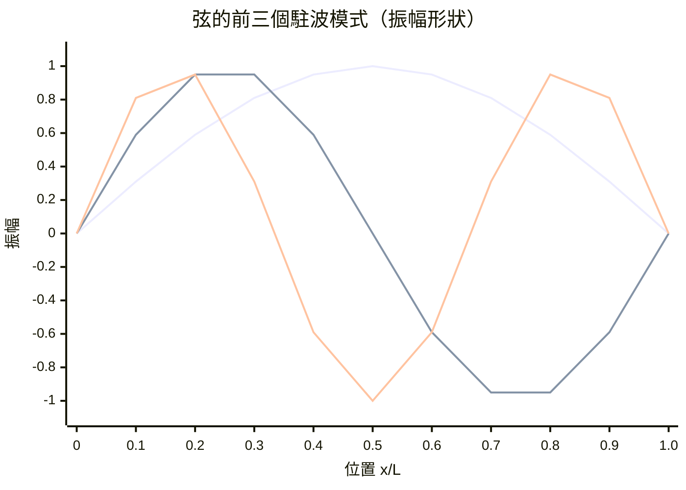

# 4.1 琴弦的振動：波形、頻率與三角函數

## 畢達哥拉斯的鐵匠鋪：數學與音樂的初次相遇

傳說畢達哥拉斯路過鐵匠鋪，發現重量成簡單整數比的鐵錘敲出的聲音最和諧：2:1 是八度，3:2 是五度，4:3 是四度。

這個傳說（細節不符物理，但精神正確）是**數學化科學的起點**：用數的比值描述感性經驗。中世紀大學的三藝之一就是音樂（musica），被歸類為**數學科目**——音樂理論與算術、幾何、天文並列。

弦的物理：長度 $L$、張力 $T$、線密度 $\mu$ 的弦，基音頻率為

$$f_1 = \frac{1}{2L}\sqrt{\frac{T}{\mu}}$$

調音師擰緊琴弦（改 $T$）、吉他手按弦（改 $L$），都是在做實驗物理。小提琴與琵琶的音色差異則來自**泛音**成分——而理解泛音，需要等待兩千年。

## 琴弦方程：波動方程的誕生

1715 年前後，布魯克·泰勒（Taylor，就是泰勒級數的那位）給出琴弦的振盪模式；1747 年，**達朗貝爾（d'Alembert）** 寫下了物理學史上第一個偏微分方程：

$$\frac{\partial^2 y}{\partial t^2} = c^2 \frac{\partial^2 y}{\partial x^2}, \qquad c = \sqrt{T/\mu}$$

一般解：$y(x,t) = f(x - ct) + g(x + ct)$——**向右與向左傳播的波**。這個「$x - ct$」的結構是波的指紋：形狀不變，整體平移。

## 一場跨越六十年的數學論戰

波動方程引發了十八世紀最激烈的數學爭論，參戰者全是頂尖人物：

| 人物 | 立場 | 主張 |
|------|------|------|
| 達朗貝爾 | 解析派 | 解必須是解析函數 |
| 歐拉 | 廣義派 | 任何「隨手畫的曲線」都可以是初始形狀 |
| 丹尼爾·白努利 | 疊加派 | 一切振動都是正弦模式的疊加 $y = \sum b_n \sin(nx)$ |
| 拉格朗日 | 謹慎派 | 對「任意函數」概念存疑 |

**這場論戰的深遠後果**：「什麼是函數？」這個問題被迫重審。十八世紀的「函數」＝解析表達式；歐拉堅持「隨手畫的曲線」也是函數——**現代函數概念的誕生，是物理需求（琴弦初始形狀可以是任意撥弦位置）倒逼出來的**。這直接鋪路給傅立葉（下一節）與十九世紀分析學的嚴格化（狄利克雷、黎曼的積分定義）。

## 駐波：為什麼弦只唱特定的音

兩端固定的弦（$y = 0$ at $x = 0, L$）只能以特定模式振動——**駐波**：

$$y_n(x, t) = A_n \sin\!\left(\frac{n\pi x}{L}\right)\cos\!\left(\frac{n\pi c t}{L}\right), \quad n = 1, 2, 3, \dots$$

- $n=1$：基音（一次只有一個「肚」）
- $n=2$：八度（頻率 $\times 2$，中間有一個節點）
- $n=3$：五度（$\times 3$）

撥一下吉他弦，它**同時**以所有模式振動——你聽到的是基音 + 一串泛音的混合。**「複雜現象 = 簡單模式的疊加」**——這個想法將由傅立葉推到極致：不僅琴弦，**任何**波形、任何訊號、任何熱的分布，都可以拆成三角函數的疊加。

## 社會背景：音樂與啟蒙運動

十八世紀是公共音樂會、歌劇院、鋼琴製造業起飛的時代（巴赫卒於 1750，海頓、莫札特相繼活躍）。**樂器製造的商業競爭**（斯特拉迪瓦里、鋼琴取代大鍵琴）不斷提出新的聲學問題；同時，啟蒙運動的百科全書派把聲學列為要目。數學家研究琴弦，既是純科學，也是服務一個規模化成長的音樂消費產業——音樂廳要大、要聽得清，需要懂混響與波傳播。

而波動方程的另一個受益者是**電信**：十九世紀電報線上的訊號方程、電話線的損耗理論，全是波動方程的親戚。琴弦的最終迴響，是一百五十年後的長途電話與光纖。

---
[下一節：4.2 傅立葉級數](04.2-傅立葉級數.md)
