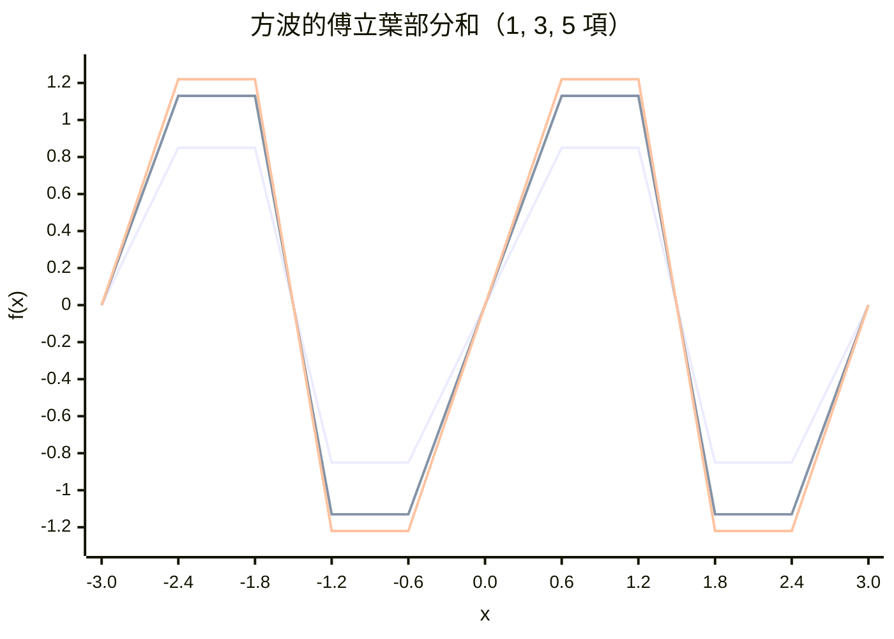
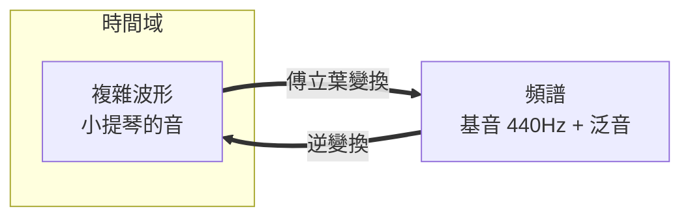

# 4.2 傅立葉級數：如何將複雜的聲音拆解為簡單的正弦波？

## 拿破崙的隨軍科學家

傅立葉（Joseph Fourier, 1768–1830）的人生是法國大革命的縮影：孤兒出身、被本篤會培養教育、差點成為神父；大革命爆發後投身政治，差點上了斷頭臺（羅伯斯比倒臺前夕被捕）；1798 年隨**拿破崙遠征埃及**，擔任埃及研究院秘書——這場軍事行動在戰場上失敗了，卻意外帶回了羅塞塔石碑與埃及學的誕生。

回到法國後，他擔任伊澤爾省省長十二年（格勒諾布爾），公務之餘研究一個具體問題：**炮管與爐子裡的熱如何傳播**。1807 年他提交論文，評審（拉普拉斯、拉格朗日、貝祖）有讚有彈；1822 年擴充為《熱的解析理論》——這本書改變了數學的走向。

**注意贊助結構**：傅立葉的科學生涯靠的是帝國行政職位（省長有薪水、有閒暇、有印刷資源）。現代「研究休假」制度的原型，正是這類官僚體系中的「文官科學家」。

## 狂妄的宣言

傅立葉宣稱：**任意函數**都能表示為正弦與餘弦的無窮級數：

$$f(x) = \frac{a_0}{2} + \sum_{n=1}^{\infty}\left(a_n \cos nx + b_n \sin nx\right)$$

係數有漂亮的積分公式（這正是微積分與三角函數正交性的完美配合）：

$$a_n = \frac{1}{\pi}\int_{-\pi}^{\pi} f(x)\cos(nx)\,dx, \qquad b_n = \frac{1}{\pi}\int_{-\pi}^{\pi} f(x)\sin(nx)\,dx$$

拉格朗日當場反對（他早年在琴弦論戰中就反對過）。傅立葉的殺手鐧是一個震驚所有分析學家的例子：**方波**——一個處處有稜角、甚至不連續的函數，竟然可以用無窮多個光滑的正弦波疊加出來：

$$f(x) = \frac{4}{\pi}\left(\sin x + \frac{\sin 3x}{3} + \frac{\sin 5x}{5} + \cdots\right)$$

## 數學為此付出的代價與收穫

傅立葉級數逼出了十九世紀分析學的整座大廈：

1. **函數是什麼？** 狄利克雷 1829 年給出傅立葉級數收斂的嚴格條件，順便給出了現代「函數」的定義（對應關係，而非公式）
2. **積分是什麼？** 黎曼 1854 年定義黎曼積分，就是為了處理傅立葉級數的係數
3. **極限是什麼？** 一致收斂、逐點收斂的區分在此誕生
4. **病態函數**：1872 年魏爾斯特拉斯造出「處處連續、處處不可微」的函數，靈感直接來自三角級數——數學開始研究「怪物」，直覺讓位於邏輯
5. **勒貝格積分（1902）與希爾伯特空間（1900s）**：最終在泛函分析中，「傅立葉級數 = 在一組正交基上展開向量」——無窮維空間的解析幾何

**這是數學史上「應用催生理論」的最佳範例：一個熱傳導的工程問題，一路逼出了現代分析的整個哲學。**

## 頻譜：換一雙眼睛看世界

傅立葉變換的本質是**座標變換**：從「時間域」（什麼時候發生什麼）換到「頻率域」（含哪些頻率成分）。就像同一張地圖可以有行政區版和地形版——兩者都對，看到的世界不同。

一個重要的不變量（不確定性原理的先聲，比海森堡早了一百年）：

> **時間上愈「窄」的訊號，頻譜上愈「寬」；反之亦然。** $\Delta t \cdot \Delta \omega \geq \frac{1}{2}$

你不可能同時知道一個聲音「精確發生在哪一瞬」和「精確是什麼音高」——鋼琴的短促敲擊聽不出音準，長音才可以。這條數學定理，將在第八章以量子力學的形式統治微觀世界。

## 小結

- 起點：炮管冷卻（軍事工程）
- 手段：三角級數展開（代數 + 積分）
- 副產品：現代函數、積分、收斂概念（數學基礎）
- 遺產：頻譜思維（看世界的新方式）

而把傅立葉的想法從「無窮級數」變成「可以跑在晶片上的演算法」，還要再等一百四十年——那是 4.3 的故事。

---
[下一節：4.3 現代應用](04.3-現代應用.md)
