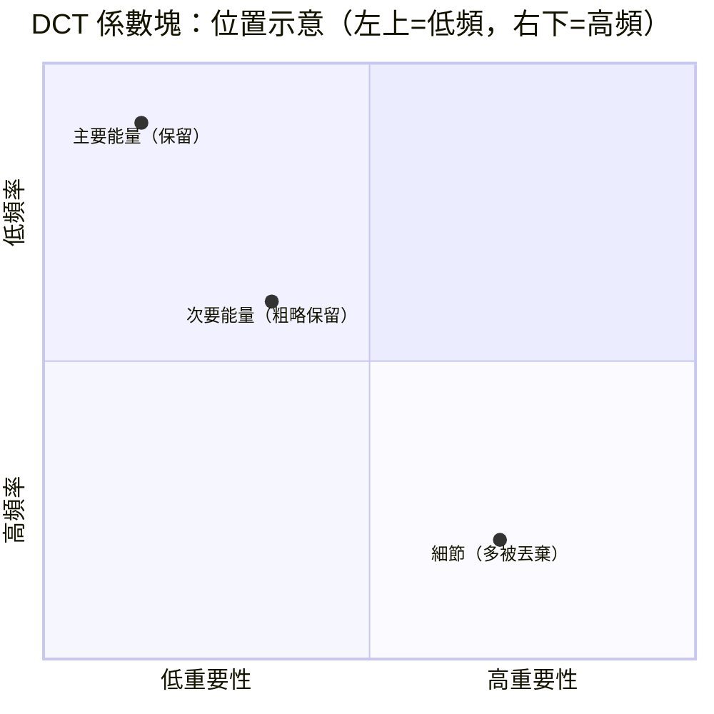
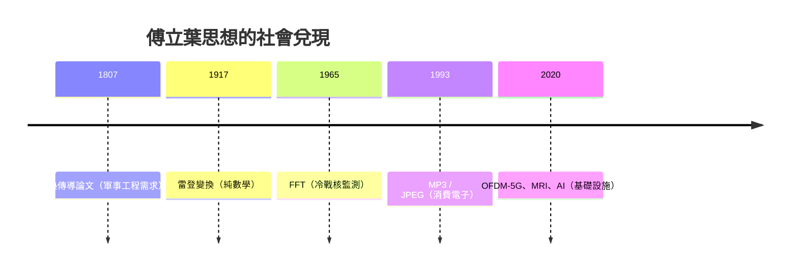

# 4.3 現代應用：MP3 壓縮、影像處理與 CT 掃描背後的數學

## 從高斯到圖基：FFT 的誕生史（一段冷戰插曲）

傅立葉變換有個致命傷：直接計算 $N$ 點需要約 $N^2$ 次乘法。$N = 1024$ 就要一百萬次——1960 年代的電腦跑不起來。

1965 年，IBM 的圖基（John Tukey，統計學家）與庫利（James Cooley，數學家）發表 FFT（快速傅立葉轉換），把複雜度降到 $O(N \log N)$——$N = 1024$ 時從一百萬次操作降到約一萬次，**快一百倍**。

鮮為人知的歷史：圖基當時在**總統科學顧問委員會**，動機是監測蘇聯核試爆——用地震儀訊號的頻譜分辨地震與核爆（《部分禁止核試爆條約》查證需求）。**冷戰軍備控制，資助了數位訊號處理的基石。**

更諷刺的是數學史的考證：高斯 1805 年（在傅立葉發表之前！）已在手稿中寫出 FFT 的核心思想，用來計算小行星穀神星的軌道插值——但沒有發表，因為那個時代不需要快。**演算法的價值是社會技術條件賦予的，不是數學本身自帶的。**

## MP3：把「聽不見的」丟掉

MP3（1993， Fraunhofer 學院）的本質：**傅立葉變換 + 感知編碼**。

關鍵是**聽覺遮蔽**：一個大音量的 1kHz 音會讓你聽不見旁邊較弱的 1.1kHz 音。心理聲學（19 世紀馮·亥姆霍茲開創的實驗生理學傳統）提供了「哪些頻率可以安全丟棄」的規則，FFT 提供了「快速找出頻率成分」的工具。

社會經濟效應：MP3 使音樂檔案小到能在網路傳播 → Napster（1999）→ 唱片產業崩塌 → 串流帝國（Spotify）→ 音樂經濟從「賣拷貝」轉為「賣訂閱」。**一條 $O(N\log N)$ 演算法，重組了全球音樂產業的產權結構。**

## 影像：JPEG 與二維變換

JPEG 把影像切成 $8\times 8$ 像素的小塊，對每塊做**二維離散餘弦變換（DCT，傅立葉的表親）**：左上角是低頻（大輪廓），右下角是高頻（細節與雜訊）。人眼對高頻不敏感 → 量化時狠砍高頻。你手機裡每一張照片，都是一次傅立葉思想的執行。

（示意：JPEG 的能量集中在左上角低頻區）

## CT 掃描：傅立葉的醫學革命

1979 年諾貝爾生理醫學獎（Cormack & Hounsfield）頒給了**電腦斷層掃描**，其數學核心是**雷登變換（Radon transform, 1917）**與傅立葉切片定理：

1. X 光從各個角度穿透身體，測得「投影」（每條線上密度的積分）
2. **切片定理**：投影的一維傅立葉變換 = 影像二維傅立葉變換中過原點的一條切片
3. 收集足夠多角度的切片，拼出完整頻譜，逆變換還原影像

**數學救了命**：從此不用開刀就能看見腦內。雷登 1917 年的純數學（積分幾何），五十年後成為每天全球數百萬次的醫療檢查——再一次，「無用的數學」排隊等著兌現。

## 更廣的版圖

| 領域 | 用到的傅立葉思想 |
|------|----------------|
| 5G / WiFi | OFDM：資料調變在正交頻率上，IFFT 生成訊號 |
| 電力系統 | 諧波分析：監控電網品質 |
| 雜湊與密碼學 | NTT（數論變換）用於多項式乘法 |
| 機器學習 | 卷積 = 頻域乘法；CNN 的卷積層靠 FFT 加速 |
| 核磁共振 MRI | 訊號本來就在 k 空間（頻域）採集，逆 FFT 成像 |
| 天文學 VLBI / 事件視界望遠鏡 | 相位關聯與頻譜合成 |

## 小結：一條思想的三次變身

**數學的社會壽命極長**：它像種子，可以在土裡埋兩百年，等產業、政治與技術條件齊備時爆發。

下一章我們看光——它走的路，是所有可能路徑中「最省時」的那一條。而證明這件事的工具（變分法），將引導我們走向整個現代物理的深層結構。

---
[下一節：5.1 費馬原理](05.1-費馬原理.md)
