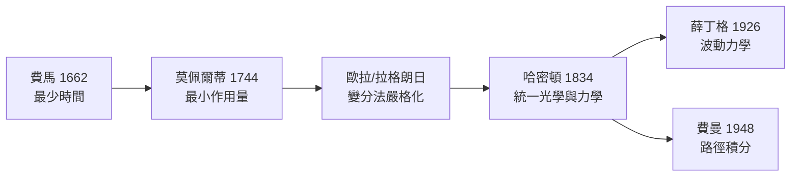

# 5.1 費馬原理：光為什麼會選擇「花費時間最少」的路徑？

## 古代與中世紀：光的行為是一場思想鬥爭

- **歐幾里得**（前 300 年）：《反射光學》已用幾何描述反射角等於入射角
- **托勒密**：測量折射，卻找不到折射角的正確公式（他假設角度成正比）
- **海桑（Ibn al-Haytham, 約 1021 年）**：開羅的阿拉伯學者，寫出《光學書》，堅持「實驗檢驗」——近代實驗方法的先聲。開羅當時是法蒂瑪王朝的學術中心，哈里發資助的智慧宮傳統仍在延續
- **開普勒**：1604 年提出小角度近似的折射定律，仍缺一般形式

折射定律的最終形式由兩人幾乎同時得到：荷蘭的**斯涅爾**（約 1621，未發表，只有手稿）與法國的**笛卡兒**（1637，《屈光學》）。此後還有費馬與笛卡兒學派（以及後來的惠更斯與牛頓微粒說）之間關於光本質的長期論戰——**光學的每一次進步，都伴隨著民族與學派的競爭**。

## 折射定律：實驗的一步

$$n_1 \sin\theta_1 = n_2 \sin\theta_2$$

$n$ 是折射率（光在介質中相對真空變慢的倍數）。玻璃 $n \approx 1.5$：光進入玻璃後「轉向法線」。眼鏡、相機鏡頭、光纖——整個光學產業建立在這一行公式上。**荷蘭的眼鏡製造業（十七世紀的「光學矽谷」）** 造出了望遠鏡與顯微鏡，直接餵養了伽利略的發現與虎克的《顯微圖譜》。

## 費馬的跳躍：最少時間原理

1662 年，法國數學家費馬（Fermat，就是「費馬最後定理」的那位）提出一個驚人的原則：

> **光在兩點之間走的路徑，是耗時最少的路徑。**

$$T = \int \frac{ds}{v} = \text{最小值}$$

**檢驗一：反射**。光從 $A$ 經鏡面反射到 $B$，幾何上等價於「在鏡中虛像 $B'$ 找最短直線」——結果恰好是入射角 = 反射角。✓

**檢驗二：折射**。光從 $A$（介質 1，速度 $v_1$）到 $B$（介質 2，速度 $v_2$），走一條折線。對折射點位置求導、令導數為零，得到：

$$\frac{\sin\theta_1}{v_1} = \frac{\sin\theta_2}{v_2} \quad\Longleftrightarrow\quad n_1\sin\theta_1 = n_2\sin\theta_2$$

——**實驗定律從變分原理中「掉」了出來**。

## 哲學炸彈：自然會「計算」嗎？

費馬原理在當時引發的震動遠超物理範圍：

- 笛卡兒學派攻擊：光走「最省時」的路，難道光有**目的**？這是目的論（teleology）復辟！
- 費馬回應：這只是數學上的等價描述，不代表自然有意志

但這顆種子長成了現代物理最深層的結構。之後兩百年：

- 莫佩爾蒂（Maupertuis, 1744）：最小作用量原理（變分 $\int p\,dq$ 極小）——被宗教界喜愛（「上帝用最經濟的方式統治宇宙」），被數學家攻擊（證明粗糙），伏爾泰還寫過小冊子嘲諷他
- 歐拉與拉格朗日：把變分法嚴格化（見 5.2）
- 哈密頓（Hamilton, 1834）：統一幾何光學與力學——「哈密頓原理」，作用量 $\int (T - V)\,dt$ 取駐值

**量子力學的橋樑**：費曼 1942 年的博士論文證明，量子粒子其實**同時走所有路徑**（路徑積分），只不過非極值的路徑互相抵消，只有「作用量駐值」的路徑存活——經典的最少時間原理，只是量子疊加的干涉結果。**目的論的外衣底下，是波動干涉的數學。**

## 為什麼「光速在介質中變慢」支持波動說

費馬原理的前提是**光在密介質中較慢**（$v = c/n$）。若光如牛頓所說是微粒，力學分析預言它在密介質中應**變快**。1850 年傅科用旋轉鏡實驗測出光在水中變慢——**微粒說出局，波動說勝利**。這是科學史上「用變分原理的符號方向判定物理理論對錯」的漂亮案例。

## 歷史迴響

- **笛卡兒折射定律的推導**其實暗含「光在密介質更快」，且帶著機械論哲學的包裝——它服務的是笛卡兒主義在歐洲學院的地位。學說競爭從來不只是證據問題，也是**權威與學派網絡**的問題
- 光學玻璃與透鏡產業（荷蘭→英國→德國蔡司）支撐了顯微學、細菌學（巴斯德、科赫）與醫學革命——折射率的數學，最終改寫了公共衛生史
- 今日的光纖通訊：全反射 + 漸變折射率設計，全是費馬原理的工程應用。你讀這本書的電子版，正沿著「最少時間路徑」穿越海底光纖而來

---
[下一節：5.2 變分法入門](05.2-變分法入門.md)
