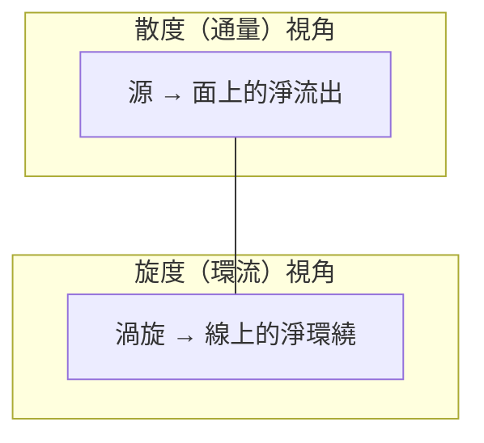

# 6.1 向量分析：散度（Divergence）與旋度（Curl）

## 十九世紀的物理：從「質點」到「場」

牛頓力學的主角是質點——有位置、有速度的小球。但十九世紀的物理學面對的是**連續分布的現象**：磁鐵周圍的鐵屑排列、通電導線周圍的磁針偏轉、流體中的壓力分布。

法拉第（Michael Faraday）——鐵匠之子、書店學徒、靠自學與皇家研究院的講職位（英國「科學普及 + 應用研究」制度的產物）——提出革命性觀念：**場（field）**。空間本身攜帶狀態，力不是隔空作用，而是透過「力線」傳遞。

法拉第的數學很弱（他只受過小學教育），但他的**實驗與幾何直覺**（力線、力管）太強了。他晚年感嘆希望有數學家能翻譯他的直覺——「場」的嚴格數學語言，就是本章的向量分析。

## 向量場：空間每個點一個箭頭

$$\vec{F}(x, y, z) = \big(F_x, F_y, F_z\big)$$

例子：風速場、磁場、引力場。描述向量場的兩個基本操作：

## 散度：往外「冒」了多少？

$$\nabla\cdot\vec{F} = \frac{\partial F_x}{\partial x} + \frac{\partial F_y}{\partial y} + \frac{\partial F_z}{\partial z}$$

**直覺**：在該點放一個微小體積，單位體積淨流出的通量。散度 > 0 是「源頭」（正電荷、泉眼），< 0 是「匯」（負電荷、下水道），= 0 表示流體「不可壓縮地穿過」。

**散度定理（高斯定理）**：封閉面上的總通量 = 內部散度的積分。

$$\oint_{\partial V} \vec{F}\cdot d\vec{A} = \int_V (\nabla\cdot\vec{F})\, dV$$

**翻譯**：「往外冒的總量」等於「內部源頭的總和」。整體與局部的一致性——這是十九世紀數學的典型品味（還有高斯散度定理在微分幾何、相對論中的廣義化）。

## 旋度：在原地「轉」了多少？

$$\nabla\times\vec{F} = \left(\frac{\partial F_z}{\partial y} - \frac{\partial F_y}{\partial z},\; \frac{\partial F_x}{\partial z} - \frac{\partial F_z}{\partial x},\; \frac{\partial F_y}{\partial x} - \frac{\partial F_x}{\partial y}\right)$$

**直覺**：把小槳輪放在該點，它自轉的方向與快慢。

**旋度定理（斯托克斯定理）**：沿閉曲線的環流 = 穿過所圍面的旋度通量。

$$\oint_{\partial S} \vec{F}\cdot d\vec{l} = \int_S (\nabla\times\vec{F})\cdot d\vec{A}$$

## 這套數學是誰、為什麼而造？

向量分析的發明史本身就是一場**數學的民族主義與政治鬥爭**：

- **哈密頓**（1830s–40s）發明四元數（quaternion）：$a + b\mathbf{i} + c\mathbf{j} + d\mathbf{k}$，用四元數代數處理三維旋轉。他的紀念碑（都柏林布魯姆橋上的乘法公式刻石，1843）是數學史上著名的「頓悟地標」
- **吉布斯**（J. W. Gibbs，耶魯）與**海維賽德**（Oliver Heaviside，英國**自學成才的電報員**！）從四元數中「拆出」向量部分，建立現代向量分析
- 四元數學派（劍橋的泰特等）與向量派激烈論戰數十年，最終向量派在 1890s 獲勝——因為**麥克斯韋方程組用向量寫太乾淨了，電機工程師需要好用而非優雅的數學**

**海維賽德的意義**：沒有大學學位、靠電報公司實務經驗自學，提出運算微積分、預言電離層（肯內利—海維賽德層，解釋無線電為何能跨越大西洋——1901 年馬可尼的越洋電報！），一生被學術體制排斥，晚年獲得遲來的承認。**工程實務與自學者多次成為數學物理的突破口**——因為應用端的問題壓力，學院理論未必最先感受到。

## 為什麼「場」的觀念是場方程的前提

電磁學的關鍵事實：**電磁力以有限速度傳播**（不是超距作用）。這要求物理量「住在空間的每一點」，且隨時間演化——正是「場」+「偏微分方程」。

- 超距作用（牛頓式）→ 無需場的數學
- 有限傳播速度 → 必須描述「此處的變化如何影響鄰處」

散度與旋度正是回答兩個基本問題的工具：**場從哪裡冒出來（散度）？場如何繞圈（旋度）？** 下一節，這兩個算符將組成物理學最著名的四行詩。

---
[下一節：6.2 四個方程如何導出「光速」常數](06.2-四個方程如何導出光速常數.md)
