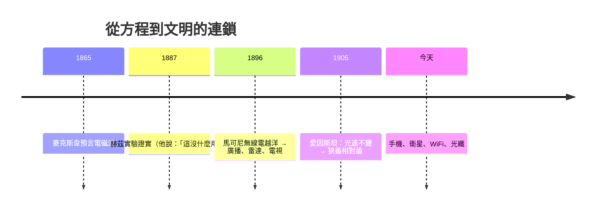

# 6.2 四個方程如何導出「光速」常數？

## 麥克斯韋與維多利亞時代的電報帝國

麥克斯韋（James Clerk Maxwell, 1831–1879）在 1860s 寫下電磁統一理論時，背景是**人類史上第一次資訊基礎設施革命**：

- 1840s–60s：電報網席捲全球（1858 年首條跨大西洋電纜），電報公司成為帝國的神經系統——大英帝國的統治依賴倫敦與殖民地的即時通訊
- **電纜公司面臨真實工程難題**：訊號在長電纜中延遲、畸變。凱爾文爵士（William Thomson）1855 年的電纜傳輸理論就是為此而寫
- 電報工程師迫切需要一套系統的電磁理論

**電信資本主義直接資助並塑造了電磁學。** 麥克斯韋後來主持 Cavendish 實驗室（1871，由公爵捐資建立——英國實驗物理制度化的起點），理論的工程兌現則靠電報工程師社群。

## 四個方程

$$\nabla\cdot\vec{E} = \frac{\rho}{\varepsilon_0} \qquad\qquad\qquad\quad\ \ (1)\ \text{電場的源是電荷}$$

$$\nabla\cdot\vec{B} = 0 \qquad\qquad\qquad\qquad\quad\ (2)\ \text{磁場無源（無磁單極）}$$

$$\nabla\times\vec{E} = -\frac{\partial\vec{B}}{\partial t} \qquad\qquad\qquad\ (3)\ \text{法拉第感應：變化的磁生電}$$

$$\nabla\times\vec{B} = \mu_0\vec{J} + \mu_0\varepsilon_0\frac{\partial\vec{E}}{\partial t} \quad\ (4)\ \text{電流與變化的電生磁}$$

歷史註記：第 (4) 式的 $\mu_0\varepsilon_0\frac{\partial\vec{E}}{\partial t}$（**位移電流**）是麥克斯韋的獨創理論貢獻——沒有任何實驗直接要求它，它是為了滿足電荷守恆而**邏輯上必須**添加的項。這是「理論一致性強迫新物理」的經典案例。

## 導出波動方程（真空：$\rho = 0,\ \vec{J} = 0$）

對 (3) 取旋度：

$$\nabla\times(\nabla\times\vec{E}) = -\frac{\partial}{\partial t}(\nabla\times\vec{B})$$

用恆等式 $\nabla\times(\nabla\times\vec{E}) = \nabla(\nabla\cdot\vec{E}) - \nabla^2\vec{E}$，配合 (1) 與 (4)：

$$\nabla^2\vec{E} = \mu_0\varepsilon_0\frac{\partial^2\vec{E}}{\partial t^2}$$

對照波動方程 $\frac{\partial^2 y}{\partial t^2} = c^2\frac{\partial^2 y}{\partial x^2}$，波速為：

$$v = \frac{1}{\sqrt{\mu_0\varepsilon_0}} = \frac{1}{\sqrt{(4\pi\times10^{-7})(8.85\times10^{-12})}} \approx 3.0\times10^8\ \text{m/s}$$

**恰好是光速。** 麥克斯韋 1865 年寫道：

> 「這個速度與光速如此接近，因此我們有充分理由認為，光本身就是電磁擾動。」

**「光」被除名為獨立現象，重新登記為電磁波。** 光學（古老）、電學與磁學被四行方程統一——人類第一次體驗「大統一」的震撼。

## 連鎖反應

赫茲的「沒什麼用」是著名的反諷：基礎研究與商業應用之間的時間差無法預測。今天所有科研資助制度的論證（如范內瓦·布希 1945 年《科學：無盡的前沿》）其思想原型就是「麥克斯韋→馬可尼」的例子。

## 狹義相對論的誕生：麥克斯韋與牛頓的矛盾

方程預言光速 $c$ 是**常數**——但相對於誰？若相對於設想中的「以太」，地球上的測量應隨方向變化。邁克生—莫雷實驗（1887）測不到任何差異。

愛因斯坦 1905 年的解法：**忠於麥克斯韋，修正牛頓**。假設光速對所有慣性觀察者相同，代價是時間與空間不再是絕對的（$E = mc^2$ 是副產品）。這條線最終通向第 3 章的彎曲時空——閉環完成。

## 小結

- 向量分析是「場」的語言；電報工程與自學者（海維賽德）共同催生了它
- 四個方程 + 一個邏輯必要項（位移電流）= 電磁光統一
- 光速從方程中「自己走出來」，成為相對論的入口
- 社會鏈條：電報帝國 → 電磁理論 → 無線電產業 → 資訊時代

下一篇轉入微觀與隨機：蒸汽機的效率問題，將逼出「熵」——人類史上最深刻也最常被誤解的數學概念。

---
[下一節：7.1 熵](07.1-熵.md)
