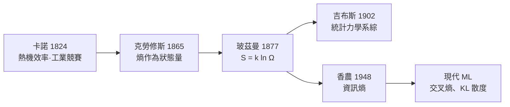

# 7.1 熵（Entropy）：混亂度的數學定義（$S = k \ln \Omega$）

## 起點：蒸汽機與英法工業競賽

熱力學誕生於一個極其世俗的問題：**怎樣讓蒸汽機更省煤？**

- 1769 年瓦特改良蒸汽機 → 工業革命的動力心臟
- 法國工程師**卡諾**（Sadi Carnot, 1824《論火的動力》）分析理想熱機，發現效率上限只取決於兩個溫度：

$$\eta = 1 - \frac{T_{冷}}{T_{熱}}$$

注意國際競爭背景：法國在蒸汽機技術上落後英國，卡諾的動機部分是**國家競爭力分析**——「英國的蒸汽機優勢能否被理論追回？」熱力學是軍事—工業競賽的產物。

- 1850s 克勞修斯（Clausius）與開爾文確立熱力學第一、第二定律；1865 年克勞修斯造出新詞 **Entropie**（源自希臘文「轉變」）：

$$dS = \frac{\delta Q_{rev}}{T} \geq 0$$

> 「宇宙的能量恆定；宇宙的熵趨於極大。」

## 玻茲曼：把「混亂」變成「數數」

克勞修斯的熵很抽象（熱量除以溫度）。**玻茲曼（Ludwig Boltzmann）** 給出了革命性的微觀定義：

$$\boxed{S = k \ln \Omega}$$

- $\Omega$：微觀狀態數——宏觀狀態（如「溫度 25°C、壓力 1 atm」）對應多少種微觀排列
- $k$：玻茲曼常數（$1.38\times10^{-23}$ J/K）

**撲克牌直覺**：一副牌「整齊排序」只有 1 種微觀排列；「洗亂」有 $52! \approx 8\times10^{67}$ 種。熵就是**「有多少種方式」的對數**。洗牌只會愈洗愈亂，不是神秘力量，而是**數數的統計必然**——亂的組態太多太多了。

為什麼用對數？因為獨立系統的微觀態數相乘（$\Omega = \Omega_1\Omega_2$），熵要相加（$S = S_1 + S_2$）——**對數把乘法變加法**，與資訊理論（香農 1948 的 $H = -\sum p\log p$）用對數的理由完全相同。熵與資訊，在數學上是同一個東西。

## 統計力學：從原子到熱力學的全套翻譯

玻茲曼與吉布斯建立的綱領：**宏觀量 = 微觀量的統計平均**。溫度是分子平均動能的量度；壓力是分子撞擊器壁的統計效應；熵是組態數的對數。

這不是單純的技術成就，而是**世界觀革命**：

1. **還原論的勝利**：宏觀規律可以被微觀定律 + 統計推導
2. **機率成為物理的基本語言**：牛頓式的確定論讓位給分布函數——這條思路直通第七、八章的隨機過程與量子力學
3. **不可逆性獲得解釋**：牛頓方程時間可逆，但熵增不可逆——因為「少數組態 → 多數組態」的機率壓倒一切（$10^{23}$ 量級的粒子數下，「自發逆轉」的機率小到宇宙年齡也等不到一次）

## 玻茲曼的悲劇：學術戰爭與時代的精神氣候

玻茲曼的原子論在當時飽受攻擊。**馬赫與奧斯特瓦爾德的「唯能論」學派**認為原子不可觀測、不該進入科學（實證主義的極端版本）。玻茲曼在維也納與萊比錫的講座上孤軍奮戰，飽受躁鬱症折磨，1906 年在義大利的里雅斯特附近自縊。

諷刺的歷史時序：**1905 年愛因斯坦用布朗運動證明原子實在（見 7.2）、1909 年佩蘭實驗蓋棺定論**——玻茲曼死後僅三年，他贏了每一場辯論。維也納中央墓園他的墓碑上，只刻著一行公式：

$$S = k\cdot\log\Omega$$

這是科學史上最令人心碎的墓誌銘。它也提醒我們：**科學共同體的評審機制可能錯殺正確理論，且錯殺的代價由個人支付。**

## 熵的跨領域遠征

| 領域 | 熵的角色 |
|------|---------|
| 化學 | 反應方向：$\Delta G = \Delta H - T\Delta S$（吉布斯自由能）——化學工業的設計依據 |
| 資訊 | 香農資訊熵：資料壓縮極限、信道容量——數位通訊的理論基礎 |
| 宇宙學 | 熱寂說：宇宙的最終命運討論 |
| 黑洞 | 貝肯斯坦—霍金熵 $S \propto A$：量子重力理論的最大線索之一 |
| 機器學習 | 交叉熵損失、最大熵模型、變分推斷——**你的 AI 分類器就是熵最小化器** |
| 經濟學 | 最大熵方法處理不完全資訊；道瓊—吉布斯傳統的統計經濟學 |

## 誤解與澄清

- ❌「熵 = 混亂」過於粗糙；更準確：**熵 = 宏觀約束下的微觀自由度（對數）**
- ❌「生命違反熱力學第二定律」——錯。地球不是孤立系統：太陽輸入低熵（高溫、光子數少而能量集中）的輻射，地球輸出高熵紅外輻射。生命的有序以更大的無序為代價——**薛丁格《生命是什麼》（1944）以「負熵」點題，這本書啟發了 DNA 的發現者們**，把熵與資訊帶進了生物學

---
[下一節：7.2 布朗運動與隨機過程](07.2-布朗運動與隨機過程.md)
