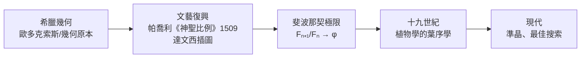
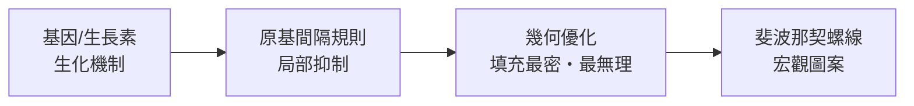

# 9.2 斐波那契數列與黃金分割率：植物排列的數學優化

## 商人筆記本裡的兔子

1202 年，比薩的**斐波那契**（Leonardo of Pisa）出版《計算之書》（Liber Abaci）。這本書的歷史意義遠大於兔子問題：

- **它是把印度—阿拉伯數碼與位值記數法引進歐洲的關鍵文本**。斐波那契的父親是比薩駐北非布吉亞（今阿爾及利亞）的海關官員——地中海貿易網絡培養出來的「跨文化數學家」。他明說：用羅馬數字做商業計算是災難，阿拉伯數碼是商人的競爭優勢
- 佛羅倫斯 1299 年一度**禁止**阿拉伯數碼記帳（怕偽造：1 改成 7 太容易）——技術採納的社會阻力；最終複式簿記（帕喬利 1494）＋阿拉伯數碼成為資本主義的記帳標準

「兔子問題」只是書中一道習題：一對兔子每月生一對新兔，新兔一個月後成熟，問一年幾對？答案是**斐波那契數列**：

$$1, 1, 2, 3, 5, 8, 13, 21, 34, 55, \dots \qquad F_n = F_{n-1} + F_{n-2}$$

## 黃金比例：從文藝復興到極限

相鄰兩項之比 $F_{n+1}/F_n$ 收斂到 $\varphi = \frac{1+\sqrt{5}}{2} \approx 1.618$——黃金比例，滿足 $\varphi^2 = \varphi + 1$。

歷史澄清（戳破流行迷思）：帕德嫩神殿、金字塔「依黃金比例設計」的說法多數缺乏原始文獻支持；「黃金比例=最美」的心理實驗（Fechner 1876）結果其實模糊。**真正堅實的黃金比例出現在兩處：純數學（連分數、極限）與植物學的葉序**——後者有機制、有數據、有理論，才是本節主題。

## 葉序（Phyllotaxis）：植物是解優化問題的工程師

觀察向日葵：籽粒排成 **21 與 34**（或 34 與 55）兩組反向螺線——相鄰斐波那契數！松果 8 與 13，鳳梨 8、13、21。為什麼？

**最佳填充問題**：新原基（籽粒、葉、花瓣的始端）在生長尖出現時，會盡量遠離既有原基（避免遮擋與資源競爭）。數學模型（Douady & Couder 1992 的動力學實驗：磁化液滴在鐵盤上自我組織）顯示：

> 「每個新元素以**黃金角** $137.5°$（$= 360°(1 - 1/\varphi) \approx 360° \times 0.382$）繞軸錯開」是唯一能**高效填充圓盤且對生長速率穩健**的排布。

為什麼偏偏是黃金角？因為 $\varphi$ 是**「最無理」的數**（連分數全是 1：$\varphi = [1; 1, 1, 1, \dots]$）——它的有理逼近最差，旋轉角用它不會與週期同步而留下空隙。**植物在用連分數論做晶片佈局。**

定量驗證：向日葵的第 $n$ 粒籽位置（Vogel 模型）：

$$r_n = c\sqrt{n}, \qquad \theta_n = n \times 137.5°$$

產生的螺線族數目正是相鄰斐波那契數（與 $\varphi$ 的連分數收斂子 $\frac{F_{n+1}}{F_n}$ 對應）。

## 數學與演化的分工

重點：**植物沒有「想要」斐波那契數**——它是簡單局部規則（新芽離舊芽最遠）在生長幾何上的必然輸出。這是「湧現」（emergence）的教科書案例：全局圖案 = 局部規則 × 幾何約束。同樣的邏輯將在第 10 章（混沌）與 11 章（群體行為）反覆出現。

## 斐波那契數的連鎖應用

| 領域 | 應用 |
|------|------|
| 演算法 | 斐波那契堆（Dijkstra 最短路徑的最快實作之一）；斐波那契搜尋 |
| 組合學 | $F_n$ = 不含相鄰 1 的位元串數；括號匹配；歐幾里得演算法最壞情況（Lamé 1845——演算法分析史的早期里程碑） |
| 建築與設計 | 模數系統（柯比意以人體+φ 建立設計格網——設計界的標準化運動） |
| 金融 | 「斐波那契回撤」技術分析——**實證上近乎占星**，但作為自證預言（太多交易者看同一條線）有微妙的社會學趣味 |
| 準晶 | 2011 年諾貝爾化學獎（Shechtman, 1982 發現準晶）——五重對稱與黃金比例的三維版；她因「違反晶體學教科書」被逐出實驗室，兩年後被證明是對的 |

## 本章小結：兩條「美」的路線

- **分形**（9.1）：粗糙、無標度、遞歸——自然形態的幾何
- **黃金比例**（9.2）：最優填充、最無理——自然排列的優化解

兩者共同的深層訊息：**自然的「美」不是審美偏好的投射，而是簡單規則在大尺度上的表現。** 而當規則是「非線性回饋」時，表現可以變得完全不可預測——這就是下一章的混沌。

---
[下一節：10.1 洛倫茲吸引子](10.1-洛倫茲吸引子.md)
