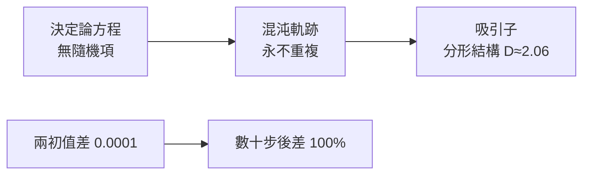

# 10.1 洛倫茲吸引子：看似隨機中的隱藏軌跡

## 氣象預報的世紀難題

天氣預報是人類最古老的數學願望之一（巴比倫占星、中國二十四節氣都是它的史前史）。但科學的突破來自兩次戰爭：

- **第一次世界大戰**：挪威學派（皮葉克尼斯 Bjerknes）建立流體力學式天氣預報理論——用手算未來 6 小時的天氣花了幾週，毫無實用價值
- **第二次世界大戰**：理查森（Lewis Fry Richardson）戰後 1922 年設想「十萬人算天氣」的數值預報工廠（幽默地想像：劇院裡坐滿算手，指揮像樂團指揮一樣協調計算）——**三十年後，這個工廠變成了電腦**

**ENIAC（1945）的公開揭幕任務之一就是 24 小時天氣預報**（Charney、馮紐曼團隊，1950）。數值預報成為可能後，新問題隨之而來：預報為什麼總在幾天後失效？

## 1961 年：小數點第四位的叛變

氣象學家洛倫茲（Edward Lorenz，MIT）用 12 個變數的簡化大氣模型做數值實驗。1961 年的一天，他想重跑一段模擬，為省時間直接從印表機輸出的**中間值**（三位小數）接續計算，而非機器內部的完整精度（六位小數）。

結果：兩條軌跡迅速分道揚鑣，最後毫無相似之處。

他的反應是科學史的名場面——先懷疑機器故障，排除後寫下結論：

> 「兩個相差無幾的初值，最終會演變成截然不同的狀態。任何預報系統若測不準初值，預報必然失敗。」

1963 年他發表〈決定性的非週期流〉；1972 年在 AAAS 演講定下科普史最成功的標題：**「巴西的蝴蝶拍翅膀，會在德克薩斯引發龍捲風嗎？」**——「蝴蝶效應」從此進入人類語言。

## 洛倫茲方程：三條方程的無窮深度

他後來把模型縮減到只剩三個變數（對流層的溫度與流速）：

$$\dot{x} = \sigma(y - x), \qquad \dot{y} = x(\rho - z) - y, \qquad \dot{z} = xy - \beta z$$

典型參數：$\sigma = 10$，$\rho = 28$，$\beta = 8/3$。

僅僅三個變數、兩個二次項——**沒有任何隨機項**，方程完全決定論——但軌跡永不重複、永不在穩定點停留，而是在相空間中畫出一個「雙翼蝴蝶」形狀，繞左翼幾圈後跳到右翼，再跳回來，圈數永遠不同。

## 「吸引子」：看似隨機中的隱藏秩序

這個集合被稱為**奇異吸引子**（strange attractor）。三個關鍵性質：

1. **吸引**：從附近任何初值出發，軌跡都會被吸到這個集合上——長期行為不是四散，而是**有形狀**
2. **奇異**：集合是**分形**（維度 $\approx 2.06$，豪斯多夫維度，接上 9.1）——無限細節、非整數維
3. **不可重複**：軌跡不封閉、不週期

**決定論 ≠ 可預測性。** 這句話顛覆了拉普拉斯的決定論宇宙觀（1814：知道所有粒子位置與動量即可預知未來）——不是因為量子力學，而是因為**決定論的經典方程本身就可能不可預測**。哲學史意義深遠：機率不再需要「真正的隨機性」作為前提，**混沌提供了「決定論底層 + 統計現象層」的完整解釋**。

## 前史：龐加萊 1890 年的先行者

洛倫茲的發現有半世紀的前史。1880s，瑞典國王奧斯卡二世懸賞「三體問題是否可解」（這本身就是**國際科學競賽制度**的範例）。龐加萊參賽，起初提交了「可解」的論文；校對中發現錯誤，推翻自己後寫出：

> 「即使初始差異小到無法察覺，後果的差異也可能大到無法預測。預測變成不可能。」

龐加萊被迫重寫論文（自付印刷費超過獎金！），過程中發明了**動力系統定性理論**（相空間、同宿軌道）——混沌理論的全部數學地基。又是一次「重寫的論文創造了新數學」。

但龐加萊的洞見沒有傳播開——因為沒有電腦畫不出軌跡圖，**視覺化的缺席延遲了科學半世紀**。這個教訓常被低估：**新儀器（包括圖像技術）決定新科學的可見性。**

## 混沌時代的制度史

- 1970s：費根鮑姆（Feigenbaum，洛斯阿拉莫斯）發現倍週期分岔的普適常數 $\delta \approx 4.6692$——用**可程式計算器**算出來的
- 1975：李天岩與約克（Yorke）在《美國數學月刊》發表〈週期三意味著混沌〉——「混沌」（chaos）一詞進入科學詞彙；選低階期刊是刻意的：要讓非數學家也讀到
- 1978–86：聖塔菲研究所（Santa Fe Institute, 1984）成立——**跨學科複雜系統研究的第一個制度化平台**（由洛斯阿拉莫斯科學家創立，部分資金來自花旗銀行董事長——金融業對非線性的興趣不意外，見 7.2）
- 混沌進入應用：心律不整分析（健康心跳其實有輕度混沌，過於規律反而是病）、加密、天氣集合預報（現代數值預報已內建「跑 50 個微擾初值」——蝴蝶效應成為標準作業程序）、衛星軌道設計（混沌三體軌道「低能量轉移」被用於太陽系任務節省燃料，如 Genesis 任務）

## 小結

| 概念 | 內容 | 歷史角色 |
|------|------|---------|
| 蝴蝶效應 | 初值敏感依賴 | 天氣預報、ENIAC |
| 洛倫茲吸引子 | 決定論混沌 + 分形 | 打破拉普拉斯宇宙觀 |
| 龐加萊 | 三體問題定性理論 | 1890s 的先知 |
| 1980s 制度化 | SFI、跨學科 | 複雜科學成為領域 |

---
[下一節：10.2 微小的初值差異如何引發巨變](10.2-微小的初值差異如何引發巨變.md)
