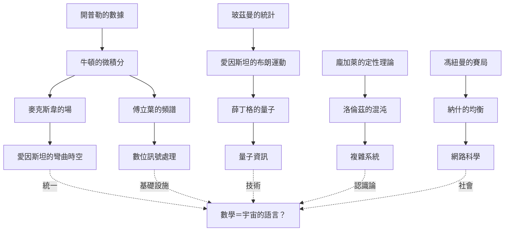

# 後記：數學是人類發明的，還是被發現的？

## 走完全書之後，回到最初的問題

自序裡我們引用了維格納的困惑——數學在自然科學中「不合理」的有效性。現在你已經走過十一個章節的證據，可以更認真地面對這個問題了。

## 先清點證據

本書反覆出現的劇本是：**數學搶跑，物理提貨。**

- 圓錐曲線：古希臘玩物 → 行星軌道（等了 1800 年）
- 虛數：代數的「不可能」→ 電機工程與量子力學的必需品（等了 380 年）
- 非歐幾何：哲學異端 → 彎曲時空（等了 60 年）
- 矩陣：凱萊的「無用遊戲」→ 原子世界（等了 67 年）
- 傅立葉變換：熱傳導 → MP3、MRI、5G（等了 150 年）
- 張量、李群、纖維叢：純數學 → 粒子物理標準模型（持續兌現中）
- 貝爾不等式：形上學爭論 → 諾貝爾獎級的實驗科學

如果數學只是人類的發明，為什麼宇宙似乎「早就在等」這些發明？

## 三種立場

### 立場一：柏拉圖主義——數學是被發現的

數學對象存在於某種永恆的抽象領域，數學家像天文學家一樣探索它。支持證據：數學的**不可否認的偶然發現**（高斯的 FFT 預先寫於 1805）、數學結構之間**意外的深層聯繫**（蒙特哥梅里對：隨機矩陣的特徵值分布與黎曼 zeta 零點分布——兩個毫無關係的領域給出同一條曲線）。

但柏拉圖主義有個尷尬：這個領域「在哪裡」？一個不佔時空、不作用於物質的實在，憑什麼存在？

### 立場二：形式主義／建構論——數學是被發明的

數學是人造的符號遊戲，公理由人選擇（非歐幾何已證明公理可以替換）。支持證據：數學確實隨文化變遷（巴比倫的 60 進位、中國的算籌、負數在歐洲被抵制數百年）。

但建構論難以解釋**收斂性**：完全不同文明的數學（希臘演繹、中國算學、印度代數）殊途同歸地抵達同一批真理（畢氏定理的三種文化版本），並且**都能預測物理**。發明的東西為什麼會與宇宙咬合？

### 立場三：演化的中間路線

本書的歷史敘事暗示第三種可能：**數學是演化出來的適應性器官，它被「設計」來捕捉世界的規律性——所以它有效並不神秘，神秘的只是世界本身竟有這麼深的規律。**

- 人腦在環境選擇壓力下發展出數感、空間直覺、模式識別（認知考古學：數概念出現於所有文化，幾何直覺出現於嬰兒）
- 數學是這些直覺的文化放大器（符號系統 = 智力的義肢）
- **但世界必須真的有可捕捉的規律**——若宇宙是純粹混沌，任何數學都無用武之地。愛因斯坦的名言在此反轉出新的意義：

> 「世界最不可理解之處，就是它竟然可以理解。」

## 制度的影子：誰決定了數學長什麼樣

走過十一章，你還應該帶走一個較少被討論的觀察：**數學不只是真理的堆積，更是制度的產物。**

| 制度力量 | 對數學的塑造 |
|---------|------------|
| 贊助者 | 教會（曆法）、王室（第谷的島）、軍方（ENIAC、RAND）、企業（IBM、貝爾實驗室）、電信資本（電報→電磁學） |
| 大學制度 | 德國研討班（量子力學）、無薪講師（黎曼的掙扎）、終身教職與其保守傾向 |
| 出版與競賽 | 期刊挑戰（最速降線）、諾貝爾獎（優先權政治）、預印本（arXiv 的開放科學） |
| 戰爭與地緣 | 微積分記號的民族之爭、納粹流亡潮、冷戰的資助結構、今日的量子競賽 |
| 歧視的代價 | 諾特、米德、孟德爾式被延遲的天才——科學共同體的篩選機制並非完美 |

**數學的「不合理的有效性」，一半是宇宙的慷慨，一半是人類制度的篩選。** 我們只記得成功的數學——那些沒能描述任何物理的優美理論（可積分系統、高維拓撲的諸多結果）安靜地躺在圖書館裡，構成「有效數學」背後巨大的沉默基座。倖存者偏差在數學史上一樣存在。

## 給學習者：三個可操作的結論

**1. 學公式，更要學公式的「問世方式」。** 每條公式都是對某個時代具體問題的回答。回到問題，公式才有意義——這是本書的寫法，也是你自學的最好方法。

**2. 尊重「無用」的數學。** 當你不知道複數、矩陣、傅立葉級數有什麼用時，記住它們的先例：全部「無用」過幾十年到幾千年。基礎數學是一張超長期的選擇權。

**3. 警惕單一敘事。** 天才敘事（牛頓的蘋果）掩蓋了數據工人（第谷的助理們）、制度資本（IBM 的研究自由）與社會需求（電報帝國）。**科學是社會的器官，社會也是科學的器官。**

## 終點，或起點

伽利略說數學是宇宙的語言。但本書的旅程顯示了更豐富的圖像：

> 數學是人類與宇宙之間一場持續四千年的對話——宇宙出題，人類發明詞彙，制度決定哪些詞彙能存活，而倖存的詞彙反過來重塑了人類的社會、經濟與自我理解。

這場對話遠未結束。量子計算的線性代數、機器學習的高維幾何、氣候系統的非線性動力學、金融網路的傳染模型——你手中的每一個新問題，都可能需要還未被發明的數學，或者，只是需要你重新翻開某本舊書，讀懂某個等待了兩百年的公式。

宇宙已經寫好了題目。剩下的，是我們的詞彙量。

---

**（全書完）**

---

## 附：全書思想路線圖

