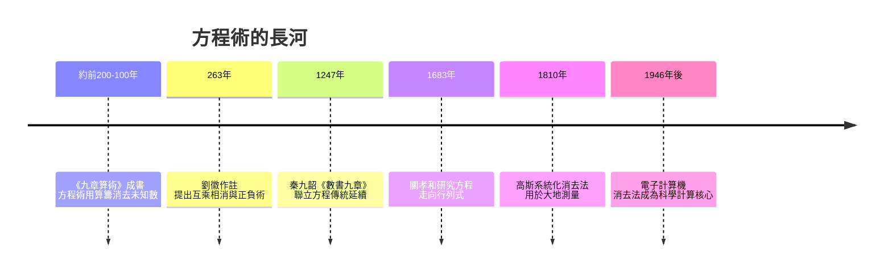

# 1.1 兩千年前的消去法：《九章算術》的方程術

## 一道漢代的應用題

《九章算術》第八章「方程」的第一題，今天讀來像一份物價表：

> 今有上禾三秉，中禾二秉，下禾一秉，實三十九斗；上禾二秉，中禾三秉，下禾一秉，實三十四斗；上禾一秉，中禾二秉，下禾三秉，實二十六斗。問上、中、下禾實一秉各幾何？

翻譯成現代語言：上等禾三捆加中等禾二捆加下等禾一捆，共得糧三十九斗，等等。設上、中、下禾每捆各產 $x, y, z$ 斗，就是三元一次聯立方程組：

$$\begin{cases} 3x + 2y + z = 39 \\ 2x + 3y + z = 34 \\ x + 2y + 3z = 26 \end{cases}$$

漢代官吏怎麼解？書中寫道：「置上禾三秉，中禾二秉，下禾一秉，實三十九斗，於右方。」——把係數排成長方形的三行數表。這正是矩陣的列。接著用「偏乘」「直除」：某行乘一個數，再逐項從另一行減去，消掉其中一個未知數。

這就是高斯消去法的完整程序——比高斯早了將近兩千年。

## 為什麼是中國？

方程術不是純思維的產物，而是國家治理的工具。秦漢帝國的規模史無前例：數千萬人口、統一的貨幣與度量衡、以糧穀實物計算的賦稅體系。中央政府每年要處理的，正是「上等田若干畝收若干、調撥若干、剩餘若干」這類線性關係。

《九章算術》的編纂者很可能就是政府的計算官員。全書九章——方田、粟米、衰分、少廣、商功、均輸、盈不足、方程、勾股——幾乎每一章都對應一項行政與工程事務：土地丈量、糧食換算、勞役分攤、築城造渠。數學在這裡從誕生起就是官僚技術，而聯立方程，正是「多個約束同時成立」這種治理問題的數學化身。

## 劉徽的註解：看不見的證明傳統

西元 263 年，魏國數學家劉徽為《九章算術》作註。他不滿足於背誦算法，而是追問「為什麼這樣做是對的」。他解釋「直除」的道理時說：

> 「舉率以減數，損益數少，而所得數多。」

並提出「互乘相消」——兩行交叉相乘再相減，可以避免分數。這其實是把消去法推向更接近現代教科書的形式。劉徽甚至討論了方程組的「正負術」，明確定義正負數的加減法則，比歐洲接受負數早了一千多年。

可惜的是，中國數學後來沒有發展出符號代數。方程術始終停留在具體數字的演算法層面——它是一門「術」，而不是一門「理」。這是制度環境的結果：官僚體系需要的是能用的程序，而非抽象結構。

## 東西方的匯流

《九章算術》經朝鮮、日本傳入東亞數學圈。日本江戶時代的和算家深研「方程」，催生了 1.2 節的主角關孝和。而在西方，消去法要到十八世紀才由歐拉、克拉默等人逐步發展，高斯在十九世紀初把它系統化。

兩千年前，一位漢代小吏在算板上擺出三行數字，逐行相消。他做的事，與今天超級電腦解百萬階方程組的核心演算法，在本質上完全相同。數學觀念可以跨越文明的時間，等待技術條件成熟的那一天。

## 歷史迴響

下一章我們會看到：行列式——這個被法國數學家視為歐洲發明的工具——其實在東亞的方程術傳統裡早有萌芽。而「把係數排成表、按規則操作」這個想法，最終成長為整個矩陣理論。
