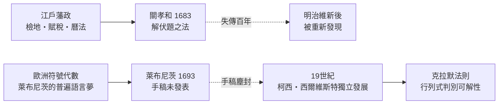

# 1.2 關孝和與萊布尼茨：行列式在東西兩端同時出生

## 兩份互不相識的筆記

1683 年，日本江戶。和算大師關孝和在《解伏題之法》中，為了解高次聯立方程，寫下了一個規則：把係數排成方陣，按「交叉相乘再相減」的方式組合，可以判斷方程組何時有解。他已經掌握了四階、五階行列式的計算法則。

1693 年，德國。萊布尼茨在給洛必達的信中，用同樣的思路處理三個未知數兩個方程的方程組：他寫下係數的「交叉乘積之和」，並用不同的字母標記行與列，指出這個量不為零時方程組才可能相容。

兩人相隔萬里、互不知道對方，卻在十年之內發明了同一個觀念。這在數學史上並非孤例——牛頓與萊布尼茨的微積分之爭更為人熟知——但這一次沒有爭執，因為關孝和的工作根本沒有傳到歐洲，直到明治維新之後才被重新發現。

## 為什麼江戶的日本會長出行列式？

答案藏在制度裡。德川幕府統一日本後，實行石高制——以稻米產量衡量領地與賦稅。各地藩政需要精確的土地測量（檢地）、複雜的換算與分配計算。測量產生了幾何，賦稅與曆法產生了代數。

和算的傳播方式也很特別：沒有官方學校，靠「家元制度」傳承，弟子拜師、發表「算額」（繪有數學題的木匾）掛在神社，向天下挑戰。這是一種競爭性的數學文化，類似今天的黑客松。關孝和出身於甲府藩的納戶役（管賬的官職），他的數學直接服務於藩政計算。

## 萊布尼茨為什麼沒有成功？

萊布尼茨看得更遠。他不只想要一個計算數值，他想要一種「語言」：用行列式的行、列標記，機械化地寫出消去的結果。他稱之為一種一般性的代數技巧，夢想它能處理「一個方程組何時相容」的普遍問題。

但萊布尼茨把這些筆記留在手稿裡，沒有發表。十八世紀的歐洲數學界靠期刊與書信網路運轉，未發表等於不存在。直到 1850 年前後，數學史家才從手稿中挖出這些想法——那時「determinant」這個詞已經由高斯引入、柯西發揚、西爾維斯特命名，歐洲傳統早已獨立長成。

## 從消去法到克拉默法則

行列式真正的舞台，是聯立方程的「公式化解法」。1750 年，瑞士數學家克拉默發表了以他命名的法則：

$$x = \frac{D_x}{D}, \quad y = \frac{D_y}{D}, \quad z = \frac{D_z}{D}$$

其中 $D$ 是係數行列式，$D_x$ 是把常數列換到第一列後的行列式。行列式不為零，方程組才有唯一解——這是「可逆性」的第一次現身，雖然當時還沒有矩陣，也沒有人這樣理解它。

克拉默法則優美但昂貴：解 $n$ 個未知數要算 $n+1$ 個行列式，計算量隨 $n$ 爆炸式增長。這預示了線性代數此後三百年的主旋律——觀念上的工具是否「算得起」，由經濟與技術條件決定。十九世紀的數學家算五階行列式要花一下午；二十世紀的電腦則宣告：克拉默法則永遠敵不過消去法。

## 關孝和的遺產

關孝和晚年雙目近乎失明，仍口述研究讓弟子記錄。他的學派（最上流）在日本延續數代，發展出圓理（早期微積分思想）、行列式、牛頓迭代法等成果。1868 年明治維新，日本全面轉向西方數學，和算在一代人之內幾乎消失。直到二十世紀，數學史家確認：《解伏題之法》比歐洲任何公開發表的行列式理論都早。

## 歷史迴響

行列式誕生於「方程組何時有解」的問題，但它只是序曲。真正的主角——把係數表本身當作運算對象——要等到高斯的測量王國與凱萊的抽象代數才登場。
