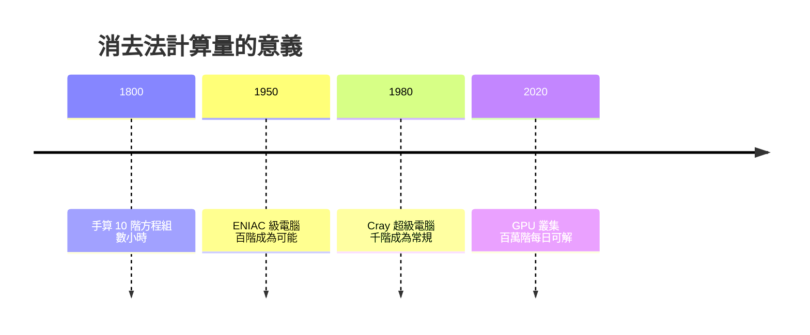

# 2.1 高斯消去法：從漢諾威大地測量到今天的超級電腦

## 一項國家工程

1818 年，漢諾威王國啟動一項浩大工程：用三角測量法繪製全境精確地圖。主持者是哥廷根大學教授卡爾·弗里德里希·高斯——當時歐洲最負盛名的數學家。他親自到荒野中操作經緯儀，在風雨與蚊蟲中度過多個夏天，測量了數千個三角點。

三角測量的數學本質是：測得大量三角形的角度與一條基線，要推出所有點的座標。但每一次觀測都有誤差，方程的數量遠多於未知數——這是「超定方程組」，不可能完美滿足。怎麼辦？

高斯的答案是兩件武器的合體：最小平方法（找出誤差平方和最小的解）與正規方程的消去法。觀測方程 $Ax \approx b$ 化為正規方程 $A^T A x = A^T b$，再用系統化的消去程序解出。這套程序在 1810 年前後的論文中已成體系，後世稱之為「高斯消去法」。

## 消去法的三個源頭

有趣的是，高斯自己不認為這是「新發明」：

- 中國的《九章算術》在兩千年前就有了「直除」；
- 牛頓在 1670 年的手稿中為解三個未知數寫過同樣的消去程序；
- 高斯在 1798 年計算穀神星（Ceres）軌道時，用的正是對稱化簡，並在 1809-1826 年間引入了「逐次消去、回代」的標準結構。

高斯的貢獻不在「發明」，而在三件事：把它變成可規模化的計算流程；證明最小平方解的統計最優性（誤差服從常態分布——所以常態分布又叫高斯分布）；以及發明「對稱化簡」等減少計算量的技巧。這最後一點是革命性的：他是第一個關心「算法效率」的數學家，計算量第一次成為數學研究的對象。

## 誤差理論：測量帝國的科學基礎

大地測量逼出了另一個深遠的觀念。高斯發現，把多餘的觀測組合起來，可以比任何單獨觀測更精確——誤差會互相抵消。他證明了最小平方估計在常態誤差下是「最優」的（後來馬爾可夫與高馬克洛夫定理加以推廣）。

這套誤差理論立刻成為十九世紀科學的制度基石：天文台、地質調查所、統計局都用它處理數據。比利時天文學家凱特勒更把它應用到人的身高、犯罪率上，開創了社會統計學。今天經濟學的迴歸分析、機器學習的最小平方法，血統都來自漢諾威的荒野測量。

## 從三角點到超級電腦

高斯消去法在電腦時代煥發新生。二十世紀四十年代末，馮紐曼與戈德斯坦分析了 $n$ 階方程組的消去法計算量——約 $\frac{2}{3}n^3$ 次浮點運算——並第一次嚴肅討論了機器計算的捨入誤差是否會毀掉結果。1951 年，馮紐曼團隊證明：對稱正定矩陣的消去法是數值穩定的。這是「數值線性代數」作為一門學科的起點。

今天，世界上最大型的科學計算——氣候模擬、飛機氣動力、核融合電漿、地震波反演——核心循環仍然是某種形式的消去法或其變形（LU 分解、Cholesky 分解、共軛梯度法）。全球超級電腦排行榜的跑分程式 Linpack，解的就是一個巨大的稠密線性方程組。

## 歷史迴響

高斯消去法是「觀念先行、需求催熟」的典範：演算法兩千年前的中國已有，但只有當民族國家需要精確地圖、而誤差理論需要數學基礎時，它才被鍛造成一門計算的科學。而高斯解方程時排出的係數表，即將在凱萊手中獲得自己的生命。
