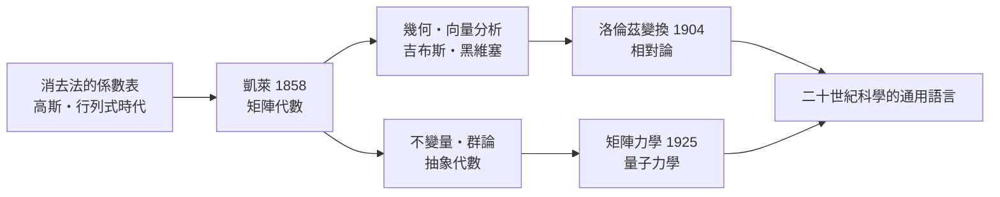

# 2.2 凱萊與矩陣代數：「毫無用處」的數學如何統治世界

## 一位律師的數學人生

亞瑟·凱萊（Arthur Cayley, 1821–1895）的人生路線在當時相當特別：劍橋數學榮譽學位後，因為大學職位稀缺（且要求擔任聖職），他做了十四年倫敦律師。這十四年他寫了兩三百篇論文——數學史上最高產的「兼職」之一。1863 年他終於回到劍橋，成為新建的 Sadleirian 純數學講座教授。

1858 年，凱萊發表了〈矩陣理論備忘錄〉（A Memoir on the Theory of Matrices）。這篇論文做了一件當時看來幾乎無意義的事：把高斯、艾森斯坦等人用來輔助消去的「係數方陣」本身當成研究對象，定義矩陣的加法、數乘、乘法，並研究它們的代數性質。

## 定義「乘法」的勇氣

矩陣加法毫無驚奇：對應元素相加。但乘法呢？凱萊的定義來自他想表示「線性變換的複合」：先做變換 $B$ 再做 $A$，等價於一個新變換，其係數是

$$(AB)_{ij} = \sum_k A_{ik} B_{kj}$$

這個「行乘列」的規則違反了兩個代數常識：$AB \neq BA$（不交換），以及兩個非零矩陣可以乘出零矩陣。當時的代數學家認為這種東西「不是真正的數」。凱萊的名言（出自論文中）是矩陣理論

> 「就其本身而言，乍看之下毫無用處。」

（"which, as it seems to me, should occupy a prominent place..."; 後人常轉述他說矩陣「毫無用處」——他的原意是：這套理論不依附於任何具體問題，自成體系。）

他隨手證明了經典的凱萊—哈密頓定理：每個矩陣滿足自己的特徵多項式。證明只對二階與三階做了驗證，一般情形留給了未來。

## 為什麼當時「毫無用處」？

因為十九世紀中葉，沒有一門科學需要抽象變換的代數。力學處理的是具體的座標；行列式已經夠用；群論剛在方程論中萌芽。凱萊的矩陣是純粹的抽象建構——就像先造好港灣，等船來。

船來得比誰預想的都快：

- 1880 年代，吉布斯與黑維塞的向量分析興起，向量的線性變換用矩陣表示最自然；
- 1904 年，洛倫茲為解釋光速不變寫下時空座標變換——正是矩陣；
- 1925 年，海森堡、玻恩與約當發現量子力學的觀測量不交換——玻恩驚呼：「這是矩陣！」（海森堡當時根本不知道矩陣為何物，玻恩是少數讀過凱萊的人）；
- 二十世紀中葉以後，數值分析、統計學、圖論、經濟學的投入產出模型（里昂惕夫，1973 年諾貝爾經濟學獎）全部以矩陣為語言。

## 群、抽象代數與教育的轉向

凱萊同時是抽象群論的奠基者之一（1854 年的群論論文）。他與西爾維斯特的友誼是數學史佳話：兩位「律師數學家」在倫敦合租公寓、在咖啡館討論不變量理論。不變量理論——研究代數形式在座標變換下不變的性質——正是「變換」成為數學主角的溫床。

到了 1930 年代，范德瓦登的《近世代數》把凱萊式的抽象結構寫進教科書，布爾巴基學派把它推向極致。線性代數從「解方程的技術」變成「研究向量空間與線性映射的理論」，大學課程的形態由此定型。

## 歷史迴響

凱萊展示了純數學最深刻的一種力量：它不問「有什麼用」，只問「結構是什麼」。但抽象代數的勝利並非一帆風順——就在凱萊寫矩陣備忘錄的同一時代，兩位真正的大師因為思想太超前，幾乎被自己的時代完全埋沒。下一章講他們的故事。
