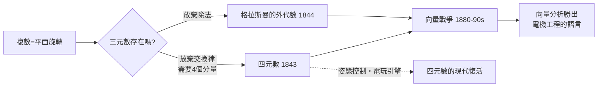

# 3.1 哈密頓的挫敗：四元數、橋上的刻字與向量的前身

## 三百年的執念

複數 $a + bi$ 可以表示平面上「旋轉加伸縮」。自十八世紀末韋塞爾、阿爾岡、高斯賦予複數幾何意義之後，一個自然的問題浮現：三維空間裡的旋轉，能不能也有一個「三元數」來表示？

這個問題折磨了數學家幾十年。哈密頓（William Rowan Hamilton, 1805–1865）——愛爾蘭的神童、都柏林三一學院的皇家天文學家——為它耗費了十餘年。他叫兒子每天早餐問他一句：「爸爸，你會乘三元數了嗎？」每天他都只能回答：「還不行。」

困難在哪裡？如果三元數 $a + bi + cj$ 存在，取平方會出現 $i^2 = j^2 = -1$，但交叉項 $ij$ 無處安放。哈密頓起初堅信 $ij = ji$——交換律是自古以來「理所當然」的代數公理。

## 橋上的那一刀

1843 年 10 月 16 日，哈密頓沿著都柏林皇家運河散步，走向皇家愛爾蘭學院主持會議。行至布魯姆橋（Broom Bridge），靈光乍現：必須放棄交換律，並且需要第四個分量。他當場用小刀在橋石上刻下：

$$i^2 = j^2 = k^2 = ijk = -1$$

由此推出 $ij = k$，$ji = -k$。四元數（quaternion）誕生了。他後來說這一刻「感覺到電路接通，火花迸出」。那塊橋石至今保存，每年有數學家去朝聖。哈密頓餘生都投入四元數：他相信它是空間物理學的終極代數，寫下了七百多頁的巨著《四元數原理》。

## 為什麼四元數輸了？

四元數確實好用：一個四元數可以優雅地表示三維旋轉，避免萬向鎖問題，今天太空飛行器的姿態控制、電動遊戲引擎裡仍用它。但在十九世紀後半，它敗給了更簡單的競爭者——向量。

美國的吉布斯與英國的黑維塞各自獨立發展出向量分析：把四元數拆開，只留「向量部分」，內積與外積就夠描述電磁學（麥克斯韋方程組用向量形式一頁寫完）。1880–90 年代爆發了著名的「向量戰爭」：四元數學派（以泰特為首）與向量學派在期刊上筆戰多年。結果向量分析大獲全勝——因為電機工程正在爆炸式成長，工程師需要的是能直接寫進黑板的計算工具，而不是更深的代數結構。

歷史的諷刺在於：四元數並非錯誤。它是最早的非交換除法代數；它的純虛部分就是三維向量；外積 $ijk$ 的結構今天以「叉積的三重性」與泡利矩陣的形式活在量子力學中。哈密頓刻在橋上的公式，是現代代數放棄交換律的第一步——那一步在當時看來是失敗，其實是革命。

## 教育制度的迴響

哈密頓的一生也折射出十九世紀科學制度的變遷。他二十二歲還沒畢業就被任命為天文學家（靠的是一篇幾何光學論文），終身在鄧辛克天文台任職，但天文觀測一塌糊塗，兩個助手讓他「成了全歐洲唯一可以名正言順不做觀測的天文學家」。他的例子後來成為論證「應設立純研究職位」的經典案例——劍橋後來為凱萊設立純數學講座，正是這種制度反思的結果。

## 歷史迴響

哈密頓的挫敗教給我們：數學的勝負常常不取決於深刻與否，而取決於哪個觀念恰好搭上了時代需要的技術列車。而那位真正先想清楚「向量空間」的人，比哈密頓更悲慘——他連被反駁的資格都沒有。
