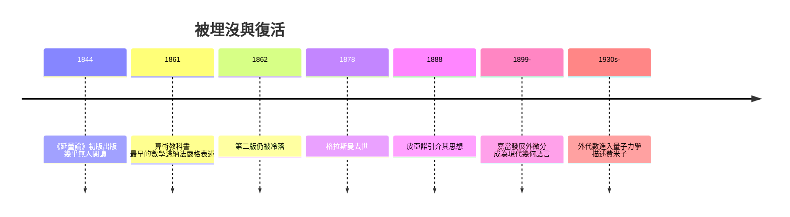

# 3.2 格拉斯曼的一生：中學教師與被冷落五十年的向量空間

## 一本無人問津的巨著

1844 年，波美拉尼亞小鎮什切青（今屬波蘭）的中學教師赫爾曼·格拉斯曼出版了一本書：《線性延量論》（Die lineale Ausdehnungslehre）。書中，他一次性地建立了現代線性代數的幾乎全部基礎：向量空間、線性無關、基底、維度、子空間、線性映射，以及外積與外代數。

今天任何一本線性代數教科書的目錄，幾乎都能在這本書裡找到雛形。當年的銷量呢？據說幾乎一本都沒賣出去。出版社後來甚至提醒他：庫存滯銷，要用廢紙作價抵帳。

## 為什麼世界沒有接住他？

三個原因疊加，造成數學史上最徹底的埋沒。

第一，語言與風格。格拉斯曼是哲學化的寫法，大量自創術語（他的「延量」、各種生造詞），沒有例題、沒有應用、沒有具體數字。當時德國數學界的主流品味是具體的計算與公式。

第二，出身與位置。格拉斯曼不是大學教授，而是中學教師，一生未獲大學教職。他曾申請大學職位，評審者承認他「在數學上有貢獻」，但仍以資歷不符回絕。十九世紀德國學術體系的等級制度，沒有給體制外的人留下通道。

第三，時機。他的核心觀念——「先定義抽象的公理結構，再研究其上的一般定理」——在 1844 年太超前。要到凱萊的矩陣代數、戴德金的理想論、乃至希尔伯特的公理化綱領之後，這種思維才成為常態。

## 挫折中的堅持

格拉斯曼沒有放棄。1861 年，他出版了《算術教科書》，用嚴格的公理方式重建算術與線性代數，甚至給出了數學史上最早的數學歸納法的精確表述之一。這本為中學教學寫的書，同樣無人理解。1862 年他推出大幅改寫、更具計算風格的《延量論》第二版——依然被冷落。

他的數學生涯的轉折點來自意想不到的人。1853 年他寫了一篇關於混合色的論文（格拉斯曼顏色混合定律，今天仍是色度學基礎）；1860 年代，克萊布什讀到他的外代數，驚為天人，大力推介；1871 年他終於獲選萊布尼茲學會（哥廷根科學院）通訊會員——但僅限於「申請教授職位被拒」的身分。1877 年，他病逝前不久還在為《延量論》第二版寫序言。墨比烏斯在給他的信中承認：「我必須承認，長期以來我沒有能力理解你的思想。」

## 死後的復活

格拉斯曼思想的全面復活發生在二十世紀，而且改變了兩門最深的學問：

- 皮亞諾在 1888 年《幾何演算》中首次系統地向世界介紹格拉斯曼的向量空間觀念，並在 1890 年構造出著名的「皮亞諾曲線」（填滿正方形的連續曲線）——靈感正是格拉斯曼式的一般空間概念。
- 嘉當的外微分形式把外代數變成微分幾何的標準語言，廣義相對論與規範場論的數學框架都建立其上。
- 量子力學裡，費米子的多粒子態必須用外代數（反對稱張量積）描述；超對稱理論的「超數」直接採用格拉斯曼變數。

一個中學教師在孤獨中寫下的符號系統，最終成為描述基本粒子的語言。

## 歷史迴響

哈密頓輸給了時代，格拉斯曼被時代直接無視。兩人的對照說明：科學共同體的承認機制——期刊、大學職位、學派、語言風格——與觀念本身的價值是兩回事。下一章，我們看「向量」的觀念如何在無窮維度上獲得最壯麗的應用。
