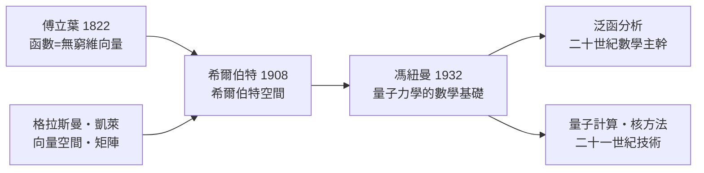

# 4.2 希爾伯特空間與量子力學：當物理住進無窮維

## 哥廷根的公理化者

大衛·希爾伯特（David Hilbert, 1862–1943）在二十世紀初推動了一個綱領：把數學的各個領域公理化。1904–1910 年間，他轉向積分方程——當時處理連續介質振動（弦、膜、彈性體）的核心課題。他發現，把積分方程看成「無窮階的線性方程組」，把函數看成無窮維向量，整個理論就清晰起來。

1908 年前後，他系統地研究了這種空間：元素是平方可積函數 $\int |f|^2 dx < \infty$，內積是 $\int f g\, dx$。他的學生施密特（就是 Gram–Schmidt 正交化中的那位）與里斯把它抽象化。這個空間後來被命名為希爾伯特空間（Hilbert space）。

有趣的是，希爾伯特本人對此相當冷淡。他關心的是積分方程論，而不是「空間」這個概念的哲學。他甚至說過：無窮維空間裡不會有什麼有趣的物理。命運很快開了一個大玩笑。

## 量子力學搬家了

1925–26 年，物理學革命。海森堡的矩陣力學（用到凱萊的矩陣，見 2.2 節）與薛丁格的波動力學同時出現。薛丁格的波函數 $\psi$ 是一個函數——按傅立葉的視角，是無窮維空間中的向量；而觀測量（動量、能量）對它做的運算，是線性映射——格拉斯曼與凱萊的語言。

1927 年，馮紐曼受希爾伯特本人的影響（當時馮紐曼在哥廷根做希爾伯特的助手），寫下《量子力學的數學基礎》（1932）：量子態是希爾伯特空間中的向量，觀測量是自伴算符，測量結果的機率由向量與特徵向量的內積平方給出。理論物理第一次整體搬進了一個數學空間。

希爾伯特聽說自己的積分方程空間成了物理宇宙的居所時，據說幽默地回答：

> 「物理對物理學家來說實在太難了。」

## 拿玩具打比：量子力學的線性代數詞典

| 數學物件 | 量子對應 |
|---|---|
| 希爾伯特空間 | 系統所有可能狀態 |
| 向量（歸一化） | 一個量子態 |
| 向量加法 $\alpha\psi + \beta\phi$ | 疊加原理 |
| 自伴算符 | 可觀測量（位置、能量…） |
| 特徵值 | 測量可能的讀數 |
| 內積 $\langle\phi\vert\psi\rangle$ | 機率振幅 |
| 非對易算符 $[A,B] \neq 0$ | 不確定性原理 |

不確定性原理在數學上不過是：兩個算符不交換，就沒有共同特徵向量，因此不能同時擁有確定值。海森堡 1925 年的物理直覺，翻譯過來就是凱萊在 1858 年發現的非交換性。

## 嚴格化與二十世紀的制度

馮紐曼的書同時也是泛函分析的奠基之作。1930 年代，巴拿赫、馮紐曼等人在波蘭的「利沃夫數學學派」與哥廷根之間推動了算子理論的黃金年代。這門學問後來成為數學的巨大分支，而它的兩大動力是：量子力學（物理需求）與積分方程（工程與分析需求）。

制度的轉變也值得注意：希爾伯特空間理論是在大學研究體制、期刊與國際數學家大會的網路中傳播的——與格拉斯曼時代的孤獨形成對照。二十世紀的數學已經職業化、國際化，新觀念的傳播以年計而非以世紀計。

## 今天的迴響

希爾伯特空間不只是物理。機器學習的核方法（kernel methods）把資料隱射到希爾伯特空間做內積；訊號處理的整個理論建立在 $L^2$ 空間上；量子計算的量子位元（qubit）就是二維希爾伯特空間的向量。你如果聽說 Google 與 IBM 在造量子電腦——他們操縱的，正是冯紐曼在 1932 年寫下的數學物件。

## 歷史迴響

從熱的傳導到原子的光譜，從格拉斯曼的冷落到量子革命的巔峰——「向量」的觀念走了將近一百年，從三維走到無窮維，從課桌走到宇宙。下一章，我們看這個觀念如何在機器時代變成億萬次運算的工程學。
