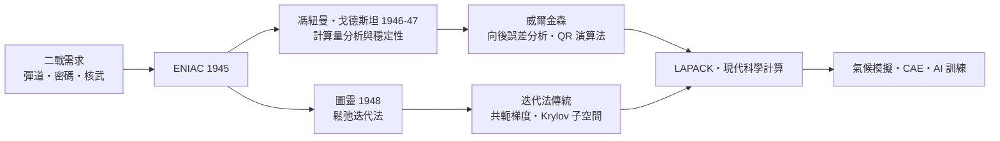

# 5.1 圖靈與馮紐曼：電腦誕生後，線性代數成了工程學

## 戰爭、彈道與電腦

1940 年代的兩件大事，把線性代數從數學推向工程的核心。第一件是第二次世界大戰：彈道計算、密碼分析、原子彈的流體力學模擬，計算量第一次成為國家級瓶頸。第二件是電子計算機的誕生：ENIAC（1945）與接續其後的機器，讓「百階方程組」從幾個月的手算變成幾分鐘的機算。

在這個轉折上站著兩位巨人。約翰·馮紐曼是 EDVAC 報告（1945）的作者，確立了「儲存程式」電腦的架構；艾倫·圖靈在 1936 年就定義了「可計算」的數學極限，戰時在布萊切利園破解 Enigma，戰後設計了 ACE 電腦的藍圖。兩人都在 1930 年代於普林斯頓相遇——圖靈是馮紐曼的博士後同事，馮紐曼甚至邀他做助理，但圖靈選擇回英國。

## 第一批嚴肅的數值問題

1946 年，馮紐曼與戈德斯坦為 ENIAC 的使用者寫下第一份系統的數值分析文獻：解 $n$ 階線性方程組的消去法需要約 $\frac{2}{3}n^3$ 次乘法。他們立刻追問一個前人從不需問的問題：機器的浮點數只有有限位，捨入誤差會不會累積到毀掉答案？

1947 年，馮紐曼與戈德斯坦證明：若係數矩陣對稱正定，消去法不會放大誤差——演算法是「穩定」的。同時他們也發現，對一般矩陣，小的主元可能導致誤差爆炸。這催生了解決方案：1950 年代英國的威爾金森（James Wilkinson）發展了「選主元」（pivoting）與向後誤差分析，把數值穩定性變成一門嚴格的理論。威爾金森後來獲得第一屆圖靈獎（1969）——圖靈獎頒給一位數值線性代數學家，本身就是這段歷史的註腳。

## 一門新學科的誕生

戰後二十年，數值線性代數成形為獨立學科。幾個里程碑：

| 年代 | 人物 | 貢獻 |
|---|---|---|
| 1950 | 蘭喬斯 | Lanczos 迭代法（大型稀疏矩陣） |
| 1951 | 豪斯霍爾德 | 用反射做 QR 分解（穩定化） |
| 1952 | 赫斯騰斯 | 共軛梯度法（大型方程組） |
| 1958 | Rutishauser | LU 分解的演算法形式 |
| 1961–65 | Wilkinson, Golub | QR 演算法求特徵值；SVD 的穩定演算法 |
| 1970s | Wilkinson 等 | ALGOL 套件 → 後演化為 LAPACK |

背後的制度力量不可忽略：美國的原子能委員會（AEC）、國防部與國家科學基金會（NSF，1950 成立）持續資助計算數學；橡樹嶺、洛斯阿拉莫斯等國家實驗室成為演算法的試驗場；冷戰讓「算得快、算得準」成為國家戰略能力。線性代數的黃金年代，是冷戰資助出來的。

## 圖靈的另一支線：迭代與平行

圖靈本人在 1948 年寫了一篇常被遺忘的論文，討論「解線性方程組的鬆弛法」——即迭代法：從猜測出發，反覆修正直到收斂。這類方法在當時被直接法（消去法）掩蓋，卻在幾十年後成為主角：現實中的矩陣動輒千萬階（網頁連結圖、三維網格），消去法填不進記憶體，迭代法與平行化成為唯一選擇。今天 GPU 上的大型稀疏解法器、深度學習的訓練迴圈，本質上都是迭代修正的思想。

## 歷史迴響

高斯在漢諾威荒野上開創的「計算工程學」，在電子電腦上獲得無限擴張。從此，「線性代數」一分為二：抽象理論（向量空間、希爾伯特空間）與數值工程（分解、誤差、複雜度）。而連接兩者、也連接數學與網際網路經濟的，是下一節的主角——奇異值分解。
