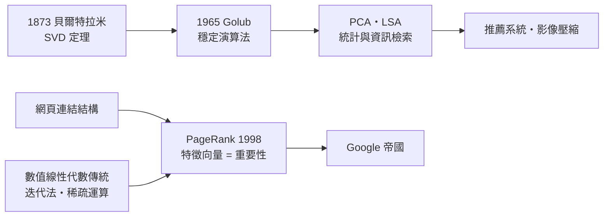

# 5.2 SVD 與 PageRank：一次搜尋背後的特徵向量

## 被重新發現的分解

矩陣的奇異值分解（Singular Value Decomposition, SVD）說：任何矩陣 $A$（哪怕不是方陣）都能寫成

$$A = U \Sigma V^T$$

其中 $U, V$ 是正交矩陣，$\Sigma$ 是對角矩陣，對角線上的奇異值由大到小排列。幾何意義直觀：任何線性變換，都是「旋轉 → 沿各軸伸縮 → 再旋轉」。

這個定理在 1873 年就由貝爾特拉米證出（方陣情形），若爾當、艾卡特與楊格（1936）逐步推廣。但它在很長時間裡是理論珍玩：數值上求 SVD 很難穩定。直到 1965 年，戈魯布（Gene Golub）與雷因施提出用 QR 演算法穩定計算 SVD，加上威爾金森的工作，SVD 才從黑板走進程式庫。戈魯布此後三十年大力推廣它，人稱「SVD 的傳道者」。

## SVD 能做什麼？

SVD 是「最佳低秩逼近」定理（埃卡特—楊格定理）：保留前 $k$ 個奇異值，得到的矩陣是在所有秩 $k$ 矩陣中最接近原矩陣的。換句話說：SVD 能把龐雜的資料壓縮成最重要的 $k$ 個「模式」。

- 影像壓縮：一張照片是矩陣，保留大奇異值丟棄小奇異值，畫面主體仍在；
- 主成分分析（PCA）：統計學找「主要變異方向」的工具，數學核心就是 SVD；
- 潛在語意分析（LSA，1990）：把「詞—文件」矩陣做 SVD，語意相近的詞會聚在一起——這是早期搜尋與推薦的基礎。

## PageRank：網路就是矩陣

1998 年，史丹佛的兩位博士生布林（Sergey Brin）與佩吉（Larry Page）發表 PageRank。問題：網頁數十億，誰的連結權重高？

他們的想法：一個網頁的重要程度，由「指向它的網頁」的重要程度決定——這是循環定義，而打破循環的工具正是特徵向量。把整個網路寫成跳轉矩陣 $M$（元素表示從某頁跳到某頁的機率），則重要性向量 $r$ 滿足

$$r = M r$$

——$r$ 是 $M$ 特徵值為 1 的特徵向量。用冪迭代法（反覆 $r \leftarrow Mr$，這正是圖靈 1948 年鬆弛法的精神後裔）收斂，幾十次迭代就得到全網的排名。

工程上真正困難的是規模：$M$ 有數十億列。Google 的解法靠稀疏矩陣儲存與平行運算——數值線性代數五十年積累（Lanczos、共軛梯度、分散式迭代）在此全部派上用場。PageRank 不一定「更聰明」，但它算得起：這是演算法的經濟學。Google 於 1998 年成立，2004 年上市，線性代數直接造就了人類史上市值最高的公司之一。

## 從搜尋到推薦

SVD 的下一步是「預測你會看什麼」。Netflix 於 2006 年懸賞一百萬美元，徵求把推薦預測誤差再降 10% 的演算法。競賽的主戰場正是矩陣：使用者×電影的評分矩陣，絕大部分空白。解法是「矩陣補全」：假設評分矩陣近似低秩（品味只有少數幾個維度），把空白處填上使得低秩性成立。冠軍方案（2009）的核心正是隨機梯度下降求解低秩分解。

這一脈的思想延續到今天的 embedding 技術：詞向量（word2vec）、推薦系統、大型語言模型中的向量表示，都是「把離散世界放進向量空間，用內積與夾角衡量相似度」——格拉斯曼的幾何直覺在矽谷獲得新生。

## 歷史迴響

一個 1873 年的定理、一個 1965 年的演算法、一個 1998 年的商業點子：SVD 與 PageRank 的故事說明，數學工具的價值要等到「問題規模 × 運算能力 × 商業動機」三者同時到位才會兌現。而讓巨大矩陣算得起的極限，正是下一節的主題。
