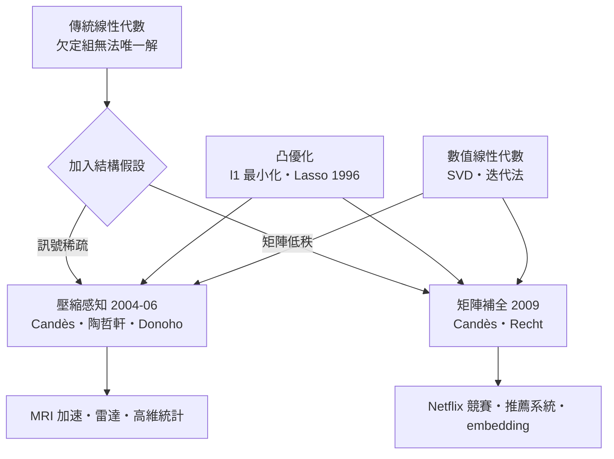

# 5.3 壓縮感知與 Netflix 競賽：稀疏世代的線性代數

## 奈奎斯特的鐵律被打破了

自 1928 年奈奎斯特、1949 年香農以來，數位訊號處理有一條鐵律：要無失真地重建訊號，採樣頻率必須至少是訊號頻寬的兩倍。MRI（核磁共振）掃描、雷達、通訊，全都按這條律付帳——採樣多，時間長、輻射大、頻寬貴。

2004 年前後，史丹佛的康德（Emmanuel Candès）在處理磁振造影數據時，發現用遠少於奈奎斯特要求的樣本，竟能完美重建影像。他與陶哲軒（Terence Tao）、多諾霍（David Donoho）很快把現象整理成定理，命名為壓縮感知（Compressed Sensing）：

如果訊號在某個基底（如小波基底）下是稀疏的——大部分係數為零——那麼隨機採樣 $m \gtrsim k \log(n/k)$ 個測量值（$k$ 為稀疏度、$n$ 為原始維度）就足以完美重建。

## 線性代數的角度：欠定方程組也能唯一解

壓縮感知的數學骨架是一次出乎意料的翻轉。設採樣得到 $y = \Phi x$，其中 $\Phi$ 是 $m \times n$ 的測量矩陣，$m \ll n$——方程比未知數少，按傳統線性代數，解有無窮多個，不可確定。

但若知道真解是稀疏的（非零元極少），情況完全改變。重建變成優化問題：

$$\min \|x\|_0 \quad \text{s.t.} \quad y = \Phi x$$

$\ell_0$ 問題是組合爆炸的，但 1990 年代統計學家（Tibshirani 的 Lasso，1996）已證明：用 $\ell_1$ 範數 $\min \|x\|_1$ 做凸近似，在合適條件下恰好找回稀疏真解。Candès–陶哲軒 2005 年的定理精確刻畫了何時成立：只要測量矩陣滿足「約束等距性」（RIP），$\ell_1$ 最小化解就是真解。

於是欠定方程組 + 稀疏先驗 = 唯一確定解。這是「加一個結構假設，讓不可能變成可能」的典範，而支撐它的全是凸優化與矩陣理論。

## 從理論到掃描儀

壓縮感知很快落地：MRI 廠商把它做成產品（如壓縮感知加速掃描），病患的掃描時間從十幾分鐘縮到幾分鐘；單像素相機、雷達、地震勘探也跟進。2010 年代，它進入統計學主流（高維回歸、稀疏學習）——當變數比樣本多時，「稀疏性」成為唯一的救生索。陶哲軒因此在 2006 年獲菲爾茲獎相關工作的加持（其主要獲獎工作包括此方向）。

## Netflix 競賽：低秩版的同一個故事

幾乎同一時期，另一個「加結構假設」的故事在商業世界展開。2006 年 Netflix 懸賞一百萬美元：根據使用者的歷史評分（48 萬使用者 × 1.8 萬部電影，超過 98% 的評分是空白），預測未看過的電影評分。

這是一個巨大的「矩陣補全」問題：填空，但填得準。解法的假設是低秩：人的品味由少數幾個因素決定（喜劇/悲劇、文藝/動作……），所以評分矩陣近似低秩。數學問題：

$$\min \ \mathrm{rank}(X) \quad \text{s.t.} \quad X_{ij} = y_{ij} \ \text{(已知評分處)}$$

與壓縮感知驚人地平行：rank 之於矩陣，如同稀疏度之於向量。Candès 與 Recht 在 2009 年證明了低秩矩陣補全的定理：隨機觀測少量元素即可唯一重建低秩矩陣。實務上的冠軍方案（BellKor's Pragmatic Chaos，2009）用矩陣分解加隨機梯度下降——把評分矩陣近似成兩個瘦長矩陣的乘積 $X \approx UV^T$，使用者的「品味向量」與電影的「屬性向量」的內積就是預測評分。

## 共同的思想譜系

兩條故事線共享同一個數學核心：凸鬆弛（用 $\ell_1$ 或核範數取代不可解的 $\ell_0$ 或 rank），以及同一批優化與矩陣工具。它們也共享同一個時代背景：資料爆炸讓「採樣永遠夠多」的舊前提失效，必須靠結構假設節約測量——這是資訊經濟學對數學提出的全新要求。

## 歷史迴響

從《九章算術》的方程術到 Netflix 的百萬美元獎金，線性代數的故事有一條隱線：每當人類想從「比未知數更少的資訊」中重建世界，就需要新的線性代數。漢代官吏靠消去法從三個方程解三個未知數；二十一世紀的科學家靠稀疏性與低秩性，從十億分之一的樣本重建整幅影像。問題變難了，但問題的形狀——一張係數表，與它的秘密結構——兩千年來沒有變過。
