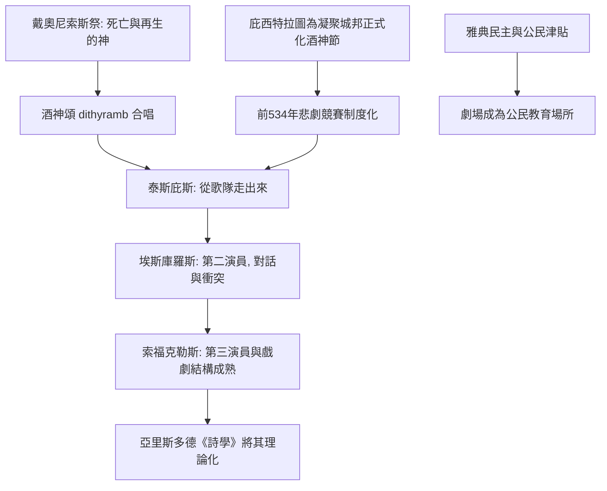

# 1.1 酒神節的歌隊：泰斯庇斯如何從合唱中站出來

時間：約西元前534年至前4世紀

## 為什麼戲劇誕生在酒神的祭典上

古希臘戲劇並非憑空出現，它是雅典城邦政治、經濟與宗教制度的產物。西元前6世紀的雅典，經歷了梭倫改革與僭主庇西特拉圖的統治，城市人口增加，手工業與海上貿易帶來財富，公民階層需要新的公共生活形式。庇西特拉圖為了統合城邦內部的農民（阿提卡鄉間的酒神崇拜）與城市貴族（奧林匹亞諸神崇拜），把鄉間的戴奧尼索斯（Dionysus，酒神與戲劇之神）祭祀正式引入雅典，建立了對戴奧尼索斯的官方崇拜。這是一個典型的政治—宗教操作：用一個新節日來凝聚整體公民。

酒神祭的核心是狂歡：信眾戴著面具、舉著陽具象徵、合唱讚歌（dithyramb，酒神頌）。戴奧尼索斯本身就是死亡與再生的神（葡萄每年冬天枯萎、春天復甦），崇拜祂的儀式因此帶有「化身為他者」的性格——這正是表演最古老的心理種子：一個人在儀式中暫時不是自己。

## 城邦出錢，全民看戲

戲劇的制度化基礎是雅典的民主制度。西元前534年（傳統紀年），雅典正式設立「悲劇競賽」，成為城市酒神節的活動之一。到了伯里克利時代（西元前5世紀），節日由城邦資助：地方有錢的公民被指定為「贊助人」（chorēgos），出錢訓練歌隊、製作面具與服裝；城邦發放「劇場津貼」讓窮公民也能買票（時代較晚時甚至免費入場）。換句話說，戲劇從一開始就是雅典公民教育的一部分，是民主政治的儀式延伸——全城男性公民同時聚集在狄俄尼索斯劇場（Theatre of Dionysus，約可容納一萬四千人），一起看審判、家庭倫理與政治的抉擇。悲劇中的兩難，正是前一天公民大會的辯論在神話中的重演。

## 泰斯庇斯：從歌隊中站出來的第一人

傳說中，伊卡里亞的泰斯庇斯（Thespis）在西元前534年贏得第一屆悲劇競賽。他的革命性一步，是在合唱之中走出來、戴上另一張面具，以「另一個角色」的口吻與歌隊對答。這聽起來簡單，卻是表演史上的破天荒：他創造了「扮演」與「回應」的分工——一邊是集體敘事（歌隊），一邊是個別人物（演員）。英語稱演員為 thespian，正源自他的名字。據說他還載著馬車巡迴演出——最早的「劇團巡演」。

觀眾初次見到有人「假裝是別人」時並不習慣：傳說有人指控這是欺騙的可疑行為，甚至有一則笑話式的記載說一位蔡基斯人試圖踹泰斯庇斯一腳（他臨時用面具護住了臉）。故事真假難證，但它反映了當時人們對「扮演」的陌生。

## 從一個人到兩個人：埃斯庫羅斯與戲劇衝突的誕生

真正的結構革命來自埃斯庫羅斯（Aeschylus，約前525至前456年）。他引入第二位演員，讓兩個角色可以直接對話與衝突，而非只由主角向歌隊報告事件。這是戲劇與史詩的分水嶺：荷馬史詩是「有人在敘述戰場」，悲劇則是「戰場本身在眼前發生」。第三位演員由索福克勒斯再加入，至此古希臘戲劇基本成型——因為面具制度下，一位演員演完一場即換角色，三人足以構成最複雜的人物網絡。

悲劇的黃金時代（前5世紀）與雅典的政治命運同步：希波戰爭勝利後的自信催生了《波斯人》這樣以敵人角度寫成的劇本；伯羅奔尼撒戰爭中城邦倫理的崩解，則化為歐里庇得斯筆下懷疑神話、拷問人性的角色。戲劇從未被孤立創作，它一直是城邦公共理性的實驗場。

## 歌隊的退場與西方戲劇的基因

歌隊從最早的三十人到五十人，逐漸從主敘事者退居為評論者與觀眾代言人，最後在歐里庇得斯之後名存實亡。但古希臘戲劇留下的基因設定影響至今：面具與角色（persona 一詞即拉丁文「面具」），後來成為人格（personality）的詞源；悲劇的情節（mythos）與淨化（catharsis）由亞里斯多德在《詩學》中總結，成為兩千年劇理論的起點；而「演員從集體中站出來」這個動作，則是整部表演史的開場姿勢。

