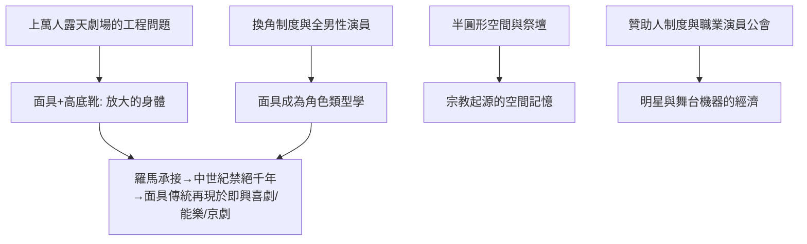

# 1.2 面具、高底靴與半圓形露天劇場：希臘表演的技術革命

時間：約西元前5世紀至前4世紀

## 一萬四千人要怎麼「看見」表情

古希臘戲劇面臨一個純粹的工程問題：露天半圓形劇場坐滿上萬人，最後一排距離舞台近百公尺，任何細微的臉部表情都不可能被看見。希臘人沒有去縮小表演需求（像兩千多年後的鏡頭表演那樣），而是反過來把身體「放大」——面具（prosopon）、高底靴（kothurnoi，讓悲劇演員增高的厚底鞋）、墊寬肩胸的服裝、裝有黃銅擴音器的面具口部（部分學者推測）。基本上，希臘悲劇演員是一具「人形擴音天線」。

聲學奇蹟的代表的例子是埃庇道魯斯劇場（Theatre of Epidaurus，約前4世紀）：石灰岩座位吸收低頻噪音、反射高頻人聲，讓最後一排也能聽清低語；舞台中央的圓形祭壇據說利用了聲波干涉。這種「石頭的音響工程」支撐了整個古典表演體系——希臘表演首先是聲音的藝術：訓練有素的嗓音、詠唱式的台詞（melos）與舞蹈節奏（orchēsis）。

## 面具：角色化、快速換角與性別中立

面具解決了三個問題。第一是可見性：誇張、固定表情的面具讓遠處觀眾讀出角色的性格與情緒類型。第二是換角制度：每位演員乘一人分飾多角之便，每個角色不同面具，演員退場換裝即換人——這也是希臘戲劇「舞台上同時不超過三人」的秘密。第三是性別：所有演員皆為男性，女性角色全部由戴女性面具的男人扮演。面具因此是將「人」轉化為「角色」的第一技術工具，這個傳統直接延續到羅馬（拉丁文 persona）、義大利即興喜劇、日本能面與京劇臉譜。

悲劇面具的表情是「定型化」的（君王、報信人、老嫗各有圖式）；喜劇面具則演成一套完整的類型學——把面具分為數十種「奴隸臉」「老翁臉」。這種類型化表演，正是兩千多年後義大利即興喜劇與中國行當的遙遠祖先。

## 劇場空間：神聖幾何與公民秩序

希臘劇場的形制承載了表演哲學。半圓形的觀眾席包圍著圓形歌隊場（orchēstra），歌隊圓圈中央是酒神祭壇——記憶著戲劇的宗教起源；歌隊場前方凸出的斜坡舞台（skēnē，即 scenery 一詞的詞源，原為演員更衣棚）出現於前5世紀。觀眾依階級與部落分區而坐（前4世紀起），劇場因此是一幅雅典社會的截面圖：祭壇在前，公民環繞，神話在人群與神聖之間上演。

空間也決定了表演的三單位性：舞台上可用的高度與深度有限，暴力（死亡、自殺）都在「台下」完成，由報信人用語言描述——「死亡不登台」的成規，塑造了西方戲劇「以言語敘述暴力」的敘事傳統。

## 舞台機器：上帝從屋頂降下

希臘人並不排斥技術。前5世紀已出現：宗教式起吊機（mechane）——讓扮神的演員從屋頂「飛」下來解決僵局，現代戲劇批評中的「機械降神」（deus ex machina）一詞即由此而來；ekkyklema——推車平台，把室內發生悲劇後的屍體一景推到台前示眾。索福克勒斯據說還發明或改良了佈景畫板（pinakes）。經濟條件同樣支持這一切：提洛同盟的貢金、贊助人（chorēgos）的賽馬式攀比、演員職業化（前4世紀出現專業悲劇演員公會，明星演員的身價開始飆漲）。

## 這套體系為何消亡

亞歷山大之後，希臘戲劇重心東移，職業演員取代詩人作者、舊戲重演取代新創作；羅馬承接了劇場建築與面具，卻把悲劇讓位給角鬥與啞劇（pantomimus，單人戴面具的舞者用身體敘事——古羅馬的「默努巨星」）。到了基督教帝國時期，劇場被視為異教遺物而查禁（西元529年左右狄俄尼索斯劇場最終停用）。但它的技術發明——面具、類型化角色、擴音身體、敘事而非展示暴力的成規——在黑暗中埋下伏筆，等著中世紀教堂的復活在千年後接上。

