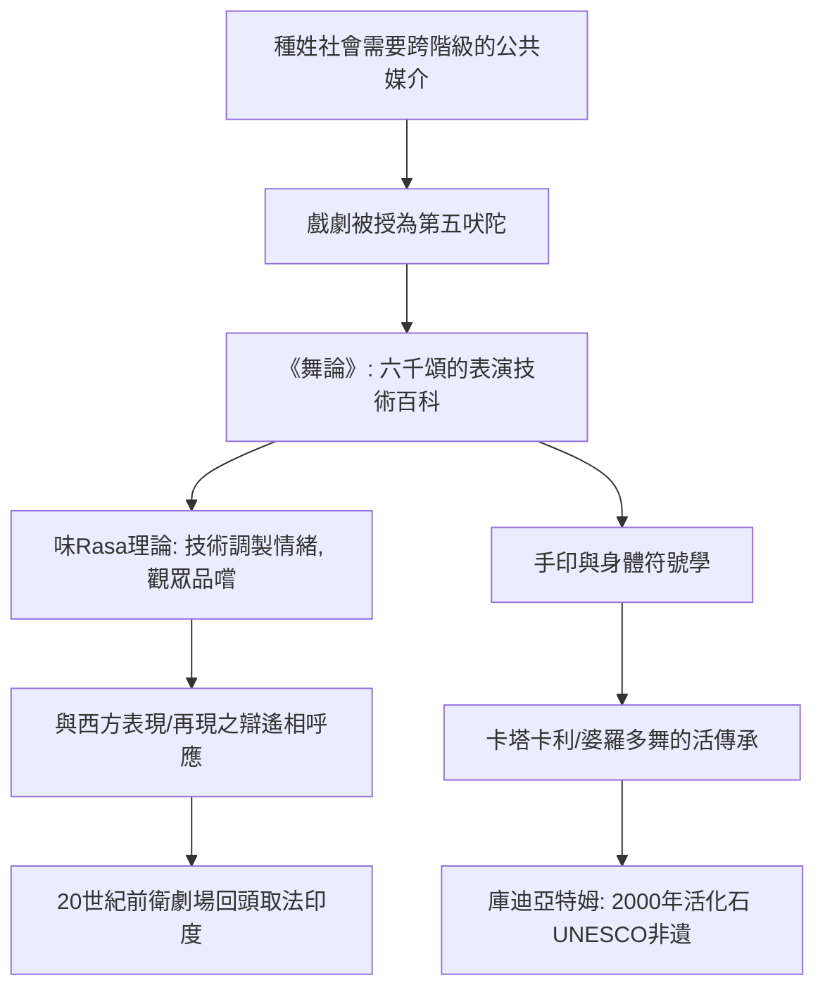

# 2.1 《舞論》與梵劇：印度人把表演寫成了科學

時間：約西元前2世紀至西元10世紀（梵劇傳統）

## 比亞里斯多德更早的表演理論

如果不看西方，表演理論最早且最完整的系統化發生在印度。《舞論》（Nāṭyaśāstra，舊譯《創舞山經》誤植，正確應為「戲劇論」）相傳為仙人婆羅多牟尼（Bharata Muni）所作，成書年代約在西元前2世紀至西元3世紀之間，共六千頌、三十六章。它不僅是戲劇理論，更是一份「表演技術手冊」：從劇場建造、化妝、音樂、樂器、手勢、步法、情緒管理到演員道德，無所不包。西方要到19世紀末斯坦尼斯拉夫斯基才做出同等密度的系統工作。

書中自述戲劇為「第五吠陀」——面向所有種姓（連首陀羅都能觀看）的知識載體。這個神話說明了制度動機：在種姓森嚴的社會中，戲劇是被授予宗教合法性的公共教育媒介。

## 味（Rasa）：情緒不是表演，而是品嚐

《舞論》最深刻的概念是「味」（rasa，字義為汁液、精華）。表演的基本公式是：情況（vibhāva）＋身體反應（anubhāva）＋不穩定情緒（vyabhicāri）＝常態情緒（sthāyibhāva）被喚起→觀眾「品嚐」到味。全書列出八種味（愛、喜、悲、怒、勇、懼、厭、奇，後世加「寂」為第九味），對應八種基本情緒（bhāva）。

關鍵在於：味不是演員自己的情緒，而是演員用精確的技術「調製」、再由觀眾品嚐的產物。這是一種「表演即烹飪」的美學——與兩千年後丹尼艾爾（Diderot）主張的冷靜演員、布萊希特的疏離表演，在結構上驚人地相通。印度理論家後來為此辯論了千年：演員要不要真的感到悲傷？（答案：不必，技術本身就能召喚味。）

## 身體的文法：手印與眼神

《舞論》規定了身體各部位的精細語彙：單手手印（mudrā）數十個、雙手組合、頭部九態、眼、眉、頸、腳步。每一個手印都有明確意義的「像」，加上情境的「顯」——手掌平舉表示「賜予」或「指路」，用法由上下文決定。這是一種發達的身體符號學：意義先被編碼，表演者負責解碼給觀眾。今天卡塔卡利（Kathakali）、婆羅多舞（Bharatanatyam）與奧迪西舞的手語系統，皆直接源於此。

## 梵劇的兩千年

印度宮廷與城市有職業劇團，國王設專官管理劇作家與演員（戲劇為王政的一部分）。經典劇作家跋娑（Bhāsa，約2至3世紀）寫了《小泥車》等劇；迦梨陀娑（Kālidāsa，約4至5世紀）的《沙恭達羅》在1789年被瓊斯翻譯成英文後震動歐洲——歌德幾乎為它寫了頌詩，德國浪漫派把它當作東方莎士比亞。這是東方劇場第一次反向影響西方戲劇思想。

隨著笈多帝國崩解與伊斯蘭政權興起（梵語宮廷資助消失），古典梵劇在10世紀左右式微，但其技術存活於：喀拉拉的梵劇活化石庫迪亞特姆（Kūṭiyāṭṭam，2001年列入UNESCO非遺）、民間的羅摩利拉（Ramlila，史詩《羅摩衍那》的全民巡演）等活的儀式劇場。「表演是一切人的公共祭祀」——《舞論》開篇婆羅多牟尼以此回答弟子：戲劇不是娛樂，而是對世界秩序的重演與教導。

