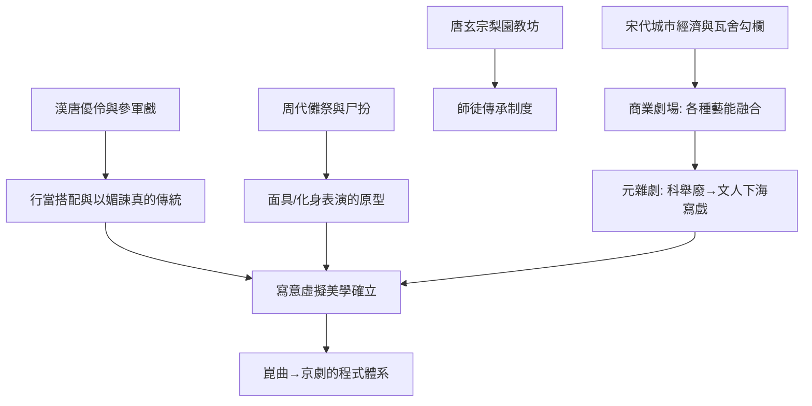

# 2.2 儺戲、參軍戲與宋元雜劇：中國戲劇從祭壇走向瓦舍

時間：約西元前2世紀至西元13世紀

## 巫與儺：演的原始功能

中國戲劇的種子在宮廷，更在民間的祭壇。甲骨文中的「尸」——由活人裝扮成先祖受祭——已是一種角色扮演；周代歲末的蠟祭（扮演百獸以歡收場）與「儺」（驅疫儀式，方相氏戴黃金四目面具、執戈揚盾，率百隸逐疫）則確立了「戴面具＝化身為另一存在」的表演格式。這條線一直活到今日：貴州安順的地戲、湘西的儺堂戲，與古希臘的酒神面具遙遙相對。

宮廷的「優」則提供了另一個源頭：優伶以滑稽調笑侍君，最著名的是秦朝的優旃（以反諷暫停秦始皇擴苑、止漆城）與漢代黃門倡優。優點在於它們發展了「以玩笑進諫」的表演思想——演員被允許說真話的制度空間。

## 參軍戲：第一個固定角色搭配

唐代的參軍戲（由漢魏「優戲」演化而來）出現了關鍵結構：兩個固定角色——參軍（被嘲弄者，穿官服）與蒼鶻（嘲弄者，褻衣執撥浪鼓般的道具）。一尊一諧、一智一愚：這是中國最早的行當搭配原型。唐玄宗本人精通音律並設梨園教坊，後世戲班奉他為祖師爺——皇帝親自介入表演制度，是中國戲曲師徒手藝傳承體系的制度起點。

## 瓦舍勾欄：市場經濟造出來的劇場

真正的轉折發生在宋代，動力不是藝術而是經濟。汴京、臨安人口逾百萬，打破坊市制的夜市、取消宵禁之後，市民有了錢與閒，瓦舍勾欄（固定的商業演出棚）隨之而起。《東京夢華錄》記載汴京瓦子「不以風雨寒暑，諸棚看人，日日如是」。商業劇場淘汰掉一切不利吸引買票的因素：唐代的科白戲、歌舞、說唱（變文）、傀儡、雜技在勾欄裡互相競爭與融合，最終在南方產生了南戲（永嘉雜劇），北方形成了雜劇。

元雜劇（13至14世紀）是商業劇場所結出的第一個黃金果實：一劇四折一楔子的結構、一人主唱的體制、曲牌聯套的音樂制度。它的政治背景微妙：科舉在元代長期停廢，讀書人仕進無門，很多人轉行寫戲——關漢卿（竇娥冤、救風塵）、王實甫（西廂記）、馬致遠皆是「九儒十丐」的產物。文化史上罕見的現象：體制把最聰明的一代文人趕進了戲班。

## 寫意的建立：以鞭代馬、以槳代船

宋元表演確立了中國戲曲的核心美學：虛擬與寫意。舞台上沒有真馬，一根馬鞭代表騎馬；三個龍套代表千軍萬馬；演員繞場一週即是行路千里。這不是技術簡陋，而是美學選擇——觀眾與演員之間有一個約定：我們一起用想像完成佈景。這與古希臘「暴力不登台」（由敘述完成）是同一邏輯的另一種實現：戲劇的本體在演員身上，不在佈景裡。王國維在《宋元戲曲史》（1913年）中以「以歌舞演故事」六字總結戲曲本質，正是對這套體系的現代重述。

## 落後的俑與先進的體系

宋元時期中國還留下了最珍貴的戲劇圖像證據：宋金墓室的戲曲磚雕、山西侯馬金代董氏墓的戲台俑群，記錄了當時行當的實際扮相。而到元末明初，另一條更長壽的分支——南戲演化出的崑曲——已在醞釀中，它將在晚明成為「百戲之祖」，並最終孕育京劇（見4.2）。中國戲曲用了兩千年，從巫的面具走到「唱念做打」的完整程式體系；同時期的西方，正等著文藝復興重新點燃。

