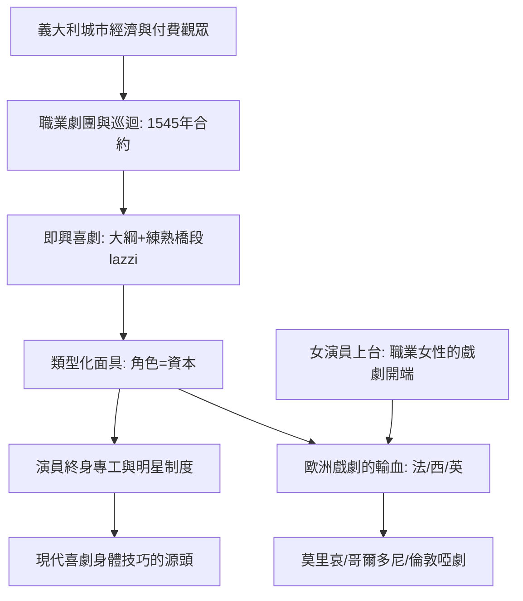

# 3.1 即興喜劇的面具：專業演員的第一次產業革命

時間：約西元1545年至18世紀

## 有劇本之前，先有職業劇團

文藝復興的義大利先恢復了古羅馬學者劇（學院裡照拉丁範本演的泰倫提烏斯式喜劇），但真正改變表演史的是另一件事：1545年，一群演員在錫耶納附近（帕杜拉的弗拉米尼奧·達·西耶納等人）簽下已知最早的演員合約，職業劇團就此誕生。經濟背景很清楚：義大利城市的手工業、貿易與印刷業造就了付費看戲的中產市民，而巡迴是唯一的生存模式——從威尼斯到巴黎到馬德里，一家一家的演。即興喜劇（Commedia dell'arte，意為「技藝喜劇」）就是職業演員在市場上磨出來的產品：他們必須在不寫完整劇本的情況下夜夜開演，還得夜夜不同。

## 類型化面具：資本主義的角色系統

即興喜劇發明了現代表演的第一個「角色資料庫」。固定的人物類型各有面具、服裝與動作語彙：潘塔羅內（威尼斯老商人）、多特萊博士（博洛尼亞的迂腐法學家、吹牛的西班牙式上尉）、僕從 Zanni 阿爾萊奇諾（其傳人哈勒昆的菱格紋服裝與帶疤面具成為後世小丑之父）、不戴面具的中產情侶 Flavio 與 Isabella——他們是對抗滿台失控僕傭的僅有的「正常人」。有趣的是：僕人角色講的是方言（貝加莫土話），老爺講托斯卡納語——語言即階級。

面具類型意味著演員終身專工：名角如女星伊莎貝拉·安德雷尼（Isabella Andreini）一輩子對應一個類型，把一個角色演成品牌。這不僅是分工，更是一種人力資本的積累——技藝可以累積、傳授、彼此競爭。

## Lazzi：喜劇的可重組積木

即興表演的技術核心是 lazzo（複數 lazzi）：預先練熟的喜劇橋段——偷吃被抓、裝病、雙層戲（僕人在樓上探出頭偷聽）、技藝般的雜技翻滾。演出現場只依賴大綱（canovaccio，場景分配與情節主線寫在一張布上），演員即興填入台詞與 lazzi。這是「即興爵士」式的表演：結構固定，獨奏自由。它訓練出的演員，是西方史上第一批身體素質驚人、能唱能舞能翻滾的全能表演者。

## 爆炸性的影響

即興喜劇的巡迴路線成為歐洲戲劇的輸血管：法國（布爾戈尼府的義大利劇團，路易十四少年時在後台看他們排戲）、西班牙、英格蘭。它輸出了：固定人物類型（莫里哀的斯卡平、阿爾巴貢出自其血統）、女演員職業化（伊莎貝拉·安德雷尼——「Isabella」既是角色名也是演員名，女性職業演員的地位由此起家）、以及倫敦啞劇與木偶戲的哈勒昆（潘趣與裘迪 Punch and Judy）。更重要的兩大遺產：其一，「演員即文本生產者」——文本在台上被創作；其二，類型化的技巧先於個別化的人物。莎士比亞在倫敦看得到或不看得到義大利劇團，都呼吸著同一種空氣；兩百年後哥爾多尼要在威尼斯改革它（刪面具、加台詞），被當成過時之物，但其骨架早已滲透進全球喜劇的每一根神經。

