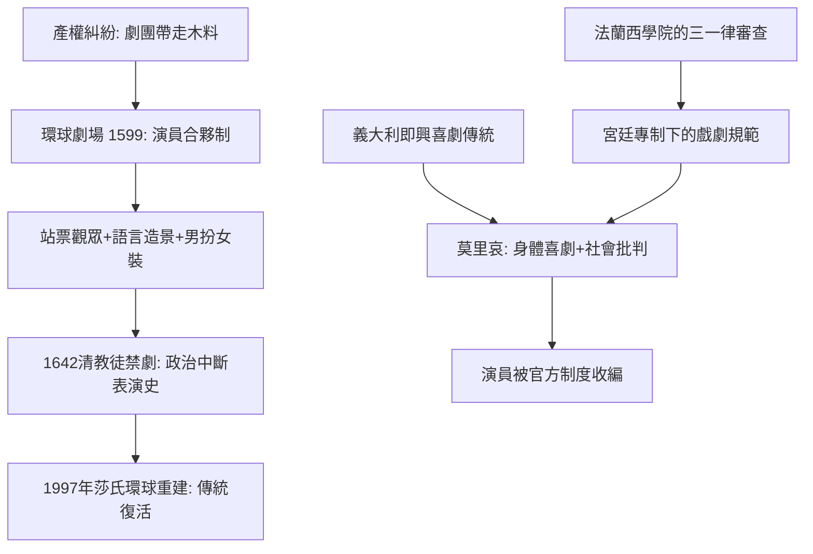

# 3.2 環球劇場與莫里哀：站著看莎士比亞，坐著看「女扮男」的宮廷喜劇

時間：約1599年至1673年

## 一根承重柱撐起的「世界」

1599年，莎士比亞所屬的內務大臣劇團（Lord Chamberlain's Men）拆走了河岸區「劇院」（The Theatre）的木料，運過泰晤士河，蓋起了環球劇場（Globe Theatre）。這不是藝術構想而是產權糾紛的產物：地主不續租，劇團帶著「自己的房子」出走——演員持股劇場，是表演史上第一次合伙人制度（成員合營、分享盈餘而非領工資）。經濟制度決定了藝術：分紅制讓演員願意押上身家，也讓莎士比亞這種劇作家兼股東兼演員的三重身分成為可能。

環球劇場是八角形露天圓場（可容約三千人），中央的舞台突進人群，上層包廂環繞，屋頂之下有「人物從天堂降下」的機關。兩個便士的站票觀眾（groundlings）擠在舞台前，再多付一點可以坐進包廂。這種結構沒有佈景（日光下不可能暗場），一切都靠語言創造：壁毯作為背景，演員說「這是丹麥的原野」，觀眾就相信了它。表演因此極度口語化、修辭化、面向觀眾——莎士比亞的獨白不是封閉的心理內銀，而是與觀眾直接交流的對話。男扮女裝（boy actors 演朱麗葉與薇奧拉）則是伊麗莎白時代禁用女演員制度的產物。

## 從木環到大火

環球劇場的命運戲劇化：1613年6月29日《亨利八世》演出時，戲中的禮炮點燃了茅草屋頂，一小時內劇場燒成灰燼（幸無人死亡，據說只燒到一個人的褲子，用啤酒澆熄）。重建的環球二號以瓦頂續命，直到1642年清教徒政權封禁劇場（英格蘭內戰期間，議會以聚眾無序之名下禁令——政治與宗教直接改寫表演史），1644年劇場被拆除改建住房。三百多年後（1997年），美國製作人山姆·瓦納梅克傾畢生之力，在倫敦泰晤士河南岸重建莎氏環球劇場（Shakespeare's Globe），斷裂四百年的表演傳統被重新接上。

## 莫里哀：喜劇與權力的婚約

法國的17世紀戲劇是另一條路：宮廷專制主義的制度美學。法蘭西學院在1637年依「古典主義三一律」裁定高乃伊《熙德》違律——國家用院士制度審查藝術。莫里哀（Molière，1622至1673年）出身即興喜劇傳統（他的劇團在省城巡演多年、背負債務），1660年代起成為國王的戲劇寵臣：劇團獲皇家津貼，而他的表演以誇張的身體喜劇聞名——《無病呻吟》首演之夜，他咳著肺癆演完「誰裝病誰就咳嗽」的病人，數小時後去世。

莫里哀把即興喜劇的身體喜劇裝進了法語詩體與社會批判：《偽君子》被禁演五年（教會勢力反撲，連路易十四一度也難以力挺，可見權力對戲劇態度的冷熱交替）。他的遺產是雙向的：喜劇從此擁有「批判社會」的合法性；演員則被官方制度收編為「國王的僕人」——表演地位史上的一大步。但莫里哀死時，因演員身分不得葬於教會之地（後經路易十四介入，才以折衷方式下葬）。

## 觀眾的兩張臉

莎士比亞的觀眾站著、扔果殼、與演員對眼；莫里哀的觀眾坐在枝形吊燈下的包廂裡，彼此欣賞（法國劇場到18世紀仍是半照明狀態，觀眾席的社交比舞台更重要）。兩種觀演關係孕育了後來的兩條血統：面向大眾的劇場（最終走向寫實與批判），與面向規範的文明劇場（最終由19世紀的「好品味」延伸到斯坦尼的第四道牆）。而他們共同指向的問題——劇場到底是演員與觀眾之間怎樣的一個空間——要到1968年彼得·布魯克《空的空間》才被重新命名。

