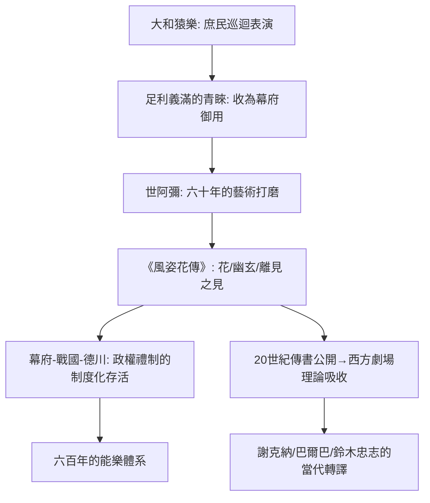

# 4.1 世阿彌與《風姿花傳》：觀客的身體化為「花」

時間：約1363年至1443年（世阿彌生卒約1363至1443）

## 一場從猿樂走出的「官學化」

日本能樂的前身是雜多的大和猿樂與近江猿樂（兼具雜技、模仿、滑稽的巡迴表演），其制度化發生在南北朝與室町時期的政治縫隙中。1374年，年幼的將軍足利義滿在京都看到大和猿樂四座之一的觀阿彌攜子世阿彌演出，大為讚賞，將此團收為幕府御用——原本是庶民宗教表演的猿樂，就此進入武士政權的最高權力核心。這一納編史無前例：把「農村祭祀」升級為「公家儀禮」，由政治權力完成了一次藝術升級。此後的形式演變當中，世阿彌得以在幕府的庇護下，用六十年時間把能樂推至極致。

## 《風姿花傳》：演員的遺書

世阿彌（Zeami，約1363至1443年）不只演與寫，他把表演理論體系化於《風姿花傳》（1400至1418年間成書，父親觀阿彌的教誨為其底本）等秘密傳書中。其核心概念有三：

「花」：表演的使人覺得新鮮、有魅力之「東西」。花是相對的——同一個演在少年時覺得可愛的花，中年必須換成沉靜之花；技藝必須隨年齡與觀眾變化而「更新」。花不是角色，是演員與觀眾之間那層正在發生的魅力。

「幽玄」：理想美學的範疇——優雅、深遠、含蓄，能劇中年女性角色（如亡靈）以近乎靜止的緩慢呈現，是幽玄的極致。

「離見之見」：演員要像觀者一樣看自己的表演（分身之目），即表演的自我監控——這幾乎是斯坦尼「第三眼」與當代表演學「後台自我」的最早表述。

## 技術：以「零」為極致的身體

能的身體語彙建立在笛（篠笛一系的能管）與三種鼓（小鼓、大鼓、太鼓）之上，加上嚴格的家族口傳（世阿彌確立的世襲祕傳制度）。演員的動作邏輯是「連呼吸都不浪費」——腳蹭地滑行（摺り足），省去一切耗費能量的動作，以最小動作承載最大張力；面具（能面）比任何表情都更「空」，觀眾必須自行填充情緒——同一張女面具，傾頭即悲、仰頭即喜（角度決定情緒）。主角（シテ）在後半場常已成亡靈：活人演死人、死人再演自己的記憶，戲中戲的結構讓能樂成為「以表演展演記憶」的藝術。

## 制度的奇蹟：幕府、戰國與政府制度下的屹立

能樂在三個世紀中連續經歷了幕府庇護（室町）、戰國大名扶持、與德川幕府的「式樂」（儀式之樂，武士的儀式必備，各藩不准私演外藩式樂）三種制度化生存。這使它成為全球唯一不靠商業票房、也不靠宗教香火、而以政權「以藝術為國家禮制」而存活六百年的表演形式。這份體系的現代回聲在19世紀末至20世紀逐漸顯影：

## 從世阿彌到今日

世阿彌晚年命運悲劇：1434年他被失寵的處境推入政治漩渦，遭足利義教流放到佐渡島，1443年前後客死他鄉。其傳書由子孫寶生家等代代祕藏，直到1909年才公開出版（校訂本《世阿彌傳書》刊行），20世紀的西方導演終於得以閱讀：葛羅托斯基、尤金諾·巴爾巴、理察·謝克納、鈴木忠志等人，都從能樂與世阿彌的「離見之見」等理論中取火。2008年能樂被UNESCO列為無形文化遺產。世界上再也沒有第二種表演，如此完整地把制度（幕府與武家禮法）、美學（幽玄）、技術（傳書與家族祕傳）與政治（戰國到近代）緊織在一起。

