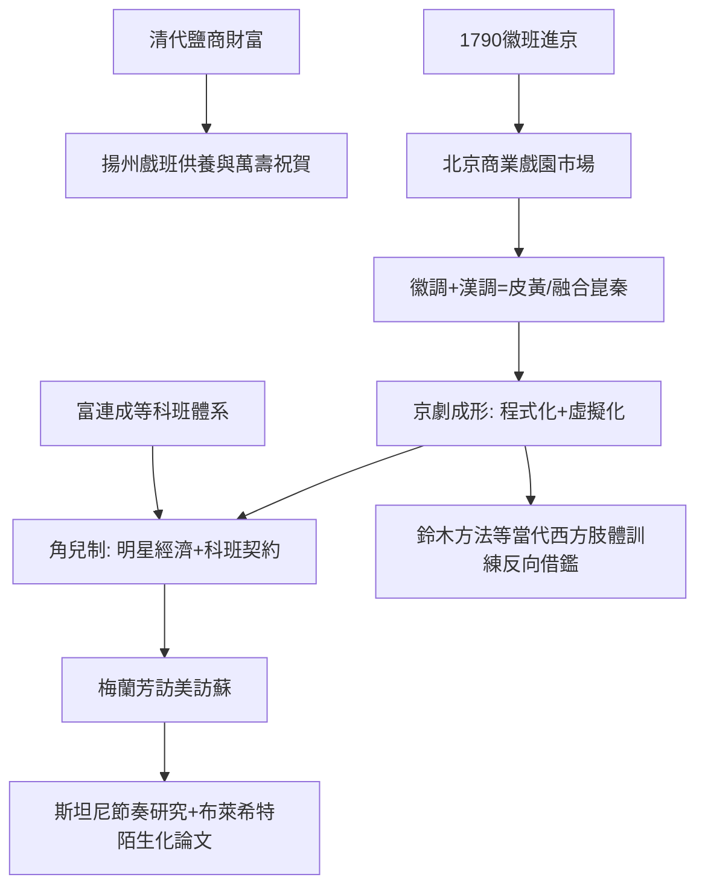

# 4.2 京劇的形成：徽班進京與程式化表演的極致

時間：1790年（徽班進京）至19世紀末

## 徽班進京：一次祝壽啟動的產業遷徙

京劇不是「設計」出來的，而是商業與政治共同釀成的。1790年（乾隆五十五年），皇帝八旬萬壽，召揚州一帶的「三慶徽班」進京祝壽；隨後四喜、春臺、和春等徽班相繼進京，扎根北京。揚州之所以出戲班，是因為鹽商巨富以養戲班互比豪奢——兩淮鹽稅是帝國財政命脈，鹽商因此富可敵國，戲曲娛樂是他們打點宮廷與炫耀身份的必備投資。誰也沒想到，這批為祝壽而來的安徽戲班，會因北京觀眾的購買力而留下來，用不到一百年時間養成為一個新劇種。

徽班在京城的融合過程很清晰：徽調（二黃）吸收了漢調（西皮，主要由湖北班底帶來），合流為「皮黃」；又兼容了崑曲（來自南方的雅聲）、秦腔、京腔的聲腔與劇目，吸收宮廷（昇平署，皇帝與太后親自擁有自己的戲班與戲樓——頤和園德和園大戲樓是專為演戲蓋的三層樓建築）與民間兩地的滋養。至道光、咸豐年間，一種以北京官話演唱皮黃的新劇種已經成形，被後人稱為京劇。

## 觀眾決定的表演革命

京劇的魅力核心是表演本身，其成因是市場：北京的戲園（茶樓）天天演戲，觀眾是反覆入場的老戲迷——他們看的是同一齣戲的第 N 次演出。這決定了京劇的兩大美學方向。

其一，經典劇目當「曲庫」用：觀眾對《打漁殺家》《空城計》的故事爛熟，看的是譚鑫培這一場的唱法比上一場好在哪裡——京劇觀賞的是「演」，不是「劇」。其二，程式（程式化）與虛擬（虛擬化）登峰造極：一行當一身規範，「生旦淨丑」各有唱法、步法、妝法；「四功五法」（唱念做打、手眼身法步）構成身體文法。舞台上無實物：一支馬鞭即是一匹馬，繞場一圈即是趕路千里，一桌二椅即山即城即衙門。演員因此必須是全能身體技藝家：練腰、腿、毯子功、把子功，童子功十年打底——這是中國版「演員的專業學院」。

## 角兒制度：明星制的極端形態

晚清京劇發展出了「角兒制」：觀眾為名角買票，劇團為名角配置（琴師、鼓師、頭、衣箱都是名角班底）。程長庚被尊為「戲聖」，譚鑫培（1847至1917年）確立「無腔不宗譚」；女演員也在此期逐漸突破禁演慣例登上舞台；宮廷則給予戲曲最高政治待遇——慈禧太后痴迷京劇，名角入宮承差拿雙份賞銀。

這套明星制的制度成果誠然代價高昂：科班（如1904年創立的喜連成/富連成社）以簽約坐科七年、體罰與嚴苛訓練「生產」演員，孩子是契約勞工；但同樣這套體系，孕育了梅蘭芳（1894至1961年）——1919年與1924年梅蘭芳兩度訪日、1930年訪美（百老匯與好萊塢）、1935年訪蘇聯，把自己的表演變成一場外交與美學事件。斯坦尼斯拉夫斯基在蘇聯觀看梅蘭芳演出並撰文論及中國戲劇的程式與節奏；布萊希特著名的《中國戲劇的陌生化效果》（1936年）正是看完梅氏演出後寫成——京劇的虛擬性（演員明知道自己不是角色）成為反「體驗派幻覺」的證據。這樣，東方與西方在20世紀中期，用兩種方式各自回答了同一個問題——表演究竟是「成為角色」還是「展示角色」？

## 木偶般的精密：京劇的技術典範

京劇的身體技術，最終被西方劇場重新發現：二十世紀至二十一世紀之交，鈴木忠志的「鈴木方法」（腳踏地板、重心下沉的訓練）、耶魯與茱莉亞學院（Juilliard）的肢體訓練、法國樂寇（Lecoq）學派，都部分承認了對亞洲程式身體的學習。京劇以「口傳心授＋身體記憶」的方式傳承了兩百年，其核心信念——表演的單位不是心理而是動作；角色先有類型再有個性；空間由觀眾相信而存在——與斯坦尼之後的西方心理表演，構成一部完整的互補史。

