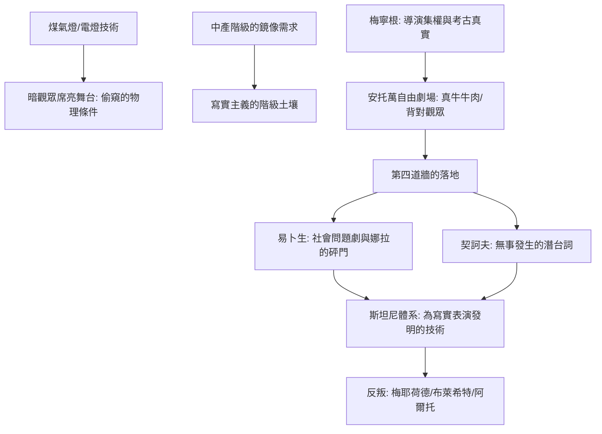

# 5.1 第四道牆：易卜生、契訶夫與會說話的客廳

時間：約1870年至1904年

## 為什麼要發明「第四道牆」

十九世紀下半葉的歐洲，發明了戲劇史上最安靜卻最革命的一個觀念：舞台是客廳，客廳面向觀眾的那一側不存在牆——演員在牆裡生活，觀眾在牆外的黑暗中偷看。這個「第四道牆」概念由狄德羅（Diderot，18世紀）預言、康斯坦丁·斯坦尼的時代正式落地，而把它變成劇場物理現實的是德國的梅寧根劇團（Meiningen Ensemble，1866年起，由格奧爾格公爵二世與導演克羅內克推動）與巴黎的安德烈·安托萬（André Antoine，1887年創立自由劇場 Théâtre Libre）。

工程與經濟背景是關鍵：煤氣燈（自1817年代起普及）與電燈（1881年倫敦 Savoy Theatre 全面電燈，克羅內克與安托萬都在劇場中使用了先進的照明）讓「暗掉的觀眾席＋亮著的舞台」首次成為可能；觀眾可以藏身黑暗，被表演「偷窺而不還手」。同時代的中產階級——房產律師、店主、公務員——正需要一面鏡子照見自己的生活方式：工人階級在革命、貴族在沒落，唯有什麼都不是的中產者成了歷史的主體。寫實主義戲劇因此不只是審美，而是階級的鏡像需求。

## 梅寧根與安托萬：把真實搬上舞台

梅寧根公爵的劇團以三件事聞名：導演集權（第一次把「導演」變成劇場最高指揮）、群眾場面的真實（士兵如軍隊般行進，導演路德維希·克羅內克對群眾演員施行近乎軍事訓練的調度）、與服裝道具的考古學準確。他們巡演歐洲（1874至1890年間巡遊多國，包括1890年的莫斯科之行），直接點燃了安托萬與年輕的斯坦尼斯拉夫斯基。

安托萬的實驗更極端：1888年演《屠夫》（The Butchers）時，他在舞台上真的搬進了整座肉鋪，懸掛真實的牛肉。他提出的方法原則是：佈景中看不見的第四面牆，也必須以「存在」的方式被演員感知——他讓演員背對觀眾表演（如背對觀眾的排隊群眾、實物噪音），彷彿觀眾只是偷窺者。這個「背對觀眾」在當時是石破天驚之舉，卻成為整個寫實表演的心理基準：把牆裡的生活演完，只是偶然能被看見。

## 易卜生：把社會的假髮拆下來

挪威劇作家易卜生（Henrik Ibsen，1828至1906年）把寫實手法變成了社會手術刀：《玩偶之家》（1879年哥本哈根首演）最後那記砰然關門聲，在19世紀的歐洲有如一顆炸彈——女主角娜拉對丈夫說「我首先是一個人，跟你一樣」，然後離家出走。德國出版商要求改一個妥協結尾（娜拉因看到孩子而留下），易卜生被迫在德文版採用「荒唐地被強加」的軟結局，自己始終引以為恥。思想影響深遠：這部劇成為早期女性主義運動的戲劇文本；戲劇史上的地位同樣根本——現代戲劇的主題從此不再來自天上的神話，而來自欠著一張借據的中產客廳。

易卜生的劇法是「調查戲」：真相不在開場被宣告，而是被一寸一寸挖出來（《群鬼》又進一步觸碰梅毒與道德偽善，在當時引起全歐的抨擊，稱他給社會拉了皮）。

## 契訶夫：無事發生的悲劇

桀傲的寫實主義在安東·契訶夫（Anton Chekhov，1860至1904年）手上走得更遠：他不要「砰門」與重場戲，他想要的是「生活的無戲可演」——《三姊妹》的舞台行動幾乎可以被一句話總結：「她們想去莫斯科，但永遠沒有去」。《櫻桃園》（1904年，莫斯科藝術劇院首演，斯坦尼親自導演與主演）寫的是一個沒落貴族家庭賣掉祖產的日常悲劇 — 背景：1861年農奴解放之後一代人，俄國貴族的經濟基礎（村社與過時的農業）已經走到社會性破產；「櫻桃園被砍」正是整個俄國舊世界的寫照。

契訶夫的表演難度因此是表演史的新課題：他要求演員做到「在無事發生時，心中必須有狂暴的洪流」── 斯坦尼的「潛台詞」（subtext）概念，正是為了契訶夫的對白而發明的：人物嘴上說天氣，腦中有別的整齣人生。

## 從客廳到全體人

寫實主義在1900年前後遭遇它的「內部反抗」（見第5.2部與第7章）：梅耶荷德嫌它太相世，布萊希特嫌它太催眠，阿爾托嫌它太文明。但没有寫實主義的「第四道牆」，就沒有它的全部反叛 —— 二十世紀的每一場劇場革命都定義在打破這道牆上。

