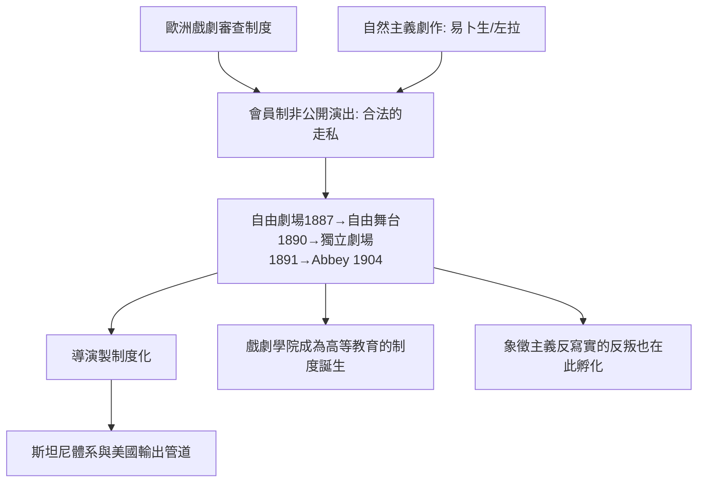

# 5.2 小劇場運動：審查制度催生的前衛溫床

時間：1887年至1910年代

## 會員制：一場合法的「走私」

十九世紀末，歐洲各國普遍保留著戲劇審查制度（法國自1830年代起、德意志各邦、俄國更是嚴苛），官方劇院與商業劇院都不敢上演易卜生式的社會批判。劇場史上的解法出人意料：法庭與商業劇場都不敢演的戲，由私人俱樂部來演——只賣會員票、不公開售票的演出被視為「私人聚會」，不受公開演出的審查法拘束。

1887年巴黎的自由劇場（Théâtre Libre，安托萬）、1890年柏林的自由舞台（Freie Bühne）、1891年倫敦的獨立劇場（Independent Theatre，由葛雷恩等人成立，1892年在倫敦演出的正是《玩偶之家》——英國第一次演易卜生）、1899年愛爾蘭都柏林的愛爾蘭文學劇場（後來的 Abbey Theatre，1904年成為世界首座國家劇院）。這些機構共享同一套制度發明：會員制、非公開演出、契約演員與「一季只演新戲」的節目政策。寫實主義、象徵主義與稍後的每一場劇場革命，幾乎都先在這種「合法的非法空間」裡孵化——審查制度反而成了前衛劇場的溫床。

## 導演的誕生：一個新的職業

小劇場運動的另一個產物是「導演」這個職業本身。在此之前，劇場的權力主導者或者是國家/貴族劇院的首席演員，或者是聘來指揮整體的臨時管理人；在小劇場裡，因為必須用低成本實現整體性，一個掌控每個角度的「組織者」角色成為必需。安托萬的排練法（演員先「生活」進角色，再整理舞台上一切有生命或無生命的細節，包括在真肉鋪背景中排戲）、柏林的奧托·布拉穆（Otto Brahm）、莫斯科的丹欽科與斯坦尼，都把「導演製」制度化。到20世紀，導演取代演員而為劇場藝術的頂點人物，這個權力移轉的源頭就在1890年代的小劇場。

## 象徵主義的另一次出走

有意思的是，小劇場運動很快自己也反抗了自己的寫實教條。1880至90年代巴黎的象徵主義者象徵主義（梅特林克 Maeterlinck 的戲劇即是一例）也在安托萬的舞台上提倡「不寫實的戲」；莫斯科則有梅耶荷德的叛離——他是斯坦尼最得意的學生，卻在1910年代試驗反寫實的程式劇場（見7.1）。從分析客廳的真相，到懷疑整個客廳的幻覺，只用了十五年——現代劇場的兩大陣營（寫實與反寫實）在1900年前後就已成形。

## 教育的制度化：戲劇學院的誕生

小劇場運動的深遠影響還在教學：因為自成體系，這些劇院必須自養演員——倫敦的皇家戲劇藝術學院（RADA，1904年創立）、莫斯科 MAT 的學校、紐約的 American Laboratory Theatre（1923）……戲劇學院作為一種高等教育機構迅速鋪滿西方。表演從「江湖手藝」轉為「可以教授的科學」，正是從這一波制度建設開始；它也直接孕育了之後的斯坦尼傳播（見6.1）與美國的演員工作室（見8.1）。

