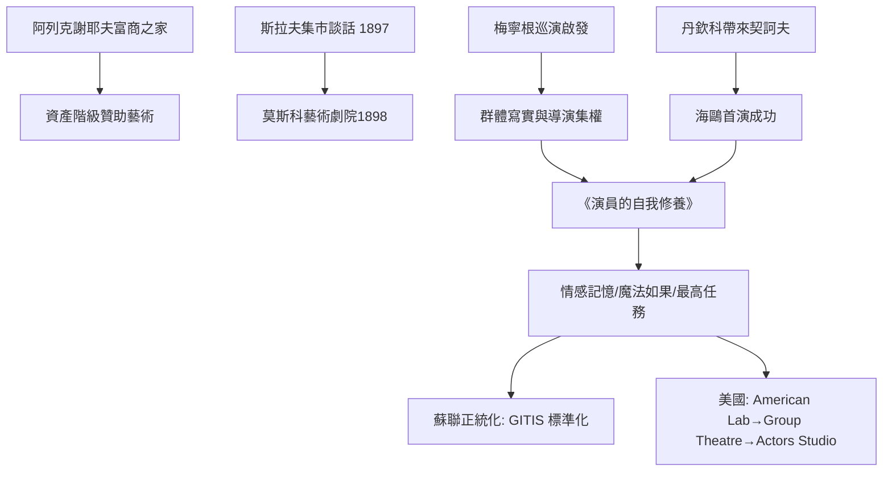

# 6.1 莫斯科藝術劇院：斯坦尼斯拉夫斯基的體驗派革命

時間：1898年至1938年

## 一個富商子弟的賭注

康斯坦丁·斯坦尼斯拉夫斯基（Stanislavski，本姓阿列克謝耶夫，1863至1938年）出身莫斯科的富商之家，家族經營金線與織物生意，在俄國實業界舉足輕重。他自少年時代在自家客廳劇院迷戀表演，卻在19世紀80至90年代的莫斯科職業劇場裡看不到出路：主演們用一副高腔朗誦所有角色，佈景粗糙、群演在台上等著幕落。1897年6月，他與文學批評家丹欽科（Nemirovich-Danchenko）在斯拉夫集市飯店（Slavyansky Bazar）閉門長談十八小時，約定合辦新劇院：斯坦尼主持排練與表演美學，丹欽科掌文學、劇目與人事。1898年，莫斯科藝術劇院（MAT）誕生，資金主要來自俄國新興富裕階層的私人贊助（如實業家莫羅佐夫）——商人階級想要一個不像帝國宮廷那樣保守的劇場，這是寫實劇院的經濟基礎。

## 為什麼需要一個「體系」

斯坦尼的體系源自自己的失敗痛楚：他自述在演某些重頭戲時，身體會在台上失靈——手在抖、聲音乾涸、情緒枯竭。他開始追問一個純粹的表演問題：身體不聽意志指揮，演員到底能控制什麼？答案日後寫進《演員的自我修養》（1938年他去世後出版）等著作，成為表演史上第一部「演員技術手冊」。

兩個外部資源啟發了他：其一，梅寧根劇團的訪問演出讓他看到「群體寫實」與導演集權的可能；其二，丹欽科帶來的契訶夫劇本。1898年12月，《海鷗》在 MAT 成功上演（把北京上海的劇場投搬到莫斯科，聽起來是笑話，但搬演契訶夫的難度正在於其「無事發生」），劇院因此以「海鷗」為院徽。

## 體系的技術內容

斯坦尼的方法大致分三層。第一，外部技術：聲音、語言、身體與節奏的訓練——先給演員一具可靠的工具。第二，心理技術（體系的核心）：集中注意（舞台上如處「孤獨中的眾目」——像在自己房間一樣自然）；魔法的「如果」（magic if：如果我處在角色的情境中，我會怎麼辦——用情境而非情緒啟動行動）；以及情感記憶（emotional memory）：從自己的過往借取真實感覺，供角色使用。第三，劇本的組織：找出角色的最高任務（super-objective）與貫穿動作（through-line）——「我為什麼這麼做」先於「我該怎麼說」。這一套把西方表演的順序整個翻轉：先有內心的邏輯，再自然流出台詞與動作，而不是先背好腔調、再「想」角色。

哲學上，斯坦尼強調「活在當下的舞台」：演員不是在重現一個算好的比例，而是每次演出都重新體驗。他不信「天才論」，相信表演是一門可以訓練的手藝——這正是「體系」（The System）的本意。

## 為什麼它征服了世界

蘇聯政權於1930年代把斯坦尼體系定為表演正統，劇院的教育系統（後來的 GITIS 等學院）隨之標準化；而更關鍵的傳播出路在美國：1923至1924年，MAT 兩度巡演紐約，演員波列斯拉夫斯基（Richard Boleslavsky）與 Carnovsky 等人留下的學生於1923年創立美國實驗劇場（American Laboratory Theatre），把斯坦尼的技術帶到紐約。這條管道接著通往劇院工會「劇團」（Group Theatre，1931年成立，斯特拉斯堡、克麗芙、伊利亞·卡山等）→演員工作室（Actors Studio，1947年，見6.2）。於是出現了表演史最大的反諷：蘇聯體系工程下的表演科學，最終成為美國電影工業的表演核心理論。

## 後半生的對手

有意思的是，斯坦尼晚年也自我修正：1930年代初他推動「模式物理動作」（method of physical actions）研究，承認情緒不能老靠挖掘記憶，身體動作是最可靠的路——刻意行動可以引發真實情感。這是他自己對「情感記憶迷信」的撥亂反正，也是後來「肢體劇場」（葛羅托斯基、謝克納）的理論伏筆之一。他未曾看到自己的影響財產流向何方，1938年去世，死後蘇聯把他奉為表演聖人——而李·斯特拉斯堡（他的美式弟子）則把「情感記憶」的長處與極端推向好萊塢。

