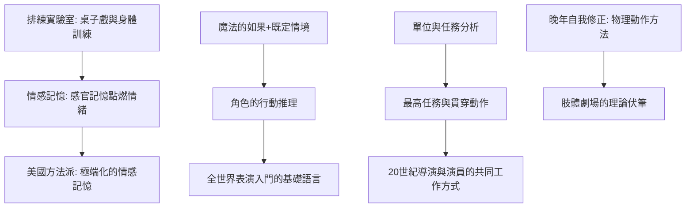

# 6.2 魔法的「如果」：情感記憶、最高任務與表演的內在迷宮

時間：約1906年至1938年

## 一個技術問題，不是一個哲學問題

斯坦尼體系常被浪漫化為「用心去演」的哲學，但它本質上是一套工程問題的解答集：如何讓演員在每晚的演出中都保持真實？如何避免第七百場《奧賽羅》的僵化詠誦？斯坦尼在藝術劇院的實驗室（他一度把底層排練廳（他自己住宅附近用作排練的場地）化為實驗室，用嚴格的桌子戲與身體訓練重排劇目）中長期試錯，其成果可以拆成幾個關鍵組件。

## 情感記憶：從自己的過去借火

「情感記憶」（emotional memory）是體系最出名也最有爭議的技術：演員閉眼回想自己生命中一次真實的經歷（氣味、光線、身體感覺優先於情節），點燃當下的真實情緒，再轉移到角色身上。斯坦尼的理由很簡單：演員在台上無法「命令」情感，卻可以命令注意——把注意力放回到真實記憶的感官細節上，情感會自己回來。技術上，他強調「感官記憶」（五感的最小單位：指尖的冰涼、空氣裡的花香），而非泛泛地「想著傷心事」。

後來的實踐史證明這個方法的效用與極限並存：美國方法派把情感記憶推到極端（見8.1）而引發心理風險；斯坦尼自己在晚年（1930年代）轉向「物理動作方法」——先做正確的、有邏輯的身體動作，情感會跟著動作出現——等於親手為自己的早期理論踩了剎車。一位表演理論家的自我修正，在理論史上極為罕見。

## 魔法的「如果」與既定情境

「魔法的如果」（magic if）比情感記憶更安全也更基礎：不挖掘過去，而是提問——「如果」我是一個被丈夫背叛的女人，「如果」窗外是1905年的彼得堡，我此刻會想什麼、先做什麼？「如果」把演員從「扮演角色」的心智負擔中解放出來，轉為解決情境的普通人。它與「既定情境」（given circumstances，作者給出的一切事實：時間、階級、天氣、前史）配合使用：情境＋如果＝行動。這套推理鏈是今天全世界表演入門課的第一堂課題。

## 最高任務與貫穿動作

體系的第三支柱是劇本的「單位與任務」分析法：把劇本切成小單位，每個單位找到演員的「任務」（一個可執行的動作動詞——不是「悲傷」而是「乞求原諒」），再上溯到角色全部行動的最高任務（super-objective）與全劇的貫穿動作（through-line of action）。表演的判準從「觀賞性」變成「目的性」：每一個動作都必須回答「我為什麼現在這樣做」。這個分析法讓演員第一次擁有了可檢驗的工作語言，也奠定了20世紀導演與演員共用的工作溝通方式。

## 製度化：學院、文字與政治

1918年起斯坦尼在蘇聯開辦歌劇與話劇演員的教學工作室（Opera Studio 與 Bolshoi 的合作實驗，1920至1930年代他的「體系」通過教習班向劇院輸出標準）。1930年代蘇聯文化官僚體系確立斯坦尼體系為社會主義現實主義的表演正統——歷史的弔詭在此：這種官方化一方面保護了體系的資源（劇院、學院、出版），一方面凍結了它的發展（體系教條化後，蘇聯戲劇教育再難出現梅耶荷德那樣的反叛者——梅耶荷德正是在這種正統化中被肅清）。體系的世界傳播因此帶著雙重身分：既是二十大師的完整論著（俄文全集八卷，1950年代在莫斯科出版；英文譯本《演員的自我修養》1936年由 Elizabeth Hapgood 首譯），也是冷戰中兩側各自重新詮釋的意識形態文本。

自1938年斯坦尼去世至今，對體系的核心辯論始終是同一個問題：表演究竟是「深度的成真」（approximate真實）還是「高度的自我表現」？這道問題由梅耶荷德、布萊希特、方法派與葛羅托斯基各自作了部分回答；每一次回答，都重新定義了一次表演教育的課程表。

