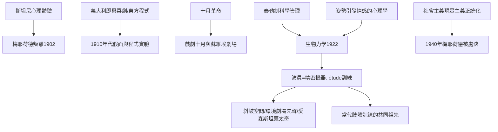

# 7.1 梅耶荷德與身體的幾何：表演從心理轉向機器

時間：約1910年至1940年

## 斯坦尼最得意學生的叛離

弗謝沃洛德·梅耶荷德（Vsevolod Meyerhold，1874至1940年）是莫斯科藝術劇院1898年創始成員中最有天分的年輕演員，斯坦尼親自調教的學徒。但他在排契訶夫《三姊妹》（1901年飾圖津巴赫）期間的分歧公開化：他不相信「在房間裡想出一個角色的靈魂」這條路，認為斯坦尼的內心技術最美也最病——它永遠慢，永遠只顧主一人。1902年他離開劇院（在省城自立劇團），1906年在波瓦爾斯卡亞街的實驗劇院排出梅氏第一部象徵主義名作，1908年起在帝國劇院中試驗「的反寫實復興」：用義大利即興喜劇的程式、西班牙的洛佩·德·維加與舊時舞台的假面語言（他用假面重排莫里哀《無病呻吟》，宣示「程式優先於心理」）。

今十月革命後，梅耶荷德把實驗推向極致：1918年他接受蘇維埃政權的劇場任務；1920年至1921年執掌「全俄劇藝局」（TEO Narkompros），發表把劇場徹底革命化的宣言；1922年起經營自己的「梅耶荷德劇場」。著名的《欽差大臣》（1926年，對果戈里喜劇的機械化重排）以平台式的斜坡佈景、演員隨時進出的開放空間，把俄國古典喜劇變成一台精密的齒輪表演。

## 生物力學：演員是精密機器

1921至1922年，梅耶荷德在莫斯科的導演工作坊裡創立「生物力學」（Biomechanics）：一套可教、可重複的演員肢體訓練系統。它的思想來源有三：其一，心理學中「先有動作、情緒隨後而來」的身體回饋理論（詹姆斯—朗格學說的世俗借用，支持他「情感不藏於內心，而由外部動作召喚」的主張）；其二，泰勒式的工廠科學管理（蘇聯「勞動科學化」熱潮的時代理論——演員如同精密的車床，要可訓練、可重複、可計畫）；其三，義大利即興喜劇與東方戲曲的程式（他在1900年代的講座中明確引用中國與日本戲曲）。

生物力學的訓練核心是 étude（練習程式），每一段都以「欲動先收」（otkaz，預備動作）開場，動作的軌跡是從抵制到拋出再收束的幾何弧線；學生在精確的節拍中拋接物品、保持平衡。梅氏的名言是「情感不是演員的原料，而是訓練的產品」——先有精確的外部動作，真實的情感隨之而來。生物力學的多數程式在他1940年遇難後失傳，僅由倖存弟子尼古拉·茲沃拉金斯基等人口傳，戰後才被復原，如今成為世界各表演學校肢體訓練教程的一脈源頭。

## 十月革命與表演的未來主義

梅耶荷德不僅改演員，也改空間：他在劇院裡架起斜坡與平台，觀眾散落在演員之間——這是「環境劇場」的先聲（比理查·謝克納1968年的環境劇場早約五十年）。他劇團裡的弟子愛森斯坦，把梅氏的舞台「吸引力」（attraction──編排對觀眾生理的直接剌激）帶入電影，化為著名的「吸引力蒙太奇」；馬雅可夫斯基的《臭蟲》《澡堂》在他劇場首演，成為蘇聯前衛藝術的高峰。

## 死亡：體系的終結與復活

1930年代的蘇聯走向政治整肅：社會主義現實主義成為唯一正統，斯坦尼體系被奉為官方理論，梅耶荷德的前衛劇場被批判為「形式主義」。1938年他的劇院被關閉，1940年他被捕後處決（妻子、女演員齊娜伊達·賴赫隨後在家中遇害）。這是表演史上最黑暗的一條線：一種表演哲學的存亡，完全由政治裁決。直到1956年他被官方平反，名字才重新出現在蘇聯劇場。

而他的遺產有多巨大？今天全球的肢體訓練（從柏林 Ernst Busch 到倫敦的 LISPA、法國樂寇學校的運動分析、以及組合劇場和日本鈴木方法的交叉）都直接或間接來自梅耶荷德「情感是由動作產生的」這一信條──斯坦尼與梅耶荷德的百年辯論，構成了西方表演訓練的全部內在張力。

