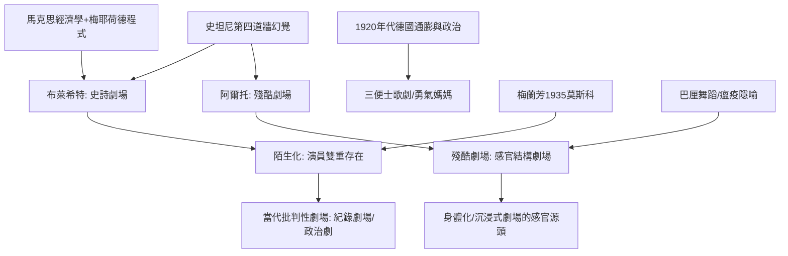

# 7.2 布萊希特與阿爾托：兩種反幻覺的劇場

時間：約1926年至1948年（布萊希特主要文本）；阿爾托1938年《劇場與其替身》

## 兩條岔出的道路

寫實主義的第四道牆建立了幻覺，斯坦尼教演員住進幻覺；二十世紀前半，兩位從幻覺牢房越獄的理論家走出了截然相反的方向：布萊希特（Bertolt Brecht）要把觀眾從催眠中叫醒、送去思考；阿爾托（Antonin Artaud）要把觀眾從思想上撞醒、扔進感官的暴風。一個冷，一個熱——當代劇場的諸多走向（紀錄劇場、旁觀劇場，以至感官沉浸式演出）都選在這兩極之間遊走。

## 布萊希特：陌生化的政治經濟學

布萊希特（1898至1956年），德國巴伐利亞出身的詩人與劇作家。他沒有選擇「抒情地控訴」資本主義，而是想理解它：《三便士歌劇》（1928年柏林首演）表面寫強盜與乞丐，實際上分析的對象是1920年代德意志通貨膨脹與投機市場；他與福利特（Erwin Piscator）的文獻劇場運動同代，也吸收了梅耶荷德的程式。1926年起他自修理論習作（閱讀馬克思的《資本論》），確立了「史詩劇場」（Epic Theatre）的架構：戲不再是一場情感的高速公路，而應像一堂有來回辯論的歷史課。

核心技術是「陌生化／疏離效果」（Verfremdungseffekt，A-effect）：以打破沉浸感的方式重現熟悉之物，讓觀眾能夠「驚訝地」看見它，彷彿是第一次。手段包括：歌隊與旁白直接向觀眾說話、演員出示自己的方法（「他們在演什麼？」）、畫面板與投影打斷連續性、人物忽然換上另一角色的面具與帽。最著名的例子《勇氣媽媽》（Mother Courage，1939年）的表演要求：演員對人物的每一個動作必須「帶著批判的目光」，同步演出「這樣的人才被時代造出來」的歷史判定——演員是「雙重存在」：既在角色之中，又在角色之上。

制度與歷史的因果鏈：布萊希特因納粹上台而流亡（1933年起，1941年落腳加州聖塔莫尼卡，與流亡的歐洲知識圈往來），1948年返回歐洲，1949年在東柏林創立柏林人劇團（Berliner Ensemble）——這家由東德官方資助的劇團，成為他後期理論的實驗室與全球巡演的出發點。他的《劇場小工具》（1948至55年間寫作）確立了「演員與角色不同一、表演是雙重的」方法論。

東方的證據：1935年他在莫斯科看過梅蘭芳的演出，翌年寫成〈中國戲劇表演藝術中的陌生化效果〉——以京劇演員「清楚知道自己是演員」為據，論證非西方表演早已解決西方的「共情陷阱」。東方戲曲的程式（演員、角色、觀眾三者之間清晰的距離）給了他最強的理論武器。他對「觀眾幻覺」的解構，日後成為紀錄劇場與政治劇場的思想法源。

## 阿爾托：劇場作為瘟疫

法國詩人阿爾托（Antonin Artaud，1896至1948年）的起點是1926年與人合辦的「阿爾弗雷·雅里劇場」（Théâtre Alfred Jarry）。他的基本判斷是：歐洲劇場的核心病症在於太文明——劇場淪為西方「文字文化」的俘虜（一切以文本與對白為中心），而劇場本應像瘟疫一樣燒破社會的表皮，露出底下的真實生命。

1931年他在巴黎殖民地博覽會看了印尼巴厘舞蹈劇場的演出，深受震撼：那是一種「不為講故事、只為震動神經」而存在的程式化表演——聲音、面具、手勢織成一套「劇場的象形文字」。1935年他執導《糠西》（The Cenci），1938年出版《劇場及其複象》（The Theatre and Its Double），提出「殘酷劇場」（Theatre of Cruelty）——「殘酷」不是血腥，而是不可妥協的嚴厲：用非鏡框的空間結構（表演在中央，觀眾四向被包圍）、物理性的聲響，以及演員如被附身者般的表演，把觀眾的身體一起拉進來，重組其感知。

阿爾托一生被精神疾病與藥物治療的失敗折磨，最後十年多在精神病院度過，1948年去世。但他的思想在1950年代後被廣泛「接受」：1964年彼得·布魯克在皇家莎士比亞劇團（RSC）內部主持「殘酷劇場」工作坊；葛羅托斯基明言吸入了阿爾托的思想；生活劇場（The Living Theatre）、日本舞踏與寺山修司的感官劇場，皆屬於阿爾托的譜系。

兩人多半可相互補充：布萊希特要剁手的理性思考，阿爾托要身體被重新組織；他們共同的反對（對象）是斯坦尼式的幻覺心理表演。二十世紀後半的「劇場革命」── 從布魯克、謝克納到葛羅托斯基與當代的沉浸式劇場──多半站在這兩個對反力量構成的三角形裡。

