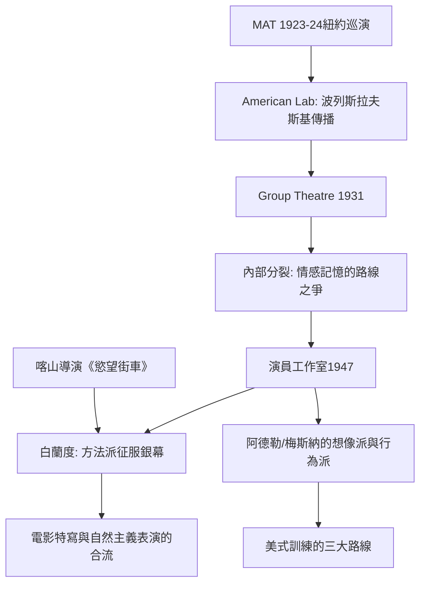

# 8.1 演員工作室：李·斯特拉斯堡與方法演技

時間：1923年斯坦尼傳入美國至1982年（斯特拉斯堡卒）

## 從莫斯科到紐約的表演輸血管

斯坦尼體系傳入美國，靠兩個具體的機構接力：其一，莫斯科藝術劇院1923至1924年的紐約巡演，演員波列斯拉夫斯基與瑪麗亞·奧斯彭斯卡婭留了下來，1923年創立美國實驗劇場（American Laboratory Theatre），傳授斯坦尼的情感記憶與「如果」；其二，1931年成立的「劇團」（Group Theatre），由哈羅德·克魯曼、謝爾·克勞福德與李·斯特拉斯堡主持，克利夫德·奧德茲為首席劇作家——《黃金男孩》等社會劇配上體驗式表演，是美國第一次擁有「以斯坦尼為方法、以社會劇為劇目」的常設劇團。1930年代後期起，斯特拉斯堡與同僚為「情感記憶該不該訓練」發生重大分歧，劇團終在內部裂痕與解散中結束（1941）。

## 演員工作室的誕生

1947年10月，演員工作室（Actors Studio）在紐約成立，創辦人為伊利亞·喀山（Elia Kazan）、羅伯特·劉易斯與謝爾·克勞福德，作為非營利的演員會社（會員制，被稱為「演員的研究所」）。1951年起，李·斯特拉斯堡（Lee Strasberg，1901至1982年）接掌教學，主導工作室近三十年。

美國方法派（Method Acting）不是複製斯坦尼，而是有意的改造：斯特拉斯堡把「情感記憶」（affective memory）置於一切訓練的核心，加上幾項美國式的補充——放鬆與集中、感官記憶練習（例如逐項回想一杯牛奶的溫度與味道）、私人瞬間（private moment：在課堂上做一件完全私人的事，直到「被看見也不失真」，以練習私密性）、與替代（substitution：用自己生命中真實的人代替角色關係中的對象）。他被批評為「心理挖掘的極端派」，他的回覆始終一致：演員必須能隨時把真實的情感從身上召喚出並加以控制——表演是一門手藝，不是祈禱。

## 工作室的表演如何改變銀幕

方法派的勝利不在舞台而在電影。工作室培養出的演員——馬龍·白蘭度、詹姆斯·狄恩、保羅·紐曼、羅伯特·德尼羅、後來的艾爾·帕西諾與梅里爾·斯特里普——正好遇上電影技術的變革：錄音麥克風與特寫鏡頭讓「不用放大音量、不用比劃手勢、只要真的活著」的小幅度表演成為標準，銀幕明星的私密性與方法的內在情緒一拍即合。

《慾望街車》（1947年百老匯舞台、1951年同名電影，皆由喀山導演、白蘭度飾 Stanley）是運動的轉捩點：白蘭度把方法演員的身體演成一團未被劇場訓練「馴化」的原始生命──鬆弛、含糊、飽滿而未經修飾。評論家後來形容：方法派帶來了一種「非演員式」的表演——情緒不經語言而經身體流出。這與之前古典舞台腔（清晰、單一、講究咬字的赫本式表演）形成強烈反差；詹姆斯·狄恩（《天倫夢覺》等）則把方法的內化推向神秘的極端。

## 兩種方法的戰事：斯特拉斯堡與阿德勒的論戰

方法派內部不斷有路線鬥爭。斯特拉·阿德勒（Stella Adler，1901至1992年）曾在巴黎當面受教於斯坦尼本人（1934年；她轉述斯坦尼的建議：「像你這樣有天分的演員不要挖掘自己的記憶，要用想像力」），成為「想像力派」的旗手，1949年成立自己的表演學院。桑福德·梅斯納（Sanford Meisner）同樣反對情感記憶，創立「重複練習」（repetition exercise：基於對對方真實狀態的感知即興回應），為另一大支系。美國表演訓練因此分裂為三大路线：斯特拉斯堡的情感派、阿德勒的想像派、梅斯納的行為派——今天的美國演員幾乎都能歸入其中之一。

必須公平地說，方法派的名聲也被傳說扭曲：極端案例如羅伯特·德尼羅為《蠻牛》（1980年）增重數十公斤，常被中文世界誇張成「為入戲而毀掉自己」的神話。斯特拉斯堡本人在課堂與講座中反覆強調：方法不是讓演員精神失控，而是「訓練演員召喚並控制真實情感的能力」。真實歷史與傳說之間，這正是最重要的一道分界。

