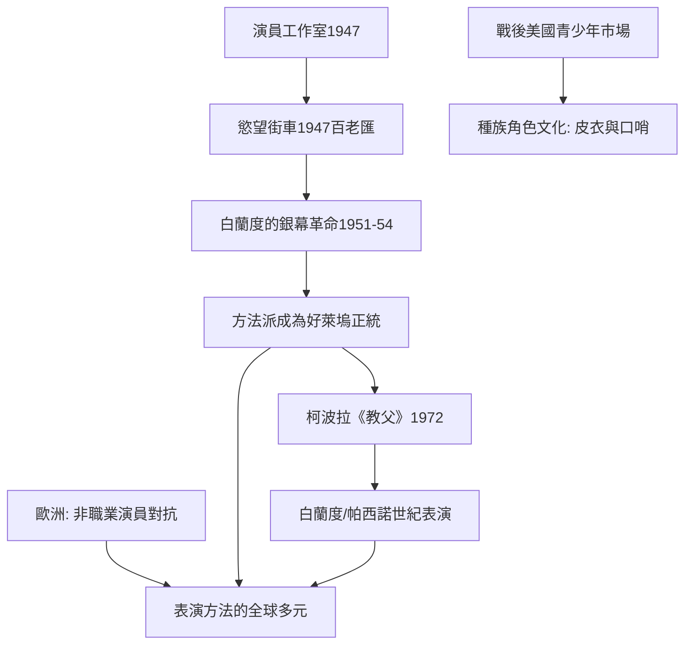

# 8.2 白蘭度與好萊塢：方法演技成為全球表演的標準

時間：1947年至1972年

## 從劇場的實驗室到銀幕的常規

演員工作室誕生於紐約的劇場世界，但方法演技統治世界是靠好萊塢完成的。歷史的結構是：1947年百老匯《慾望街車》首演——伊利亞·喀山導演，馬龍·白蘭度（Marlon Brando，1924至2004年）飾演粗暴的史丹利；1951年喀山把同一齣戲搬上銀幕；白蘭度以鬍渣、汗濕的白背心、含糊的低語，成為一種「全新人類」的銀幕形象。1954年的《碼頭風雲》讓他拿到奧斯卡獎，而喀山正是演員工作室的創辦人之一——所以方法派上銀幕，走的是紐約舞台→好萊塢電影的同一條輸送線，導演與演員常是同一群人。

## 白蘭度現象的三層意義

第一層是表演技術：白蘭度的表演把舞台腔的整齊拆掉，讓身體的不完美（鬆弛的肩、舔嘴唇、抓衣角的小動作）成為表演語言。攝影機記錄的是「正在生活」的人，而不是「正在表演」的人。第二層是文化意義：白蘭度的身體就是戰後美國青年的形象──《飛車黨》（The Wild One，1953年）的皮衣、《慾望街車》的野性、《碼頭風雲》裡被打敗的拳擊手；詹姆斯·狄恩（《伊甸園之東》等主演，1955年去世後成為偶像）把這種不安感延到一個美學極致。方法派與「青少年」這種新市場互相成就：白蘭度與狄恩的角色正是戰後繁榮中不再聽父親話的年輕人。

第三層最深刻：方法派把明星制度改寫為「影響力」制度。從前的明星必須在銀幕上「演好」，方法派明星出售的是「真實的重量」──演員本人的人格神秘感（白蘭度的政治介入、狄恩的悲劇）成為角色的擔保。這在各種範圍深化了表演與現實的模糊：觀眾開始分不清演員與角色──而這種「分不清」，正是表演工業最強的消費動力，也是方法派經久不衰的商業祕密。

## 世界化：從美國到世界

1960至1970年代，方法派成為好萊塢的主導正統：羅伯特·狄尼羅（《計程車司機》《蠻牛》，與導演馬丁·史柯西斯長期合作）、達斯汀·霍夫曼、艾爾·帕西諾，與「電影學院」一代的導演互為土壤。1972年的《教父》（柯波拉導演）更是方法派的世紀之作：白蘭度飾柯里昂教父，在臉頰填棉花、壓出沙啞的喉音，一句「我會給他一個無法拒絕的提議」成為表演史的教材；飾麥可的帕西諾正是演員工作室培養出來的紐約演員。影片的表演美學——內在張力蓄積於極低聲量的「弱音」之中、隨時可能爆發——定義了此後美國電影的表演標準，至今仍是影視學校的第一課教材。

## 全球的迴聲與反彈

方法派「征服世界」的同時也存在反例：歐洲藝術電影（布列松、義大利新現實主義）走的是「非職業演員＋極簡指導」的路線（德西卡《單車失竊記》起用真實工人瑞奇奧飾父親——表演是「被生活要求的動作」，而非「被哄引的情感」）；印度與日本電影的明星制則延續程式／寫意的另一條線。1990年代以後的全球化電影時代，方法派成為世界主流之一，但它始終只是表演可能的家族之一——同時存在的還有歐洲的克制、印度的程式與亞洲的身體傳統。二十一世紀的表演，與其說方法派統治一切，不如說觀眾向表演者要求的最大密度提高了——極致真實化，是方法派留給所有表演的最大遺產。

