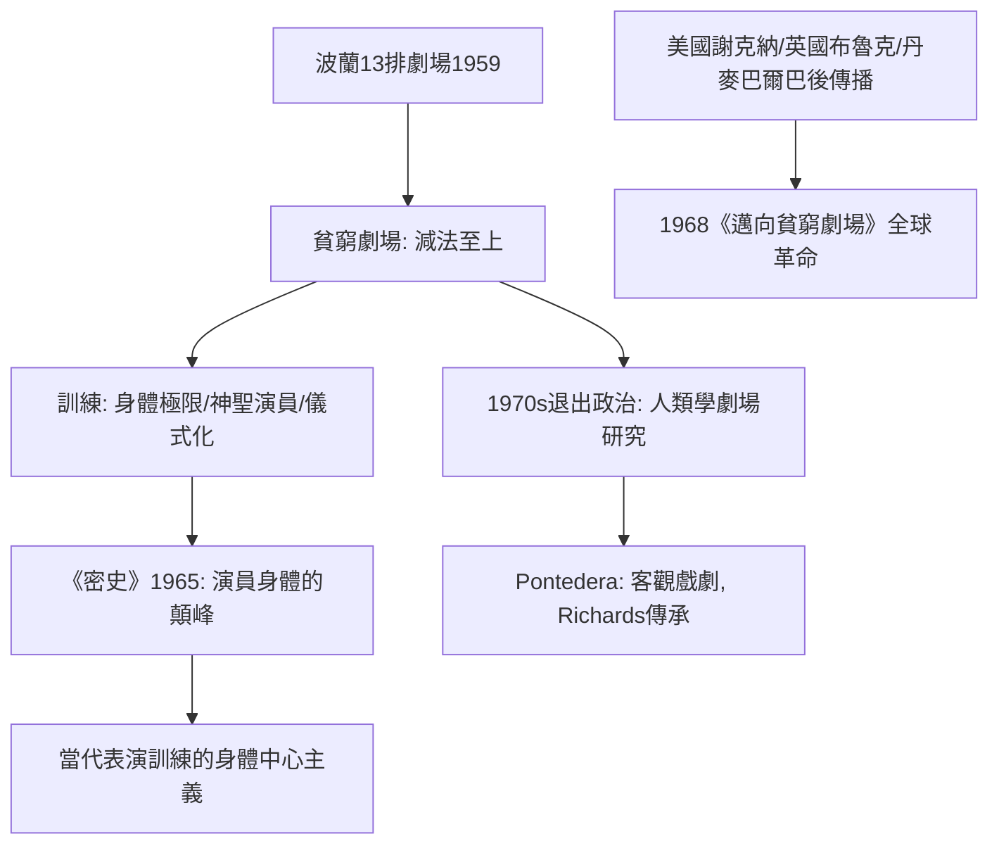

# 9.1 葛羅托斯基的貧窮劇場：演員與觀眾的肉身對峙

時間：1933年至1999年（葛羅托斯基生卒；貧窮劇場時期約1959至1969年）

## 一個反對自己的時代

耶日·葛羅托斯基（Jerzy Grotowski，1933至1999年）是波蘭劇場導演，其劇場學校的訓練與研究是二十世紀後半劇場革命的「技術中心」。他從克拉科夫高等戲劇學校畢業，1959年在奧波雷（Opole）創立「十三排劇場」（Teatr 13 Rzędów），後遷至弗羅茨瓦夫（Wrocław）。

## 「貧窮」的意思：技術不窮，裝窮

「貧窮劇場」反對的對象是「富有的劇場」：電影與電視可以動用一切機器與資本，劇場若比影片「富有」就永遠輸掉；「貧窮」指劇場唯一不可替代的東西——演員的身體本身。葛羅托斯基砍掉了化妝、戲服的裝飾性、燈光的說明性、配樂的伴奏（演員自己唱、自己奏），直到舞台上只剩下赤裸的人身。他與尤金尼奧·巴爾巴合編的《邁向貧窮劇場》（1968年出版，匯集1959至1969年間的宣言與筆記）宣示：劇場的核心不是佈景與技術，而是演員與觀眾之間的直接相遇。

## 演員的「訓練科學」

葛羅托斯基的演員訓練以物理訓練（翻磙、倒立、東方瑜伽式練習）與身體極限開發為基礎，目標是他所稱的「神聖演員」（holy actor）：演員不展示自己、不表演美麗，而是通過排除身心的阻礙達到「自然而然奉獻」——他的名言是「演員的敵人只有一個：自己」。他的代表作《忠貞王子》（The Constant Prince，1965年，主演里夏爾德·采斯拉克）被公認為二十世紀演員表演的顛峰之一；理查·謝克納看了此劇後承認：「那是我看過的最劇烈的一次表演。」

## 觀眾的排佈：一個實驗室

貧窮劇場對觀演空間的關係同樣是大膽的實驗：《忠貞王子》的演出中，觀眾被安排在修道院病床上方，演員在床緣出現、伸手可以碰觸觀眾——刻意營造一種不安全但極度逼近的劇場親密。葛氏的名言是：劇場不是要解決問題，而是要成為「相遇」（encounter）的場所——一個神聖的、共同經歷的儀式空間。他的空間實驗全都服務於這個定義，也比當代的沉浸式劇場早了數十年。

## 政治的沉默：一次退出

1970年代，葛羅托斯基做了一個更激進的決定：放棄「演出」本身。他的團隊改名為「劇場勞動中心」（Centre for Theatre Research），轉向「副劇場」（paratheatre，非演出性的參與式工作坊）與「根源劇場」（Objective Drama）——研究古代與原住民儀式的身體技術（1970年代在美國與墨西哥、1980年代起在義大利龐泰代拉 Pontedera 的工作中心）。他1999年去世。其工作由弟子托馬斯·理查茲（Thomas Richards，《與葛羅托斯基工作》1995年出版）在龐泰代拉的工作中心延續至今。

## 影響的鯨吞：他的「反斯坦尼」革命

葛羅托斯基的影響不止於「貧窮美學」，而在於一套重造身體的方法學：其一，訓練從「身體的極端狀態」（汗水、呼吸、倒立中的平衡）出發，讓情感由身體扛出來——「身體先、心後」，是梅耶荷德路線的灼熱變體。其二，把觀演距離壓縮到以厘米計，預示了沉浸式劇場。其三，「表演即儀式」的觀念，使儀式劇場在20世紀末成為可成立的類型。1968年布魯克的《空的空間》（見9.2）與謝克納的環境劇場都公認受他啟發；巴爾巴所創的奧丁劇場（Odin Teatret）承其傳承；他在1966年紀錄片《工作中的葛羅托斯基》中的訓練影像，至今仍是世界戲劇學校的必看教材。

