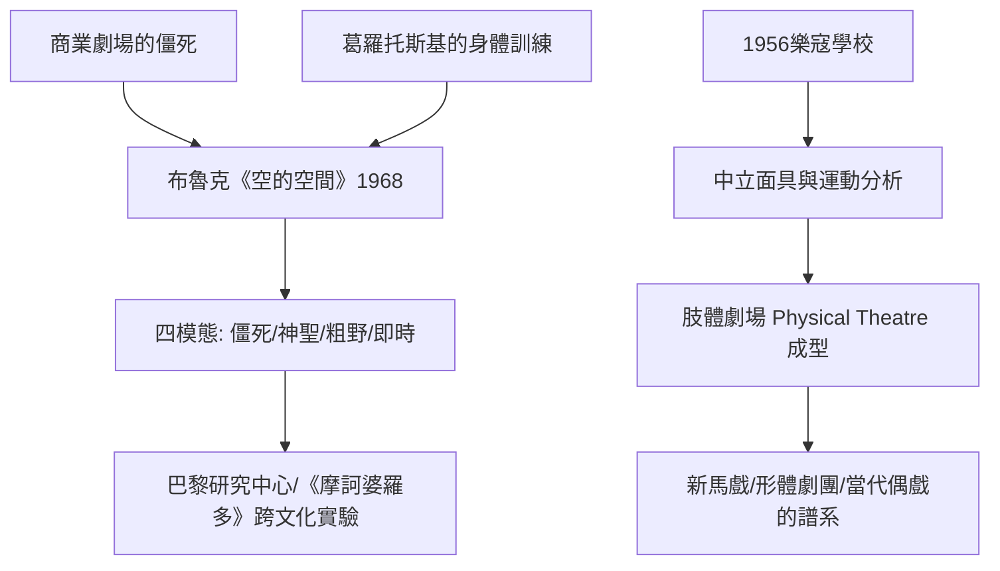

# 9.2 空的空間與樂寇學派：布魯克與當代肢體劇場

時間：1968年至今

## 「我可以拿任何一個空間，叫它做舞台」

1968年，英國導演彼得·布魯克（Peter Brook，1925至2022年）出版《空的空間》（The Empty Space），以一個簡單而鋒利的定義開篇：我可以拿任何一個空白空間，稱它為舞台；有一個人走過這個空間，另一個人看著，就構成了戲劇。這個定義剔除了劇場的一切附屬物（大樓、佈景、票務），只留下兩個要素：演員與觀眾。它同時給出四種分類：僵死的劇場（Deadly Theatre，僵化的商業與程式化演出）、神聖的劇場（Holy Theatre，指向超越性的儀式劇場）、粗野的劇場（Rough Theatre，街頭、喜鬧、庶民的劇場）與即時的劇場（Immediate Theatre，與當下觀眾直接相連的劇場）。這組框架至今仍是戲劇系入門的第一課；其中對「僵死劇場」的批判——西區與百老匯的商業劇場年復一年不出新意——是對整個工商業劇場的直接挑戰。

## 布魯克的空間實驗

他的實踐力不亞於文筆：1970年他把《仲夏夜之夢》搬進三面白色的抽象立方空間，演員在懸吊鞦韆上飛行（皇家莎士比亞劇團 RSC 的名演）；1971年他在巴黎創立國際劇場研究中心（CIRT，即後來的國際劇場創作中心），集合多國演員做跨文化的非母語實驗；1970年代初在伊朗舊都的遺址及異地陌生人中實踐「非語言劇場」（Orghast 計畫，使用自創語言，觀眾聽不懂卻能懂）；1985年在巴黎推出九個多小的《摩訶婆羅多》（Le Mahabharata，改編印度史詩，由讓—克勞德·卡里埃爾改編），成為20世紀劇場文化的標語事件之一。他的信條是：舞台上的一切（包括語言）都是「暫時的、活的」——空間的空，是為了讓表演的「發生」有地方降落。

## 樂寇學校：身體的詩

法國的雅克·樂寇（Jacques Lecoq，1921至1998年）是另一條「劇場即身體」的技術源頭：1956年他在巴黎創立的樂寇學校（École internationale de théâtre Jacques Lecoq）至今仍是最著名的肢體劇場學院。其訓練核心是「用身體認識世界」：學生先以動作模仿一切（水、火、布料的質地、動物、季節），再進入面具訓練——中立面具（neutral mask，一張零表情的素面面具，訓練「純粹的在場」與身體的覺知）、表情面具與半面具（半臉寫實、半臉前觀眾）。樂寇的名言是「身體是詩」：語言以前，身體已經完成表達。他開創的「運動分析」成為當代表演教育的方法學基礎。

## 從訓練到類型：肢體劇場的誕生

布魯克與樂寇的時代恰好是戰後劇場制度的轉折：1960年代起，英法德等國建起了公共補助劇院制度，使非商業的導演劇場可以長期營運；表演訓練全面身體化（樂寇的運動分析、葛羅托斯基的身體極限訓練），成為學院課程的一部分；劇場與舞蹈、馬戲、偶戲之間的邊界開始融化——「肢體劇場」（Physical Theatre）作為一種獨立類型就此確立。此後的實證影響廣泛：法國的新馬戲（cirque nouveau，其不少團隊的導演與訓練直接出自樂寇學校）、倫敦的形體劇團（如 Théâtre Complicité）、以動作為本的默劇復興，乃至當代偶戲與影像動作的技術根基，都屬於這條血統的下游。

一句話總結這一章：二十世紀末的劇場核心問題不再是「我該說什麼」，而是「一個能與世界互動的身體，究竟長什麼樣」。這是對斯坦尼「心理體驗」的一次歷史性反轉，也是21世紀沉浸式、數位化表現的理論準備。

