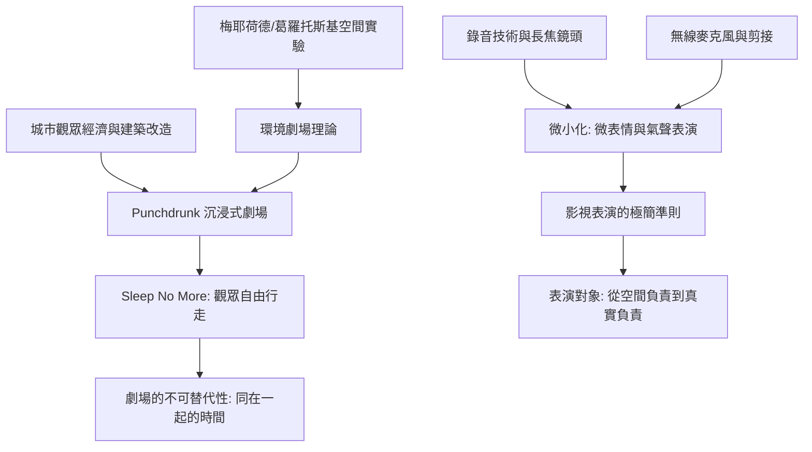

# 10.1 從鏡頭到沉浸式劇場：當表演貼近你的眼睛

時間：1990年代至今

## 鏡頭是一面放大鏡，也是一面篩網

18世紀劇場的觀眾坐在枝形吊燈下，20世紀初的鏡框式劇場任觀眾坐直背、挺脖子；攝影機的誕生（尤其是聲片時代的錄音機麥克風與長焦特寫）改寫了表演單位：過往要靠大音量與誇張肢體過活的劇場表演，在鏡頭前變成一門「精細化」的技藝——臉部的微表情（一絲肌肉的抖動就足以傳達心理）、氣聲台詞（耳語式的低聲演法）、停頓的節奏（比任何一句台詞都更有力）。麥克風的進化（從短焦麥克風到領夾式無線麥克風，1990年代體育、綜藝與紀錄片普及）讓演員可以像生活一樣低聲說話；而攝影機的推拉搖移與正/反打的剪接邏輯，把表演分解成一格一格可以重組的素材——演員必須在鏡頭前保持情緒的「強度一致」，因為剪接師會把兩個不同時刻的鏡頭接在一起。

在教材上，這種差異常被總結為：劇場表演「對空間負責」（要讓最後一排聽見並相信），鏡頭表演「對真實負責」（要經得起特寫的放大檢驗）。影視表演因此偏向極簡、真實、內化；劇場表演偏向連貫、重複與輻射狀的身體擴散。

## 微表情的科學與表演的信任

有趣的是，影視表演與表演訓練制度的互動不斷擴大：方法派訓練（見8.1）先後在紐約與洛杉磯的戲劇學校制度化；倫敦的皇家戲劇藝術學院（RADA）等院校把「鏡頭前表演」列為必修課——「會不會演特寫」已成為21世紀演員的基準能力。

## 沉浸式劇場：觀眾走進戲裡

同一時代的劇場世界正在反向革命。1960年代以前的先驅（梅耶荷德的斜坡空間、葛羅托斯基的病床設計）搭建了理論基礎，2003年倫敦的 Punchdrunk 劇團把「沉浸式劇場」變成全球文化現象：其《Sleep No More》（2011年紐約版）把五層樓的麥基特里克旅館區建築（McKittrick Hotel）改造成1920年代的黑暗迷宮，觀眾戴上白色面具，在五個小時內自由走動，跟隨任何一位演員、打開任何一扇櫥櫃、翻閱任何一封書信──戲劇從「你必須坐著看」改為「你自己決定要看什麼」。這個形式結合了三個條件：經濟上，紐約與倫敦的城市票房與票價為中型細分市場開了路；技術上，建築改造與無線揚聲網路允許多空間同步；藝術上，斯特拉斯堡、布魯克與環境劇場的先驅提供了理論。

沉浸式劇場的商業奇蹟顯著：紐約版《Sleep No More》連演十餘年（2011至2024年），累計票房逾億美元；上海版（2020年開幕）證明這種形式的可複製性。它的戲劇學意義更值得記下：觀眾從「被動的觀看者」變成「主動的觀看者/──意義不是被安排的，而是「剪輯」出來的，每個觀眾走出劇場，都帶著一部不同的電影。

## 哪裡是「表演」最後的邊界

沉浸式劇場證明了戲劇理論反覆言及的一件事：劇場的存在性不依賴佈景與文本──它以「身與身的同在」為底線；這呼應了1968年布魯克那句「空白的空間＋兩個人的相遇」。屏幕化與平台化（電視、串流、短影音）的擴張，把表演推向越來越小的螢幕和越來越多的「真人直播」（2020年代直播劇場、Zoom 劇場）；劇場的反擊不是技術，而是它不可被下載的唯一武器──「現在、此時、和你」。

